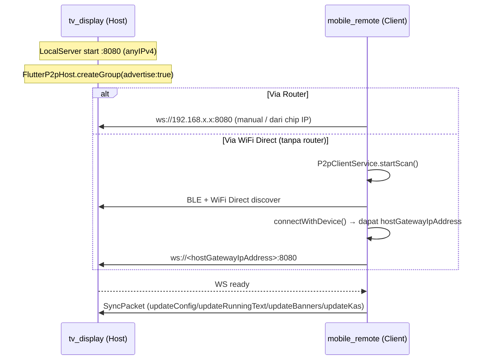

# Masjid You — Architectural Decision Records (DECISIONS.md)

> Kumpulan keputusan arsitektur: **kenapa, mengapa, dan bagaimana** setiap keputusan besar diambil.
> Format ringan ADR — setiap catatan: Konteks → Keputusan → Alasan → Konsekuensi.

---

## Daftar ADR

1. [ADR-001 — Menulis Ulang dari Nol menggantikan `Alyeandemo`](#adr-001)
2. [ADR-002 — Memilih Flutter untuk kedua platform](#adr-002)
3. [ADR-003 — Arsitektur Local HTTP Server + P2P/WiFi Direct](#adr-003)
4. [ADR-004 — Fallback UI Handler (banner default & running text kosong)](#adr-004)
5. [ADR-005 — `didUpdateWidget` + Auto-scroll untuk teks panjang](#adr-005)
6. [ADR-006 — Shared package `shared_models` untuk protokol & model](#adr-006)
7. [ADR-007 — Perhitungan jadwal sholat offline (`adhan`) + offset per sholat](#adr-007)
8. [ADR-008 — Indikator "Unsaved Changes" + sinkronisasi manual](#adr-008)

---

## ADR-001 — Menulis Ulang dari Nol menggantikan `Alyeandemo`

### Konteks
Proyek sebelumnya bernama **`Alyeandemo`** adalah aplikasi tampilan masjid berbasis web. Pembuatan ulang dilakukan di lingkungan **Termux** (terminal Android) yang sangat terbatas, sehingga muncul banyak masalah struktural.

### Keputusan
Buang kode `Alyeandemo` sepenuhnya dan tulis aplikasi baru dari nol sebagai monorepo Flutter bernama **`masjid-you`**.

### Alasan
- **Masalah Termux**: membangun aplikasi Android penuh di Termux rentan terhadap toolchain yang tidak stabil, cache rusak, dan keterbatasan memori — tidak cocok untuk proyek produksi berkelanjutan.
- **Non-atomic**: basis kode lama bertumbuh tanpa pemisahan modul/arsitektur yang jelas sehingga sulit diuji dan dirawat.
- **Web-only**: versi web tidak bisa menjadi aplikasi *kiosk* fullscreen yang stabil di Google TV / Android TV; butuh akses hardware (WiFi Direct, BLE, wakelock, kunci layar) yang hanya tersedia di aplikasi native.
- **Kebutuhan baru**: sinkronisasi jarak jauh, tata letak TV 2K, koneksi tanpa internet — semuanya butuh fondasi arsitektur baru.

### Konsekuensi
- Migrasi penuh ke Flutter berarti timeline pengembangan awal lebih panjang, tetapi membayar lunas dengan testability, hot reload, dan satu codebase untuk kedua perangkat.

---

## ADR-002 — Memilih Flutter untuk kedua platform

### Konteks
Dibutuhkan **satu aplikasi kiosk** untuk Google TV/Android TV (display) dan **satu aplikasi kontroler** untuk HP Android, dengan penampilan yang konsisten dan render yang mulus.

### Keputusan
Gunakan **Flutter (Dart)** untuk `tv_display` dan `mobile_remote`, plus satu paket `shared_models` di dalam satu monorepo.

### Alasan
- **Cross-platform**: satu bahasa untuk TV & HP; Android TV punya `LEANBACK_LAUNCHER` dan `uses-feature` yang mudah dikonfigurasi di manifest.
- **60 fps untuk TV**: rendering berbasis skia/impeller memberi animasi halus (carousel, marquee, ring countdown) bahkan pada resolusi TV.
- **Material You 3**: `ColorScheme.fromSeed(0xFF006A60)` menghasilkan tema modern yang konsisten di kedua app, ringan tanpa aset gambar tema.
- **Kiosk mode**:
  - `SystemChrome.setEnabledSystemUIMode(SystemUiMode.immersiveSticky)` menyembunyikan status bar.
  - `wakelock_plus.enable()` mencegah TV tidur.
  - Manifest menandai aktivitas sebagai `LEANBACK_LAUNCHER` agar muncul di daftar aplikasi TV.
- **Ekosistem paket**: `adhan` (jadwal sholat offline), `geolocator` (GPS), `flutter_p2p_connection` (WiFi Direct/BLE), `shelf` (server WebSocket) tersedia dan matang.

### Konsekuensi
- Dua aplikasi + satu paket harus di-*build* bersamaan (menggunakan *Dart workspaces* / `workspace:` di `pubspec.yaml` root).
- Performa & pengujian layar memerlukan perhatian khusus (lihat ADR-005 dan dokumentasi TV).

---

## ADR-003 — Arsitektur Local HTTP Server + P2P/WiFi Direct

### Konteks
Masjid sering berada di lokasi tanpa koneksi internet atau tanpa router WiFi yang dapat dikonfigurasi. Remote HP harus bisa mengontrol TV hanya dengan jaringan lokal.

### Keputusan
- **TV** menjadi **server WebSocket** `anyIPv4:8080` (paket `shelf` + `shelf_web_socket`).
- **Remote HP** menjadi **client WebSocket** yang menyambung ke `ws://<ip-TV>:8080`.
- Tambahan jalur koneksi **WiFi Direct + BLE** (`flutter_p2p_connection`) sehingga HP dapat menemukan TV **tanpa router**:
  - TV: `FlutterP2pHost.createGroup(advertise: true)` → membuat hotspot p2p.
  - HP: `FlutterP2pClient.startScan(...)` menemukan perangkat, `connectWithDevice(...)` menyambung.
  - IP handoff: `HotspotClientState.hostGatewayIpAddress` diisi otomatis ke kolom IP Remote.

### Alasan
- **Tanpa internet/router**: komunikasi lokal murni; tidak ada dependensi cloud, API eksternal, atau akun.
- **Offline-first**: semua data (jadwal, banner, kas, running text) disimpan/dikirim lokal; perhitungan jadwal juga offline (ADR-007).
- **Simple > pub-sub**: satu arah push (Remote → TV) cukup untuk use-case pengaturan kiosk; pesan dikemas sebagai `SyncPacket` JSON ber-`SyncAction` sehingga mudah diextend (contoh: `triggerBeep`, `getInitialState` sudah ada di enum).
- **Broadcast** tersedia di `LocalServer.broadcast()` untuk kebutuhan multi-client di masa depan (misal beberapa remote).

### Konsekuensi
- IP TV harus diketahui Remote — ditutupi oleh WiFi Direct (otomatis) dan chip "Remote Sync IP" di header TV untuk kasus WiFi router.
- WebSocket mempertahankan koneksi hidup; TV menangani `onDone`/`onError` untuk membersihkan client yang putus.
- Emulator tidak punya radio P2P/BLE asli → pengujian WiFi Direct harus di perangkat fisik.

### Diagram alur koneksi

---

## ADR-004 — Fallback UI Handler (banner default & running text kosong)

### Konteks
Tidak semua masjid langsung mengisi konten. Saat daftar banner kosong atau running text kosong, layar TV tidak boleh kosong / patah, dan harus tetap informatif.

### Keputusan
- **`BannerCarousel`** (di `apps/tv_display/lib/widgets/banner_carousel.dart`): jika `_activeBanners.isEmpty` → tampilkan kartu fallback: ikon masjid `Icons.mosque_rounded` + teks **"Jagalah Shaf dan Shalatlah Tepat Waktu"**.
- **`RunningTextBar`** (di `apps/tv_display/lib/widgets/running_text_bar.dart`): jika tidak ada pesan aktif → hentikan marquee, badge **INFORMASI** memenuhi full width, tampilkan teks statis **"Tidak ada informasi"**.
- Setiap fallback tetap memakai warna & bentuk dari `ColorScheme` (Material), bukan hardcode.

### Alasan
- **Ketahanan kiosk**: layar TV berjalan 24/7; fallback mencegah blank screen dan kebocoran layout.
- **Pengalaman pengguna**: pesan default mengingatkan jamaah (menjaga shaf) alih-alih tampilan mati.
- **Menghindari bug render**: kasus daftar kosong yang tidak ditangani dapat memicu pembagian dengan nol di `PageView.builder`/`animateToPage`.

### Konsekuensi
- Filter "aktif" dilakukan di dua tempat: `MediaBanner.isActive` dan `RunningTextMessage.isActive` — konsisten karena keduanya di-seed `true` oleh default.
- Running text default *lama* yang menampilkan teks dengan `Color(...)` yang bocor telah dihapus total (perbaikan leak string).

---

## ADR-005 — `didUpdateWidget` + Auto-scroll untuk teks panjang

### Konteks
Info Masjid (banner) bisa sangat panjang, dan Running Text bisa berubah kapan saja lewat sinkronisasi. Di layar TV (960×540 logis di emulator), teks yang panjang berisiko overflow atau terpotong.

### Keputusan
- **Tidak memakai `FittedBox`** untuk mengecilkan teks (menjadi terlalu kecil untuk dibaca di TV).
- **`_BannerPage`** (`banner_carousel.dart`) menggunakan `SingleChildScrollView` + `ScrollController` dengan **auto-scroll pelan**:
  - Timer `50 ms`, durasi total ~`9000 ms`, langkah = `maxScrollExtent / (9000/50)`.
  - Berhenti saat mencapai ujung; reset ke atas saat halaman berubah konten atau kembali aktif.
- **`didUpdateWidget`** dipakai untuk reaksi perubahan data *tanpa* membongkar state:
  - Jika konten banner berubah → batalkan timer, `jumpTo(0)`, mulai ulang.
  - Jika halaman menjadi aktif lagi → reset & mulai ulang.
- **`RunningTextBar`** juga memakai `didUpdateWidget` untuk menyalakan/mematikan timer marquee saat daftar pesan berubah dari kosong ↔ terisi.

### Alasan
- Teks harus tetap **terbaca** (font tidak mengecil) — prioritas utama pada tampilan jarak jauh di TV.
- `didUpdateWidget` lebih efisien daripada membongkar-pasang stateful widget, dan menghindari timer yang membuang resource / menumpuk.
- `maxScrollExtent <= 0` diabaikan → tidak ada scroll percuma untuk teks pendek.

### Konsekuensi
- Ada dua timer independen di area banner: timer *page* 10 detik (pindah halaman) dan timer *scroll* 50 ms (scroll vertikal). Keduanya di-`cancel` di `dispose`.
- Regresi overflow dipantau oleh test `TV layout has no overflow at small TV viewport` (960×540).

---

## ADR-006 — Shared package `shared_models` untuk protokol & model

### Konteks
Dua aplikasi berbagi bentuk data yang sama (config, banner, running text, kas, jadwal). Menyalin model di kedua app akan menyebabkan drift.

### Keputusan
Buat paket Dart lokal **`packages/shared_models`** (di-*workspace* root), berisi:
- `SyncPacket` + `SyncAction` (protokol WS),
- `MosqueConfig`, `IqamahDuration` (konfigurasi),
- `PrayerType` + `PrayerSchedule` + `PrayerScheduleItem` (jadwal sholat offline),
- `MediaBanner`, `RunningTextMessage`, `KasTransaction`, `KasSummary`,
- `kAllPrayerTypes` (daftar 6 sholat).

### Alasan
- **Single source of truth**: serialisasi (`toMap`/`fromMap`/`toJson`/`fromJson`) ditulis sekali.
- **Backward compatibility** ditangani di satu tempat (contoh: `MediaBanner.fromMap` memetakan `subtitle` lama → `content`; `MosqueConfig.fromMap` membaca `prayerCorrectionMinutes` lama → seed semua offset).
- **Test terpusat**: `test/shared_models_test.dart` (12 test) mengunci perilaku protokol.

### Konsekuensi
- Setiap perubahan model wajib sinkron di `toMap`/`fromMap` dan di test.
- Perubahan di `shared_models` mengharuskan rebuild kedua app.

---

## ADR-007 — Perhitungan jadwal sholat offline (`adhan`) + offset per sholat

### Konteks
Jadwal sholat harus akurat dan tersedia **tanpa internet**. Koordinat bisa dari manual atau GPS. Setiap masjid butuh koreksi halus per waktu (misal beda 1–2 menit dengan jadwal lokal).

### Keputusan
- **Hitung lokal** memakai paket `adhan` (`CalculationMethod.singapore`, madhab shafi — sesuai standar Kemenag RI / MABIMS).
- Koordinat bersumber dari:
  - **Manual**: kolom Latitude/Longitude di tab Pengaturan Remote.
  - **GPS**: tombol "Ambil Koordinat dari GPS" via `geolocator` (izin lokasi runtime).
- **Offset per sholat**: `MosqueConfig.prayerOffsets` berupa `Map<PrayerType, int>` (menit, boleh negatif), diisi 6 kolom di Remote. `PrayerSchedule.calculate` menerapkan offset per waktu (termasuk perhitungan Fajr besok untuk countdown).
- **Simulasi**: tombol "Simulasi Jadwal" menghitung jadwal untuk tanggal + jam pilihan secara offline dan menandai sholat berikutnya + countdown.

### Alasan
- **Offline-first**: tidak ada panggilan API astronomi; semua kalkulasi lokal (ADR-003).
- **Akurasi lokal**: offset per sholat memungkinkan penyesuaian terhadap hisab masjid setempat tanpa mengubah rumus.
- **Verifikasi cepat**: simulasi memberi kepercayaan sebelum data dikirim ke TV.

### Konsekuensi
- `PrayerSchedule.calculate(config, [targetDate])` menerima tanggal opsional — dipakai TV tiap detik (untuk countdown) dan dialog simulasi (untuk pratinjau).
- Nilai koordinat di-clamp (lat −90..90, lng −180..180) dan fallback ke nilai lama bila input tidak valid.
- Backward compat: config lama ber-`prayerCorrectionMinutes` diterjemahkan ke semua offset.

---

## ADR-008 — Indikator "Unsaved Changes" + sinkronisasi manual

### Konteks
Remote bisa mengedit banyak hal (banner, running text, kas, config) saat TV belum terhubung. Tanpa penanda, pengguna tidak tahu data sudah sampai ke TV atau belum.

### Keputusan
- Di `_RemoteHomeScreenState` (mobile_remote) ada flag **`_hasUnsyncedChanges`**.
- Setiap mutasi (tambah/edit/hapus/toggle) men-set `_hasUnsyncedChanges = true` dan menyimpan daftar lokal.
- Jika terhubung, perubahan langsung dikirim dan flag di-reset `false`.
- Jika belum terhubung, muncul **banner amber** di bawah AppBar: ikon `sync_problem` + "Ada perubahan belum dikirim ke TV" + tombol **"Kirim Ke TV"** yang memanggil `_pushAllToTv()`.
- `_pushAllToTv` memastikan koneksi ada; `_syncAllToTv` mengirim 4 jenis data sekaligus.

### Alasan
- **Kesadaran status**: pengguna tahu kapan perubahan masih lokal (belum tampil di TV).
- **Anti kehilangan data**: perubahan disimpan di memori lokal sehingga masih bisa dikirim setelah terhubung.
- **UX sederhana**: satu tombol "Kirim Ke TV" = batch sinkronisasi penuh.

### Konsekuensi
- Semua handler mutasi mengikuti pola seragam: `setState { data...; _hasUnsyncedChanges = true; }` → jika `_isConnected` kirim → reset flag.
- Auto-connect WiFi Direct memanggil `_connectToTv()` yang pada sukses melakukan `_syncAllToTv()` dan membersihkan flag.

---

> Kembali ke [MAP.md](MAP.md) | Lanjut ke [tv_display/widget_mapping.md](tv_display/widget_mapping.md) | [mobile_remote/tab_mapping.md](mobile_remote/tab_mapping.md)
