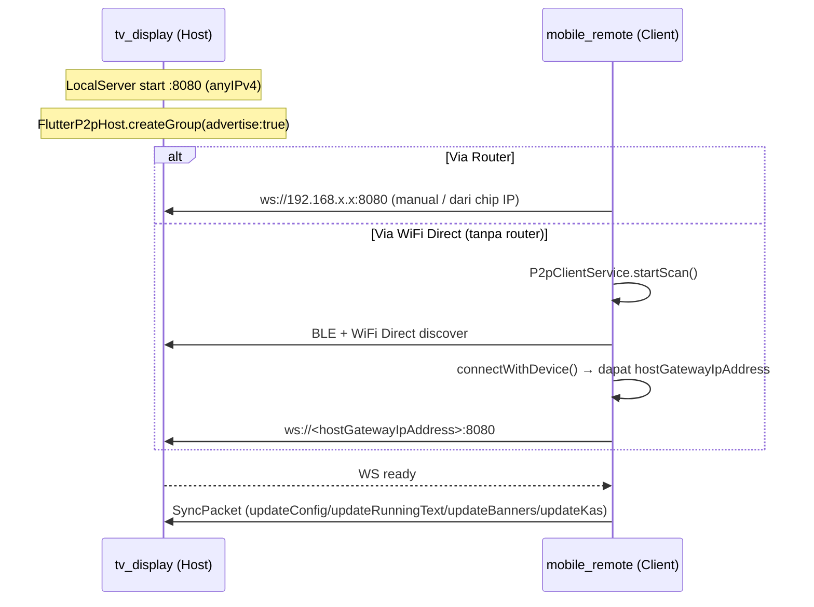

# Masjid You — Architectural Decision Records (DECISIONS.md)

> Kumpulan keputusan arsitektur: **kenapa, mengapa, dan bagaimana** setiap keputusan besar diambil.
> Format ringan ADR — setiap catatan: Konteks → Keputusan → Alasan → Konsekuensi.

---

## Daftar ADR

1. [ADR-001 — Menulis Ulang dari Nol menggantikan `Alyeandemo`](#adr-001)
2. [ADR-002 — Memilih Flutter untuk kedua platform](#adr-002)
3. [ADR-003 — Arsitektur Local HTTP Server + P2P/WiFi Direct](#adr-003)
4. [ADR-004 — Fallback UI Handler (banner default & running text kosong)](#adr-004)
5. [ADR-005 — `didUpdateWidget` + Auto-scroll untuk teks panjang](#adr-005)
6. [ADR-006 — Shared package `shared_models` untuk protokol & model](#adr-006)
7. [ADR-007 — Perhitungan jadwal sholat offline (`adhan`) + offset per sholat](#adr-007)
8. [ADR-008 — Indikator "Unsaved Changes" + sinkronisasi manual](#adr-008)
9. [ADR-009 — State Machine Waktu Shalat + Animasi CustomPainter](#adr-009)
10. [ADR-010 — Material 3 Expressive dengan `material_new_shapes`](#adr-010)
11. [ADR-011 — Shape Manual (`RoundedRectangleBorder(28)` + `ArchBorder`) & model swap jam](#adr-011)
12. [ADR-012 — Revert tema M3 Expressive di mobile_remote (kembali ke square)](#adr-012)
13. [ADR-013 — Perbaikan Bug Major P0 & Penanganan Error Konektivitas](#adr-013)
14. [ADR-014 — Perbaikan WiFi Direct Discovery & Prasyarat Check](#adr-014)
15. [ADR-015 — Validasi Prasyarat WiFi Direct di Mobile Remote](#adr-015)
16. [ADR-016 — Transport Bluetooth Classic (RFCOMM) sebagai jalur sync tanpa router](#adr-016)
17. [ADR-017 — Bluetooth Discovery Location Services Check (Android ≤11)](#adr-017)
18. [ADR-018 — Menu Admin Side Panel D-Pad + Autentikasi PIN Challenge-Response Bluetooth](#adr-018)
19. [ADR-019 — Connection Gatekeeper Remote + Keamanan Dialog PIN (Red Screen `_dependents.isEmpty`)](#adr-019)
20. [ADR-020 — Perbaikan Umpan Balik Koneksi Remote (snackbar `??` + nonce challenge)](#adr-020)

---

## ADR-001 — Menulis Ulang dari Nol menggantikan `Alyeandemo`

### Konteks
Proyek sebelumnya bernama **`Alyeandemo`** adalah aplikasi tampilan masjid berbasis web. Pembuatan ulang dilakukan di lingkungan **Termux** (terminal Android) yang sangat terbatas, sehingga muncul banyak masalah struktural.

### Keputusan
Buang kode `Alyeandemo` sepenuhnya dan tulis aplikasi baru dari nol sebagai monorepo Flutter bernama **`masjid-you`**.

### Alasan
- **Masalah Termux**: membangun aplikasi Android penuh di Termux rentan terhadap toolchain yang tidak stabil, cache rusak, dan keterbatasan memori — tidak cocok untuk proyek produksi berkelanjutan.
- **Non-atomic**: basis kode lama bertumbuh tanpa pemisahan modul/arsitektur yang jelas sehingga sulit diuji dan dirawat.
- **Web-only**: versi web tidak bisa menjadi aplikasi *kiosk* fullscreen yang stabil di Google TV / Android TV; butuh akses hardware (WiFi Direct, BLE, wakelock, kunci layar) yang hanya tersedia di aplikasi native.
- **Kebutuhan baru**: sinkronisasi jarak jauh, tata letak TV 2K, koneksi tanpa internet — semuanya butuh fondasi arsitektur baru.

### Konsekuensi
- Migrasi penuh ke Flutter berarti timeline pengembangan awal lebih panjang, tetapi membayar lunas dengan testability, hot reload, dan satu codebase untuk kedua perangkat.

---

## ADR-002 — Memilih Flutter untuk kedua platform

### Konteks
Dibutuhkan **satu aplikasi kiosk** untuk Google TV/Android TV (display) dan **satu aplikasi kontroler** untuk HP Android, dengan penampilan yang konsisten dan render yang mulus.

### Keputusan
Gunakan **Flutter (Dart)** untuk `tv_display` dan `mobile_remote`, plus satu paket `shared_models` di dalam satu monorepo.

### Alasan
- **Cross-platform**: satu bahasa untuk TV & HP; Android TV punya `LEANBACK_LAUNCHER` dan `uses-feature` yang mudah dikonfigurasi di manifest.
- **60 fps untuk TV**: rendering berbasis skia/impeller memberi animasi halus (carousel, marquee, ring countdown) bahkan pada resolusi TV.
- **Material You 3**: `ColorScheme.fromSeed(0xFF006A60)` menghasilkan tema modern yang konsisten di kedua app, ringan tanpa aset gambar tema.
- **Kiosk mode**:
  - `SystemChrome.setEnabledSystemUIMode(SystemUiMode.immersiveSticky)` menyembunyikan status bar.
  - `wakelock_plus.enable()` mencegah TV tidur.
  - Manifest menandai aktivitas sebagai `LEANBACK_LAUNCHER` agar muncul di daftar aplikasi TV.
- **Ekosistem paket**: `adhan` (jadwal sholat offline), `geolocator` (GPS), `flutter_p2p_connection` (WiFi Direct/BLE), `shelf` (server WebSocket) tersedia dan matang.

### Konsekuensi
- Dua aplikasi + satu paket harus di-*build* bersamaan (menggunakan *Dart workspaces* / `workspace:` di `pubspec.yaml` root).
- Performa & pengujian layar memerlukan perhatian khusus (lihat ADR-005 dan dokumentasi TV).

---

## ADR-003 — Arsitektur Local HTTP Server + P2P/WiFi Direct

### Konteks
Masjid sering berada di lokasi tanpa koneksi internet atau tanpa router WiFi yang dapat dikonfigurasi. Remote HP harus bisa mengontrol TV hanya dengan jaringan lokal.

### Keputusan
- **TV** menjadi **server WebSocket** `anyIPv4:8080` (paket `shelf` + `shelf_web_socket`).
- **Remote HP** menjadi **client WebSocket** yang menyambung ke `ws://<ip-TV>:8080`.
- Tambahan jalur koneksi **WiFi Direct + BLE** (`flutter_p2p_connection`) sehingga HP dapat menemukan TV **tanpa router**:
  - TV: `FlutterP2pHost.createGroup(advertise: true)` → membuat hotspot p2p.
  - HP: `FlutterP2pClient.startScan(...)` menemukan perangkat, `connectWithDevice(...)` menyambung.
  - IP handoff: `HotspotClientState.hostGatewayIpAddress` diisi otomatis ke kolom IP Remote.

### Alasan
- **Tanpa internet/router**: komunikasi lokal murni; tidak ada dependensi cloud, API eksternal, atau akun.
- **Offline-first**: semua data (jadwal, banner, kas, running text) disimpan/dikirim lokal; perhitungan jadwal juga offline (ADR-007).
- **Simple > pub-sub**: satu arah push (Remote → TV) cukup untuk use-case pengaturan kiosk; pesan dikemas sebagai `SyncPacket` JSON ber-`SyncAction` sehingga mudah diextend (contoh: `triggerBeep`, `getInitialState` sudah ada di enum).
- **Broadcast** tersedia di `LocalServer.broadcast()` untuk kebutuhan multi-client di masa depan (misal beberapa remote).

### Konsekuensi
- IP TV harus diketahui Remote — ditutupi oleh WiFi Direct (otomatis) dan chip "Remote Sync IP" di header TV untuk kasus WiFi router.
- WebSocket mempertahankan koneksi hidup; TV menangani `onDone`/`onError` untuk membersihkan client yang putus.
- Emulator tidak punya radio P2P/BLE asli → pengujian WiFi Direct harus di perangkat fisik.

### Diagram alur koneksi



---

## ADR-004 — Fallback UI Handler (banner default & running text kosong)

### Konteks
Tidak semua masjid langsung mengisi konten. Saat daftar banner kosong atau running text kosong, layar TV tidak boleh kosong / patah, dan harus tetap informatif.

### Keputusan
- **`BannerCarousel`** (di `apps/tv_display/lib/widgets/banner_carousel.dart`): jika `_activeBanners.isEmpty` → tampilkan kartu fallback: ikon masjid `Icons.mosque_rounded` + teks **"Jagalah Shaf dan Shalatlah Tepat Waktu"**.
- **`RunningTextBar`** (di `apps/tv_display/lib/widgets/running_text_bar.dart`): jika tidak ada pesan aktif → hentikan marquee, badge **INFORMASI** memenuhi full width, tampilkan teks statis **"Tidak ada informasi"**.
- Setiap fallback tetap memakai warna & bentuk dari `ColorScheme` (Material), bukan hardcode.

### Alasan
- **Ketahanan kiosk**: layar TV berjalan 24/7; fallback mencegah blank screen dan kebocoran layout.
- **Pengalaman pengguna**: pesan default mengingatkan jamaah (menjaga shaf) alih-alih tampilan mati.
- **Menghindari bug render**: kasus daftar kosong yang tidak ditangani dapat memicu pembagian dengan nol di `PageView.builder`/`animateToPage`.

### Konsekuensi
- Filter "aktif" dilakukan di dua tempat: `MediaBanner.isActive` dan `RunningTextMessage.isActive` — konsisten karena keduanya di-seed `true` oleh default.
- Running text default *lama* yang menampilkan teks dengan `Color(...)` yang bocor telah dihapus total (perbaikan leak string).

---

## ADR-005 — `didUpdateWidget` + Auto-scroll untuk teks panjang

### Konteks
Info Masjid (banner) bisa sangat panjang, dan Running Text bisa berubah kapan saja lewat sinkronisasi. Di layar TV (960×540 logis di emulator), teks yang panjang berisiko overflow atau terpotong.

### Keputusan
- **Tidak memakai `FittedBox`** untuk mengecilkan teks (menjadi terlalu kecil untuk dibaca di TV).
- **`_BannerPage`** (`banner_carousel.dart`) menggunakan `SingleChildScrollView` + `ScrollController` dengan **auto-scroll pelan**:
  - Timer `50 ms`, durasi total ~`9000 ms`, langkah = `maxScrollExtent / (9000/50)`.
  - Berhenti saat mencapai ujung; reset ke atas saat halaman berubah konten atau kembali aktif.
- **`didUpdateWidget`** dipakai untuk reaksi perubahan data *tanpa* membongkar state:
  - Jika konten banner berubah → batalkan timer, `jumpTo(0)`, mulai ulang.
  - Jika halaman menjadi aktif lagi → reset & mulai ulang.
- **`RunningTextBar`** juga memakai `didUpdateWidget` untuk menyalakan/mematikan timer marquee saat daftar pesan berubah dari kosong ↔ terisi.

### Alasan
- Teks harus tetap **terbaca** (font tidak mengecil) — prioritas utama pada tampilan jarak jauh di TV.
- `didUpdateWidget` lebih efisien daripada membongkar-pasang stateful widget, dan menghindari timer yang membuang resource / menumpuk.
- `maxScrollExtent <= 0` diabaikan → tidak ada scroll percuma untuk teks pendek.

### Konsekuensi
- Ada dua timer independen di area banner: timer *page* 10 detik (pindah halaman) dan timer *scroll* 50 ms (scroll vertikal). Keduanya di-`cancel` di `dispose`.
- Regresi overflow dipantau oleh test `TV layout has no overflow at small TV viewport` (960×540).

---

## ADR-006 — Shared package `shared_models` untuk protokol & model

### Konteks
Dua aplikasi berbagi bentuk data yang sama (config, banner, running text, kas, jadwal). Menyalin model di kedua app akan menyebabkan drift.

### Keputusan
Buat paket Dart lokal **`packages/shared_models`** (di-*workspace* root), berisi:
- `SyncPacket` + `SyncAction` (protokol WS),
- `MosqueConfig`, `IqamahDuration` (konfigurasi),
- `PrayerType` + `PrayerSchedule` + `PrayerScheduleItem` (jadwal sholat offline),
- `MediaBanner`, `RunningTextMessage`, `KasTransaction`, `KasSummary`,
- `kAllPrayerTypes` (daftar 6 sholat).

### Alasan
- **Single source of truth**: serialisasi (`toMap`/`fromMap`/`toJson`/`fromJson`) ditulis sekali.
- **Backward compatibility** ditangani di satu tempat (contoh: `MediaBanner.fromMap` memetakan `subtitle` lama → `content`; `MosqueConfig.fromMap` membaca `prayerCorrectionMinutes` lama → seed semua offset).
- **Test terpusat**: `test/shared_models_test.dart` (12 test) mengunci perilaku protokol.

### Konsekuensi
- Setiap perubahan model wajib sinkron di `toMap`/`fromMap` dan di test.
- Perubahan di `shared_models` mengharuskan rebuild kedua app.

---

## ADR-007 — Perhitungan jadwal sholat offline (`adhan`) + offset per sholat

### Konteks
Jadwal sholat harus akurat dan tersedia **tanpa internet**. Koordinat bisa dari manual atau GPS. Setiap masjid butuh koreksi halus per waktu (misal beda 1–2 menit dengan jadwal lokal).

### Keputusan
- **Hitung lokal** memakai paket `adhan` (`CalculationMethod.singapore`, madhab shafi — sesuai standar Kemenag RI / MABIMS).
- Koordinat bersumber dari:
  - **Manual**: kolom Latitude/Longitude di tab Pengaturan Remote.
  - **GPS**: tombol "Ambil Koordinat dari GPS" via `geolocator` (izin lokasi runtime).
- **Offset per sholat**: `MosqueConfig.prayerOffsets` berupa `Map<PrayerType, int>` (menit, boleh negatif), diisi 6 kolom di Remote. `PrayerSchedule.calculate` menerapkan offset per waktu (termasuk perhitungan Fajr besok untuk countdown).
- **Simulasi**: tombol "Simulasi Jadwal" menghitung jadwal untuk tanggal + jam pilihan secara offline dan menandai sholat berikutnya + countdown.

### Alasan
- **Offline-first**: tidak ada panggilan API astronomi; semua kalkulasi lokal (ADR-003).
- **Akurasi lokal**: offset per sholat memungkinkan penyesuaian terhadap hisab masjid setempat tanpa mengubah rumus.
- **Verifikasi cepat**: simulasi memberi kepercayaan sebelum data dikirim ke TV.

### Konsekuensi
- `PrayerSchedule.calculate(config, [targetDate])` menerima tanggal opsional — dipakai TV tiap detik (untuk countdown) dan dialog simulasi (untuk pratinjau).
- Nilai koordinat di-clamp (lat −90..90, lng −180..180) dan fallback ke nilai lama bila input tidak valid.
- Backward compat: config lama ber-`prayerCorrectionMinutes` diterjemahkan ke semua offset.

---

## ADR-008 — Indikator "Unsaved Changes" + sinkronisasi manual

### Konteks
Remote bisa mengedit banyak hal (banner, running text, kas, config) saat TV belum terhubung. Tanpa penanda, pengguna tidak tahu data sudah sampai ke TV atau belum.

### Keputusan
- Di `_RemoteHomeScreenState` (mobile_remote) ada flag **`_hasUnsyncedChanges`**.
- Setiap mutasi (tambah/edit/hapus/toggle) men-set `_hasUnsyncedChanges = true` dan menyimpan daftar lokal.
- Jika terhubung, perubahan langsung dikirim dan flag di-reset `false`.
- Jika belum terhubung, muncul **banner amber** di bawah AppBar: ikon `sync_problem` + "Ada perubahan belum dikirim ke TV" + tombol **"Kirim Ke TV"** yang memanggil `_pushAllToTv()`.
- `_pushAllToTv` memastikan koneksi ada; `_syncAllToTv` mengirim 4 jenis data sekaligus.

### Alasan
- **Kesadaran status**: pengguna tahu kapan perubahan masih lokal (belum tampil di TV).
- **Anti kehilangan data**: perubahan disimpan di memori lokal sehingga masih bisa dikirim setelah terhubung.
- **UX sederhana**: satu tombol "Kirim Ke TV" = batch sinkronisasi penuh.

### Konsekuensi
- Semua handler mutasi mengikuti pola seragam: `setState { data...; _hasUnsyncedChanges = true; }` → jika `_isConnected` kirim → reset flag.
- Auto-connect WiFi Direct memanggil `_connectToTv()` yang pada sukses melakukan `_syncAllToTv()` dan membersihkan flag.

---

## ADR-009 — State Machine Waktu Shalat + Animasi CustomPainter

### Konteks
Layar TV harus secara otomatis mengikuti siklus ibadah jamaah: menjelang azan → azan berkumandang → jeda ikamah → shalat berlangsung → kembali normal. Remote butuh kendali cepat (skip) dan durasi tiap fase yang bisa diatur realtime.

### Keputusan
- **Model di `shared_models`**: `MosqueConfig` mendapat 4 durasi (`preAdhanMinutes`=15, `adhanMinutes`=2, `preIqomahMinutes`=1, `shalatMinutes`=10) — dikirim via `updateConfig`, backward-compatible (default saat field absen).
- **Protokol**: enum `PrayerPhase` (normal/preAdhan/adhan/preIqomah/shalat) + `SyncAction.skipAdhan/startShalat/finishShalat` (Remote→TV) dan `stateUpdate` (TV→Remote, berisi fase + sisa detik).
- **TV — `PrayerStateMachine`** (`lib/state/prayer_state_machine.dart`): manager murni `ChangeNotifier` yang di-*drive* oleh clock timer 1 detik yang sudah ada (tidak ada timer internal sendiri — bebas drift & bebas resource).
  - Auto-start dari `NORMAL` saat `timeUntilNextPrayer <= preAdhanMinutes` (Syuruq/sunrise dikecualikan — bukan waktu azan).
  - Transisi otomatis antar fase berdasarkan durasi; skip manual hanya valid pada fase terkait (no-op di fase lain).
  - `updateConfig` men-clamp sisa waktu bila durasi baru lebih pendek.
- **TV — `PrayerStateOverlay`** (`lib/widgets/prayer_state_overlay.dart`): overlay layar penuh di atas Stack utama.
  - `PRE_ADHAN`/`PRE_IQOMAH`: **circular progress ring** (`_CircularRingPainter`, `TweenAnimationBuilder` 900 ms agar mulus antar tick 1 detik) + ikon + nama shalat + countdown.
  - `ADHAN`: **wavy progress bar** (`_WavyProgressPainter` — single sine wave stroke line + cursor bar `|` ala media player Material You) dengan palet **moody low-contrast** (muted teal/dark olive/amber/sage), ikon speaker, "Azan [Nama] Berkumandang".
  - `SHALAT`: layar **hitam penuh** dengan teks statis sangat redup di tengah.
  - Animasi gelombang memakai `AnimationController.repeat()` + `CustomPainter(repaint:)` → hanya repaint, bukan rebuild → 60 FPS ringan. **Progress wavy bar dihitung sub-detik** dari `PrayerStateMachine.deadline` terhadap `DateTime.now()` di tiap frame `paint` → cursor bergerak mulus 60 FPS, bukan melompat per tick 1 detik.
- **Remote**: tab Pengaturan mendapat 4 field durasi + kartu "Aksi Cepat Waktu Shalat" (tombol aktif sesuai fase TV yang diterima dari `stateUpdate`). Durasi di-persist ke **SharedPreferences** dan dikirim ke TV.

### Alasan
- **Offline-first & realtime**: protokol lokal WS yang sudah ada (ADR-003) dipakai apa adanya; tidak ada state management library baru.
- **Performa TV (60 FPS)**: `CustomPainter` + `repaint` menghindari rebuild widget per frame; `AnimatedBuilder` hanya rebuild overlay 1×/detik saat countdown berubah.
- **Deterministik & teruji**: state machine murni Dart diuji unit (15 kasus: auto-start, auto-cycle, skip, clamp, sunrise-exclude, forcePhase); overlay diuji bebas overflow pada viewport TV 960×540.
- **UX kiosk**: layar redup total saat shalat mencegah silau; skip dari Remote menjaga jadwal tetap terkontrol.

### Konsekuensi
- Perubahan durasi hanya berdampak pada fase yang sedang berjalan (clamp); siklus tetap berjalan normal.
- `stateUpdate` di-broadcast tiap detik saat fase berlangsung (trafik kecil di LAN).
- Test layout memakai `MasjidDisplayScreen(autoPrayerCycle: false)` agar deterministik terhadap waktu nyata; perilaku otomatis diuji terpisah di unit test.

## ADR-010 — Material 3 Expressive dengan `material_new_shapes`

### Konteks
UI masih memakai bentuk standar Material 3 (`RoundedRectangleBorder`/`StadiumBorder`). Produk ingin tampilan yang lebih ekspresif: blob latar belakang berbentuk organik (ala pemutar media Android 16 "Now Playing"), kartu dengan sudut "puffy", dan badge berbentuk pil — tanpa menunggu rilis stable M3 Expressive di Flutter.

### Keputusan
- **Package**: `material_new_shapes: ^1.0.0` (MIT, tanpa deps tambahan selain `flutter`/`meta`/`vector_math`) ditambahkan ke `tv_display` dan `mobile_remote`.
- **Pendekatan hybrid**: jadikan shape default terasa *expressive* dengan memakai material eksperimental (`MaterialShapes.*`), tapi tanpa mengubah struktur widget yang sudah ada. `tv_display` memakai **theme-level** (cardTheme, typography emphasized) + blob background; `mobile_remote` memakai **per-widget** (semua kartu, tombol, chip, dropdown, dialog, NavigationBar) dengan `M3Pressable` untuk feedback spring.
- **`M3ShapeBorder`** (duplikat di `apps/tv_display/lib/theme/m3_shape_border.dart` dan `apps/mobile_remote/lib/m3_shape_border.dart`): wrapper `ShapeBorder`/`OutlinedBorder` untuk `RoundedPolygon` dari `MaterialShapes.*`. Polygon ternormalisasi (0..1) diskalakan ke `Rect` via `Matrix4.setEntry` (bukan `Matrix4.translate`/`scale` yang deprecated di Flutter 3.44). Turunan `OutlinedBorder` agar sah dipakai di `ButtonStyle.shape` (bertipe `OutlinedBorder?`).
- **`MaterialBlobBackground`** (tv_display) ditulis ulang: tanpa `BackdropFilter` (boros di TV); 4 shape M3 besar (`cookie4Sided` teal 20%, `clover4Leaf` emerald 18%, `flower` darkTeal 16%, `sunny` teal 14%) dengan `MaskFilter.blur(3)`, masing-masing berputar (kecepatan ±0.14–0.22 rad/s) + melayang pola Lissajous, digambar di `CustomPainter(repaint:)` pada `AnimationController.repeat()` → hanya repaint 60 FPS.
- **Bentuk**: Card = `MaterialShapes.puffy`; badge/pil = `MaterialShapes.pill`; `tv_display` pakai emphasized typography (display/headline weight 700–900, letterSpacing −0.5..−2).

### Alasan
- **Anti-overfit ke rilis Flutter**: `MaterialShapes` ditarik dari `material_new_shapes` yang stabil di versi package, bukan dari SDK; bila API Flutter berubah, cukup upgrade package.
- **Kompatibilitas API**: `M3ShapeBorder` dibangun menyesuaikan `ShapeBorder`/`OutlinedBorder` Flutter 3.44 (`OutlinedBorder.lerp` fallback "pick nearest", `Matrix4.setEntry` menggantikan `translate`/`scale` deprecated).
- **Performa TV**: animasi blob lewat `repaint` + `Canvas.save/restore`; tidak ada layer blur/backdrop → hemat GPU untuk kiosk TV.
- **UX**: shape organik + feedback spring membuat remote terasa lebih modern tanpa ganti framework.

### Konsekuensi
- `material_new_shapes` ditambahkan di kedua pubspec (version `^1.0.0`); `flutter pub get` di root.
- `flutter analyze`: 0 error di kedua app (sisa hanya info pre-existing `avoid_print` + deprecation `DropdownButtonFormField.value`).
- Test: tv_display 25/25, mobile_remote 2/2, shared_models 18/18.
- Verifikasi emulator (Android TV 960×540): blob terdeteksi bergerak (51% posisi berubah antar 2 frame), bentuk non-lingkaran (variasi radius radial 0.83 = cookie/flower), kartu ber-sudut puffy (corner-inset 22 px).
- `M3ShapeBorder` non-const (getter `MaterialShapes.*` bukan konstanta) → tidak bisa dipakai dalam `const` tree; `StadiumBorder` pada badge diganti ke `M3ShapeBorder(MaterialShapes.pill)`.
- `SwitchThemeData(thumbShape:)`/`SliderThemeData(shape:)` dihapus dari theme remote — parameter dihapus pada Flutter versi ini (bentuk default tetap bagus).

---

## ADR-011 — Shape Manual (`RoundedRectangleBorder(28)` + `ArchBorder`) & model swap jam

### Konteks
Setelah ADR-010, beberapa shape dari `material_new_shapes` ternyata tidak pas untuk kiosk TV saat diverifikasi visual (user menyerahkan verifikasi visual ke pengamat/agent UI/UX): (1) `MaterialShapes.square` dibulatkan **terlalu besar** (`_cornerRound30`) sehingga kartu tidak tampak bersih; (2) `MaterialShapes.arch` ternormalisasi (0..1) sehingga saat di-stretch ke kapsul jam yang lebar, kubah membesar dan **memakan ruang vertikal** header — bahkan versi awal yang menggambar dome di luar `rect.top` ter-clip menjadi puncak datar; (3) kartu shalat aktif menampilkan jam statis besar **di atas** ring sehingga berebut perhatian.

### Keputusan
- **Kartu besar** (Header, Info Masjid, Kas Summary, Running Text Bar) memakai **`RoundedRectangleBorder(borderRadius: 28)`** manual, menggantikan `MaterialShapes.square` dari package.
- **Kapsul jam** memakai **`ArchBorder`** — kelas `OutlinedBorder` baru di `apps/tv_display/lib/theme/m3_shape_border.dart` — arch manual: dome **selalu di dalam bounds** (puncak di `rect.top`, sisi lurus mulai di `rect.top + rise`), `rise = min(width × domeFactor, height × 0.4)` dengan `domeFactor = 0.2`. `getInnerPath = getOuterPath` karena `Path.deflate` tidak tersedia di Flutter 3.44.9. Padding kapsul: `only(top: 20, bottom: 12, left: 28, right: 28)`.
- **Badge "SELANJUTNYA" dihapus**; kartu shalat aktif memakai `RoundedRectangleBorder(28)` + side `primary` 2px + `primaryContainer`, dan **hanya menampilkan nama + ring**.
- **Model swap** di `_NextPrayerTimer`: `Timer.periodic(4s)` membalik `_showCountdown`; `AnimatedSwitcher` (fade + slide 400ms, kunci `ValueKey(_showCountdown)`) menampilkan countdown ("tersisa") ↔ jam ("waktu") bergantian di dalam ring.
- Kartu non-aktif tetap `M3ShapeBorder(MaterialShapes.slanted)`; badge tetap pill/stadium.

### Alasan
- **Keseragaman & kebersihan**: radius 28 konsisten di semua kartu dan menghindari pembulatan package yang berlebihan; `RoundedRectangleBorder` juga `const`-friendly.
- **Anti-clip**: dengan dome di dalam bounds, kapsul jam tidak pernah terpotong datar berapa pun lebar/tinggi container (bug ditemukan lewat verifikasi emulator).
- **Hierarki visual**: kartu aktif cukup ditandai border + warna; informasi waktu disajikan bergantian di dalam ring sehingga tidak bertabrakan dengan ring (mengembalikan perilaku "jam bergantian" yang sudah disetujui user).

### Konsekuensi
- `M3ShapeBorder` masih dipakai untuk kartu non-aktif shalat, badge pill, dan (saat itu) seluruh tema remote (`puffy`/`pill`) — lihat [ADR-012](#adr-012) untuk status terbaru remote; `ArchBorder` & `RoundedRectangleBorder(28)` khusus layar TV.
- Test yang ada (25/25 tv_display) tetap lulus; verifikasi visual emulator: dome terlihat naik dari sisi ke puncak tanpa overflow, teks jam tetap di bawah dome.
- Dokumen terkait: [`tv_display/m3_shapes.md`](tv_display/m3_shapes.md) (detail apa/kenapa/bagaimana) & `widget_mapping.md` §2.6.

---

## ADR-012 — Revert tema M3 Expressive di mobile_remote (kembali ke square)

### Konteks
Setelah ADR-010, `mobile_remote` memakai `M3ShapeBorder(MaterialShapes.puffy)` untuk semua kartu, dialog, dan bottom sheet. Secara visual, `puffy` berbentuk 4 lobus dan tampak seperti **clover** (daun semanggi). User melaporkan seluruh UI admin tiba-tiba berubah bentuk menjadi clover dan meminta kembali ke **square biasa**.

### Keputusan
- **Revert shape mobile_remote ke Material 3 standar** di `_buildTheme` (`apps/mobile_remote/lib/main.dart`):
  - `cardTheme` → `RoundedRectangleBorder(borderRadius: 16)` (konsisten dengan `OutlineInputBorder(16)` input field).
  - `dialogTheme`/`bottomSheetTheme` → `RoundedRectangleBorder(borderRadius: 28)`.
  - `navigationBarTheme.indicatorShape`, `chipTheme.shape`, `filledButtonTheme`/`outlinedButtonTheme`/`textButtonTheme` → `StadiumBorder()`.
- **Hapus artefak M3 Expressive** dari mobile_remote: file `lib/m3_shape_border.dart` dihapus; import `material_new_shapes` & `m3_shape_border.dart` dihapus dari `main.dart`; dependency `material_new_shapes` dihapus dari `apps/mobile_remote/pubspec.yaml`.
- **Pertahankan `M3Pressable`** — kelas lokal (spring scale saat tekan) tidak mengubah bentuk dan tetap dipakai.

### Alasan
- **Feedback langsung user**: bentuk clover tidak cocok untuk UI admin yang padat informasi (form, daftar kas, banner); shape netral square/rounded tidak merebut perhatian dari konten.
- **Konsistensi internal**: radius 16 kartu menyamai radius input field; pill standar M3 untuk tombol/chip adalah bentuk default yang sudah familier.
- **Hapus kode mati**: setelah semua referensi `MaterialShapes.*` hilang, `M3ShapeBorder` dan dependency tidak lagi terpakai — dihapus agar build bersih dan tidak ada dead code.
- `material_new_shapes` tetap dibutuhkan `tv_display` (kartu shalat non-aktif `slanted`, badge pill, blob background) sehingga tidak dihapus dari repo secara global.

### Konsekuensi
- `flutter analyze` mobile_remote: 0 error (4 info pre-existing: `deprecated_member_use` ×2, `avoid_print` ×2); `flutter test` 2/2 lulus; APK debug dibangun & ter-install ke `emulator-5554`.
- `M3Pressable` tidak bergantung pada `material_new_shapes` (Flutter bawaan) → tetap kompatibel.
- Status shape saat ini: **tv_display** memakai campuran `M3ShapeBorder` (slanted/pill) + manual (`RoundedRectangleBorder(28)`/`ArchBorder`); **mobile_remote** murni Material 3 standar.
- Dokumen terkait: [`mobile_remote/theme_shapes.md`](mobile_remote/theme_shapes.md) (apa/kenapa/bagaimana) & `tab_mapping.md` §1.

---

## ADR-013 — Perbaikan Bug Major P0 & Penanganan Error Konektivitas

### Konteks
Saat pengujian dan analisis statis codebase, ditemukan beberapa masalah kritis (P0):
1. Perubahan teks running text dan banner yang dikirim dari remote tidak memicu restart animasi/timer jika jumlah item tetap sama.
2. Inisialisasi P2P host dan server WebSocket lokal di `apps/tv_display/lib/main.dart` belum memiliki penanganan error (try-catch & stream onError), berisiko memicu crash unhandled exception saat port terpakai atau service bermasalah.
3. Pemanggilan `forcePhase` pada `PrayerStateMachine` saat `schedule` bernilai null berpotensi menyebabkan ketidakstabilan state.

### Keputusan
1. **`RunningTextBar.didUpdateWidget`**: Diperbarui untuk membandingkan `id`, `content`, dan `category` dari pesan aktif, sehingga perubahan teks/kategori memicu `_startAutoScroll()`.
2. **`BannerCarousel.didUpdateWidget`**: Diperbarui untuk mendeteksi perubahan daftar banner aktif dan memicu reset/start timer rotasi halaman `_startTimer()`.
3. **Penanganan Error Server & P2P**:
   - `_p2pHost.start()` dibungkus dalam blok `try-catch` dan listener `stateStream` diberi handler `onError`.
   - `_localServer.start()` dibungkus dalam blok `try-catch`.
   - Pencarian IP lokal `_fetchLocalIp()` menggunakan `debugPrint` untuk logging error.
4. **`PrayerStateMachine.forcePhase`**: Menambahkan fallback aman ke `PrayerType.fajr` saat tidak ada jadwal shalat berikutnya yang tersedia.

### Alasan
- **Akurasi Tampilan**: Marquee running text dan rotasi banner harus langsung merespons mutasi data tanpa memerlukan restart aplikasi TV.
- **Kestabilan Kiosk TV**: TV display berjalan 24/7 tanpa pengawasan manusia; server WebSocket dan P2P Host harus tahan terhadap error jaringan atau bentrok port.

### Konsekuensi
- Tampilan TV secara instan memperbarui running text dan banner begitu dikirim dari Remote HP.
- Aplikasi TV lebih tangguh terhadap kegagalan jaringan lokal / P2P.

---

## ADR-014 — Perbaikan WiFi Direct Discovery & Prasyarat Check

### Konteks
Mode WiFi Direct tidak bisa menemukan device saat dijalankan di device asli (mobile remote / TV display).
1. **TV Display (`p2p_host_service.dart`)**: Tidak ada validasi prasyarat sebelum `createGroup()`. Jika Location/Bluetooth/WiFi mati, pembuatan grup gagal tanpa umpan balik ke user.
2. **Mobile Remote (`p2p_client_service.dart`)**: Pemindaian BLE (`startScan()`) tidak mengecek status GPS/Location. Pada Android 6-11, BLE scan tanpa Location aktif menghasilkan 0 perangkat tanpa error, membuat remote stuck pada "Mencari TV...".
3. **Mobile Remote (`main.dart`)**: Pemindaian otomatis berhenti dalam 15 detik, namun callback `onDone` tidak diproses sehingga UI tidak mengupdate status pemindaian.

### Keputusan
1. **Model Prasyarat (`P2pPrerequisites`)**: Menambahkan model prasyarat yang mencakup status WiFi, Bluetooth, Location, serta perizinan P2P & Bluetooth.
2. **Metode Validasi di Host (`P2pHostService`)**:
   - Menambahkan `checkPrerequisites()` untuk mengevaluasi kesiapan hardware dan perizinan.
   - Menambahkan helper `enableWifiIfNeeded()`, `enableBluetoothIfNeeded()`, dan `enableLocationIfNeeded()` untuk membantu menyalakan layanan yang mati secara otomatis/manual.
3. **Alur UX Validasi di TV Display (`main.dart`)**:
   - Menambahkan `P2pMode` enum (`pending`, `directFull`, `directIpOnly`).
   - Melakukan pemeriksaan prasyarat di `initState()`. Jika lengkap, mulai host mode Direct penuh. Jika tidak, tampilkan dialog interaktif "WiFi Direct Belum Siap" yang memberikan pilihan untuk mengaktifkan semua layanan satu per satu, atau memilih fallback "Mode IP Saja".
4. **Perbaikan Scan di Mobile Remote (`p2p_client_service.dart` & `main.dart`)**:
   - Menambahkan validasi dan aktivasi otomatis `checkLocationEnabled()` dan `enableLocationServices()` sebelum scan.
   - Mengirim callback `onDone` dari `P2pClientService.startScan()` ke `_startScan()` remote untuk memperbarui UI (`_isScanning = false` dan pesan status selesai/tidak ditemukan).

### Alasan
- **Keandalan Koneksi**: WiFi Direct & BLE sangat sensitif terhadap prasyarat hardware dan perizinan OS Android yang ketat. Validasi eksplisit meminimalkan kegagalan diam-diam (silent failure).
- **Pengalaman Pengguna (UX) yang Jelas**: Memberikan umpan balik visual terperinci mengenai modul mana yang belum aktif (WiFi, Bluetooth, atau Lokasi) serta tombol tindakan cepat untuk mengatasinya.
- **Fleksibilitas (YAGNI & Fallback)**: Jika hardware tidak mendukung penuh atau perizinan ditolak, user dapat beralih dengan mudah ke "Mode IP Saja" di mana WebSocket server lokal tetap berjalan lancar melalui jaringan WiFi normal.

### Konsekuensi
- Aplikasi TV Display & Remote HP mendeteksi dan memandu user menyalakan WiFi, Bluetooth, dan Lokasi secara transparan.
- Status scan remote HP terupdate otomatis saat timeout pemindaian (15 detik) tercapai.
- Pengujian static analysis (`flutter analyze`) lolos dengan bersih.

---

## ADR-015 — Validasi Prasyarat WiFi Direct di Mobile Remote

### Konteks
ADR-014 menambahkan validasi prasyarat WiFi Direct (`P2pPrerequisites` + dialog "WiFi Direct Belum Siap") di sisi **TV Display**. Di sisi **Mobile Remote**, validasi hardware/perizinan masih *implicit* di dalam `P2pClientService.startScan()` (auto-enable diam-diam tanpa umpan balik). Jika WiFi/Bluetooth/Lokasi/perizinan belum siap, scan BLE menghasilkan 0 perangkat dan user hanya melihat "Mencari TV..." tanpa tahu harus menyalakan apa.

### Keputusan
1. **Model & helper di `P2pClientService`** (`apps/mobile_remote/lib/services/p2p_client_service.dart`): tambahkan `P2pPrerequisites` (mirror dari `P2pHostService` TV), `checkPrerequisites()`, `askPermissionsIfNeeded()`, `enableWifiIfNeeded()`, `enableBluetoothIfNeeded()`, `enableLocationIfNeeded()`.
   - Saat `_client == null` (bukan Android / test), `checkPrerequisites()` mengembalikan status "siap" agar tidak memblokir.
   - `startScan()` di-refactor memakai helper yang sama (tetap auto-enable sebagai safety net).
2. **Alur UX validasi di `_RemoteHomeScreenState`** (`apps/mobile_remote/lib/main.dart`):
   - Tombol "Cari TV" (`_startScan`) kini berjalan `async`: cek `checkPrerequisites()` dulu → jika `isReady(locationRequired: sdk < 31)` langsung `_runScan()`; jika tidak, tampilkan dialog **"WiFi Direct Belum Siap"** (barrier non-dismissible) berisi status Wi-Fi, Bluetooth, Lokasi, dan Izin Perangkat.
   - Dialog dua aksi (sama seperti TV): **"Mode IP Saja"** → tutup dialog, user memakai koneksi IP manual; **"Aktifkan & Mulai"** → `_enableAllP2pServices()` (SnackBar panduan → buka pengaturan → **minta izin sistem dulu** (`askPermissionsIfNeeded`) → enable layanan yang mati → cek ulang → scan langsung atau tampilkan dialog lagi).
   - Helper `_androidSdkVersion()` dibawa ke Remote untuk menentukan `locationRequired` (Lokasi wajib pada Android < 12).
3. **Perbaikan simetris di TV** (`apps/tv_display/lib/main.dart` `_enableAllP2pServices`): `P2pHostService.askPermissionsIfNeeded()` kini dipanggil sebelum enable layanan — sebelumnya TV juga tidak memicu dialog izin sistem sehingga baris "Izin Perangkat" bisa tetap merah selamanya. Kedua app kini konsisten meminta izin P2P/Bluetooth (dialog sistem) sebelum menyalakan layanan.

### Alasan
- **Konsistensi antar perangkat**: UX validasi kini simetris antara TV (host) dan Remote (client) — mencerminkan ADR-014.
- **Anti silent failure**: user melihat persis modul mana yang belum aktif sebelum scan, bukan berakhir pada "0 perangkat ditemukan".
- **Keandalan scan**: BLE scan di Android 6–11 memang butuh Lokasi aktif; validasi eksplisit mencegah kegagalan diam-diam.

### Konsekuensi
- `P2pPrerequisites` terduplikasi di dua app (TV: `server/p2p_host_service.dart`; Remote: `services/p2p_client_service.dart`) — pola duplikasi sama seperti `M3ShapeBorder` sebelum dihapus; tidak dipindah ke `shared_models` agar paket shared tetap murni Dart tanpa dependensi plugin Flutter.
- `flutter analyze` mobile_remote: 0 error (sisa info pre-existing `avoid_print` ×2 & `withOpacity`); `flutter test` 2/2 lulus. TV: `flutter analyze` 0 error & `flutter test` 30/30 lulus.
- Tombol "Cari TV" meminta izin setiap kali prasyarat belum lengkap (dialog), dan status UI scan tetap sama saat siap langsung.

---

### P2P hardening & refactor `shared_models` (sesi agent-parallel gagal, dilanjutkan inline)
- **Refactor `shared_models`**: `fromMap` semua model di-hardening (fallback tipe-aman, tanpa `TypeError` dari `as` cast: angka/datetime/kunci non-String, payload non-Map pada `SyncPacket`); `==`/`hashCode`/`toString` untuk semua model; `prayerOffsets` unmodifiable via `MosqueConfig._internal` (dipakai `fromMap` & `copyWith` — salinan deep copy); `MediaBanner.copyWith(clearBase64Image:)` untuk menghapus gambar; `library` name & `shared_models_base.dart` (dead code) dihapus.
- **Bug ditemukan & diperbaiki saat menulis test**: `LocalServer.stop()` melempar `ConcurrentModificationError` bila ada klien aktif saat shutdown (iterasi `_clients` sambil `onDone` menghapus elemen) → iterasi salinan `List.of`.
- `RemoteWsClient.isValidIp` ditertakan: menolak leading-zero (`01.1.1.1`) & whitespace — octet `[0-9]` tunggal tanpa awalan 0.
- Baseline hijau penuh: `dart test` shared_models 41/41, `flutter test` mobile_remote 15/15 & tv_display 37/37; `dart analyze`/`flutter analyze` bersih (sisa info pre-existing `avoid_print`/`withOpacity`).
- Laporan analisis konektivitas lengkap (arsitektur LocalOnlyHotspot+BLE, izin per SDK level, temuan bug) ada di [p2p_analysis.md](p2p_analysis.md).
- Status: 3 agent paralel gagal karena kredit Cline habis; seluruh workstream diselesaikan inline.

---

## ADR-016 — Transport Bluetooth Classic (RFCOMM) sebagai jalur sync tanpa router

### Konteks
WiFi Direct (`flutter_p2p_connection`) bergantung pada `LocalOnlyHotspot` yang rapuh: butuh WiFi + Lokasi aktif, izin `NEARBY_WIFI_DEVICES`, dan sering gagal diam-diam di perangkat/emulator tertentu. Untuk masjid tanpa router, dibutuhkan jalur cadangan yang tidak memerlukan hotspot sama sekali. Mobile Remote sudah memakai Bluetooth hanya untuk advertise/BLE discovery lewat plugin P2P, bukan untuk data.

### Keputusan
Menambah paket workspace `packages/bluetooth_sync` (plugin Android + wrapper Dart) yang memakai **Bluetooth Classic RFCOMM**:

- **Host di TV** (`apps/tv_display/lib/server/bluetooth_host_service.dart`): `listenUsingInsecureRfcommWithServiceRecord` dengan UUID tetap, lalu `ACTION_REQUEST_DISCOVERABLE` agar TV terlihat. Discoverable di-re-arm tiap **110 detik** (batas sistem 120–300 detik) selama status `listening`.
- **Client di Remote** (`apps/mobile_remote/lib/services/bluetooth_client_service.dart`): discovery → pilih TV → `createInsecureRfcommSocketToServiceRecord` → tukar `SyncPacket` JSON.
- **Framing**: `4 byte big-endian panjang + payload` — sama di host & client, dijaga unit test (`packages/bluetooth_sync/test`).
- **Satu socket dua arah**: plugin Kotlin memakai satu `@Volatile connectedSocket` untuk read & write kedua peran; penulisan dibungkus `synchronized` agar frame tidak terinterleave.
- **Izin adaptif**: mode `host` (CONNECT + ADVERTISE) vs `client` (CONNECT + SCAN); Android < 12 memakai `ACCESS_FINE_LOCATION`. `enable()` di Android 13+ lewat `ACTION_REQUEST_ENABLE`, bukan `adapter.enable()`.
- **UI**: Remote menganggap tersambung bila jalur WS **atau** BT aktif; paket keluar dari `RemoteWsClient.onSendPacket` di-mirror ke BT. Di TV, chip status BT di header bisa di-tap untuk restart host saat error.

### Konsekuensi
- Sinkronisasi tetap satu arah per pengiriman (Remote → TV), dengan `getInitialState` diminta sekali saat transisi tersambung — bukan tiap emit state (bug lama yang membuat paket terkirim berulang).
- Bluetooth Classic menuntut app **TV** memperoleh izin `BLUETOOTH_ADVERTISE`; dialog izin pertama kali muncul saat host start.
- Bandingkan dengan ADR-015: validasi prasyarat dilakukan di service, dan kegagalan izin kini muncul sebagai error yang terbaca di UI, bukan scan kosong.
- Keterbatasan: BT Classic tidak bisa dipakai untuk transfer besar secara cepat; banner Base64 besar tetap lebih baik lewat WS.
- Rincian bug + status perbaikan: [bt_rfcomm_rough_plan.md](bt_rfcomm_rough_plan.md).

---

## ADR-017 — Bluetooth Discovery Location Services Check (Android ≤11)

### Konteks
Remote (Android 11, SDK 30) tidak menemukan TV saat discovery meskipun izin `BLUETOOTH_SCAN` diberikan dan TV discoverable. **Penyebab root**: Location Services (GPS/NETWORK) mati di device Remote. Android ≤11 tidak mengirim event `ACTION_FOUND` selama Location Services off (persyaratan sistem Android untuk sharing lokasi presisi selama scan BT).

### Keputusan
1. **Plugin Kotlin** (`BluetoothSyncPlugin.kt`):
   - Tambah method `isLocationEnabled()`: cek `LocationManager.isProviderEnabled(GPS/NETWORK)` untuk SDK≤30; return `true` untuk SDK≥31.
   - Tambah method `openLocationSettings()`: buka `Intent(ACTION_LOCATION_SOURCE_SETTINGS)` agar user bisa menyalakan lokasi.
   - Di `startDiscovery()`: jika SDK≤30 dan lokasi off, `postError` dengan pesan jelas lalu `discoveryFinished` **tanpa menjalankan scan**.

2. **Dart Wrapper** (`bluetooth_sync.dart`):
   - Expose `isLocationEnabled()` dan `openLocationSettings()` ke layer app.

3. **BluetoothClientService** (`apps/mobile_remote/lib/services/bluetooth_client_service.dart`):
   - Sebelum panggil `BluetoothSync.startDiscovery()`, cek `isLocationEnabled()` terlebih dahulu.
   - Jika lokasi off, set flag `needsLocation = true` dan pesan error, lalu return tanpa scan.

4. **UI Tombol Pengaturan Lokasi**:
   - Tombol 'Buka Pengaturan Lokasi' di tab Konektivitas (ConnectivityTab + main.dart) via flag `needsLocation` di BluetoothClientState; tombol muncul hanya saat lokasi mati.

### Alasan
- **Layering yang jelas**: cek dilakukan di dua level — plugin native (guard resource hardware) dan Dart (early exit, konsistensi pesan UI & state).
- **Pesan error spesifik & aksi cepat**: "Aktifkan Lokasi (GPS) di pengaturan — dibutuhkan Android untuk mencari perangkat Bluetooth" menerangkan sebab dan menyediakan tombol langsung untuk membuka pengaturan tanpa navigasi manual.
- **Cakupan SDK**: hanya perlu check di SDK≤30; Android 12+ (SDK≥31) memakai izin runtime `BLUETOOTH_SCAN` tanpa dependensi ke Location Services.
- **Testability**: unit test mensimulasikan lokasi mati vs nyala; memverifikasi bahwa `startDiscovery` native tidak pernah dipanggil saat lokasi off.

### Konsekuensi
- Perubahan **non-breaking**: method baru hanya dipanggil oleh service dan UI pendukung, tidak merusak alur Bluetooth Classic yang sudah ada.
- Daftar file yang diubah (8 file): `BluetoothSyncPlugin.kt`, `bluetooth_sync.dart`, `bluetooth_client_service.dart`, `connectivity_tab.dart`, `main.dart`, `bluetooth_sync_test.dart`, `bluetooth_client_service_test.dart`, `DECISIONS.md`.
- Test coverage: 68 total (35 mobile_remote + 33 bluetooth_sync); semua pass.
- APK dibangun ulang & diinstall ke Remote device; diverifikasi berfungsi.

---

## ADR-018 — Menu Admin Side Panel D-Pad + Autentikasi PIN Challenge-Response Bluetooth

### Konteks
Setelah jalur Bluetooth RFCOMM (ADR-016) aktif, dua masalah tersisa di sisi TV:

1. **UX Android TV**: pengaturan koneksi Bluetooth hanya bisa diakses lewat dialog tengah layar; tidak ramah remote D-Pad (tidak ada focus highlight, autofocus, atau cara menutup dengan tombol Back yang jelas). Header juga memuat chip "Remote Sync IP" & "Mode Bluetooth" yang memakan ruang vertikal konten utama.
2. **Keamanan**: begitu host RFCOMM listening, perangkat manapun yang tahu UUID bisa connect dan mengirim `SyncPacket` — tanpa autentikasi sama sekali. Layar TV publik juga langsung memunculkan dialog discoverable Bluetooth saat app dibuka, mengganggu tampilan.

### Keputusan
**UI — `AdminMenuOverlay` (side panel kanan):**

- Tombol Back remote ditangkap di root lewat `PopScope(canPop: false)` di `MasjidDisplayScreen` → membuka panel admin, bukan keluar aplikasi. Panel punya `PopScope` sendiri: Back di dalam panel menutup panel (slide-out), bukan menutup aplikasi; tombol `goBack` keyboard juga dipetakan ke tutup.
- Panel slide-in dari sisi KANAN (400px, full-height, ala drawer Android TV) menggantikan dialog tengah; animasi 260ms `easeOutCubic`, scrim hitam pekat 0.85 yang bisa diketuk untuk menutup.
- Ramah D-Pad penuh: menu berupa daftar aksi (toggle koneksi → salin PIN → kembali) yang dibungkus `Focus` per item di dalam `FocusScope` panel dengan autofocus di item pertama — kursor remote tidak pernah nyasar ke konten latar. Navigasi D-Pad Atas/Bawah berpindah antar item lewat traversal default Flutter; OK/`enter` memicu aksi aktif. Indikator fokus kontras: border teal 2px + glow (`BoxShadow` primary 0.35) + latar primary 0.12, animasi 120ms. Saat panel tertutup, `FocusScopeNode` panel di-unfocus sehingga fokus kembali ke layar utama.
- Item "Salin PIN" hanya ada saat koneksi aktif (PIN tampil); saat toggle dimatikan item tersebut hilang dan fokus jatuh ke item berikutnya.

> **Diubah oleh ADR-020**: aksi "Salin PIN" dihapus dan kartu PIN dipindahkan ke paling atas panel agar terbaca dari jarak jauh tanpa navigasi D-Pad.
- Chip "Remote Sync IP" & "Mode Bluetooth" dihapus dari `HeaderClock`; nama masjid diperbesar ke 30px. Running text bar diubah menjadi full-width 44px flush dasar layar (tanpa margin/radius).
- Semua container panel memakai `RoundedRectangleBorder` eksplisit (radius 12/16) untuk menimpa `cardTheme` global `M3ShapeBorder` puffy yang rusak saat di-stretch di panel sempit.

**Security — autentikasi PIN Challenge-Response di `BluetoothHostService`:**

- Host **tidak lagi auto-start saat app dibuka** — hanya berjalan saat toggle "Nyalakan Koneksi" di menu admin dinyalakan. Dialog discoverable hanya muncul saat itu.
- PIN 4 digit acak (`Random.secure()`) di-generate ulang **tiap toggle ON** dan ditampilkan di panel; PIN lama kedaluwarsa otomatis.
- Protokol baru di `SyncAction` (`packages/shared_models`): `authChallenge` (TV→Remote, payload nonce hex 128-bit), `authResponse` (Remote→TV, pin+nonce), `authSuccess`, `authFailure`.
- Nonce di-regenerate **tiap koneksi baru** — challenge tidak bisa di-replay dari sesi sebelumnya (PIN bisa saja terlihat orang di layar TV).
- Paket data apapun yang masuk sebelum autentikasi **ditolak** di `_handlePacket`; `broadcast()` juga hanya bekerja bila `_authenticated == true`.
- PIN salah 3x → TV mengirim `authFailure` terakhir, memutus koneksi native (`BluetoothSync.disconnect()`), dan kembali listening; Remote harus connect ulang (PIN di panel masih sama sampai toggle di-reset).
- Sisi Remote: `BluetoothClientService` menyimpan nonce (`_pendingNonce`) saat `authChallenge` masuk, memicu `onAuthChallenge` → `RemoteHomeScreen` menampilkan dialog PIN (`_showPinDialog`/`_submitPin`) → `submitPin()` mengirim `authResponse`. `authFailure` ditampilkan sebagai error; `authSuccess` menandai jalur siap.

### Konsekuensi
- Layar utama TV bersih dari popup sistem saat startup; satu-satunya cara mengaktifkan Bluetooth adalah lewat panel admin yang hanya bisa dibuka dengan remote.
- Siapapun yang tidak bisa melihat layar TV tidak bisa menghubungkan Remote (pengetahuan PIN = kehadiran fisik di depan TV), dengan nonce mencegah replay attack.
- Header kehilangan indikator status konektivitas langsung; status kini hanya terlihat saat panel admin dibuka (dipilih secara sadar untuk memaksimalkan ruang konten).
- Paket auth `authChallenge/authResponse/authSuccess/authFailure` diabaikan oleh client/server WebSocket lama — protokol WS tidak berubah dan tetap tanpa autentikasi (asumsi LAN tepercaya tetap berlaku, lihat ADR-003).
- Test coverage: 55 test `tv_display` + 39 test `mobile_remote` lulus, termasuk `admin_menu_overlay_test.dart` (slide-in kanan + container rounded, PIN tampil, Back menutup, fokus D-Pad autofocus/OK/arrow-down) dan `bluetooth_host_service_test.dart` (challenge-response, lockout 3x).

---

## ADR-019 — Connection Gatekeeper Remote + Keamanan Dialog PIN (Red Screen `_dependents.isEmpty`)

### Konteks
Remote mengakses seluruh menu (Pengaturan/Konten/Tes) sekaligus tanpa status koneksi, dan tab Konektivitas masih membawa jalur WiFi Direct yang sudah tidak dipakai. Lebih parah, saat mengklik perangkat TV di kartu Bluetooth alurnya: RFCOMM connect → TV kirim `authChallenge` → dialog PIN dibuka. Bila **PIN salah** lalu pengguna menekan **"Batal"**, aplikasi crash Red Screen:

```
framework.dart: Failed assertion: line 6268 pos 12: '_dependents.isEmpty': is not true
```

Dua penyebab terverifikasi (dijepit dengan widget test yang mereproduksi alur itu):
1. **Dialog dibuat di pemanggil**: `TextEditingController` dibuat di `_RemoteHomeScreenState` lalu di-`dispose()` dari `.then()` milik `showDialog`. Selama animasi keluar route, `TextField` masih memakai controller yang sudah dibuang → *"TextEditingController was used after being disposed"* + `RenderFlex overflowed by 99748 pixels`.
2. **`setState` saat route dialog masih aktif**: listener `stateStream` Bluetooth memanggil `setState` pada subtree yang sedang ditukar (gatekeeper ↔ menu utama) sementara route dialog masih menjadi dependent tree → assertion `_dependents.isEmpty`. `ScaffoldMessenger.of(context)` juga menahan `ScaffoldState` dari subtree itu, sehingga snackbar "PIN salah" ikut memperburuk keadaan.

### Keputusan
1. **`_PinDialog` sebagai `StatefulWidget`**: controller dimiliki dialog sendiri dan dibuang di `State.dispose` — tidak ada dispose manual dari pemanggil.
2. **Kunci global**: `appNavigatorKey` (NavigatorState) + `appMessengerKey` (ScaffoldMessengerState) dipasang ke `MaterialApp`. Dialog PIN dibuka dengan `useRootNavigator: true` dan ditutup via `appNavigatorKey.currentState?.pop()`; snackbar lewat `appMessengerKey.currentState` (fallback aman bila null). Tidak ada lagi dialog/snackbar yang bergantung pada context/ScaffoldState dari subtree yang bisa dibongkar.
3. **State BT ditahan selama pairing**: listener `stateStream` menyimpan event terakhir ke `_pendingBtState` bila `_pinDialogOpen == true`, dan **tidak** memanggil `setState`. State diterapkan oleh `_drainPendingBtState()` hanya setelah route dialog benar-benar lepas (dari `.then()`).
4. **Tombol "Batal" urutan aman**: `hideCurrentSnackBar()` → `pop()` → `unawaited(cancelAuth())`. Tanpa `setState` selagi route dialog hidup.
5. **`cancelAuth()` menjadi async dan memutus socket**: hanya membuang nonce membuat sesi RFCOMM menggantung; event `disconnected` yang menyusul (selagi dialog masih hidup) adalah pemicu langsung assertion. Memutus koneksi mengembalikan UI ke standby sehingga penutupan dialog bersih dan pengguna kembali ke layar sambungan.

### Konsekuensi
- Crash Red Screen hilang; regresi dikunci test `pin_dialog_bluetooth_flow_test.dart` yang menjalankan alur lengkap discovery → connect → `authChallenge` → dialog PIN → `authFailure` → Batal dan menolak assertion framework (`_dependents.isEmpty`, controller disposed, overflow). Sebelum fix, test yang sama gagal dengan tepat exception tersebut.
- Dialog PIN kini aman terhadap rebuild apa pun dari event koneksi (TV memutus saat dialog terbuka, PIN salah berulang, reconnect cepat).
- Konsekuensi sadar: selama dialog pairing terbuka, status Bluetooth di layar sambungan tidak ter-update realtime (yang tertampil adalah state saat dialog dibuka). Ini tradeoff yang diterima — setelah dialog ditutup state terakhir langsung diterapkan.
- Catatan lingkungan tes: `MockStreamHandler` plugin butuh `tester.runAsync` agar pesan platform benar-benar terkirim di widget test; tanpa itu event `data` tampak "hilang" padahal bukan bug produksi.

---

## ADR-020 — Perbaikan Umpan Balik Koneksi Remote (snackbar `??` + nonce challenge)

### Konteks
Setelah refactor gatekeeper (ADR-019), dua keluhan pengguna saat memakai Remote:

1. **Tombol "Hubungkan" (koneksi IP) tampak mati**: menekan tombol tidak memunculkan apa pun — tidak sukses, tidak gagal, tidak pesan. Penyebab: penggantian massal `ScaffoldMessenger.of(context)` menjadi `appMessengerKey.currentState ?? ScaffoldMessenger.of(context).showSnackBar(...)` pada 16 situs. Operator `??` **mengembalikan operand kiri** bila non-null, sehingga `showSnackBar(...)` (operand kanan) **tidak pernah dievaluasi**. Seluruh umpan balik koneksi hilang.
2. **PIN Bluetooth yang benar ditolak TV**: TV mengirim `authChallenge` segera setelah koneksi terbentuk, tetapi `BluetoothClientService` men-_clear_ `_pendingNonce = null` di case `BluetoothSyncEventType.connected`. Urutan event platform channel **tidak dijamin** — event `data` (challenge) bisa diproses lebih dahulu, lalu nonce yang sudah masuk dibuang oleh handler `connected`. Akibatnya `respondWithPin()` berhenti lebih awal dan TV tidak pernah menerima jawaban PIN yang sah.

### Keputusan
1. **Satu jalur umpan balik**: semua snackbar memakai helper `_showSnack(message, {background})` yang menulis ke `appMessengerKey.currentState` (global, stabil lintas transisi). Tidak ada lagi ekspresi `??` yang menelan pemanggilan method.
2. **Nonce challenge tidak boleh dibuang oleh event `connected`**: baris `_pendingNonce = null` dihapus dari case `connected`; nonce hanya dibuang pada `disconnect()`, `authFailure`, atau saat challenge baru benar-benar tiba. `_authenticated = false` tetap di-set karena setiap koneksi baru memang mengulang autentikasi.
3. **Panel admin TV**: aksi D-Pad "Salin PIN" dihapus; kartu PIN 4-digit dipindahkan ke **paling atas** panel (di bawah judul + deskripsi, sebelum toggle koneksi) agar langsung terbaca dari jarak jauh. Akses fokus D-Pad tersisa: toggle koneksi → kembali.

### Konsekuensi
- Pengguna kembali mendapat konfirmasi eksplisit saat koneksi IP gagal, dan melihat pesan "PIN salah" beserta nomor percobaan.
- Urutan event platform channel tidak lagi menjadi sumber kegagalan diam-diam (silent failure) pada autentikasi.
- Kartu PIN di TV kini terbaca tanpa navigasi D-Pad tambahan; salin PIN lewat clipboard (yang di TV jarang berguna) sengaja dihilangkan.
- Regresi dikunci test: alur BT kini mengirim event `data` (challenge) **sebelum** event `connected`, mengetik PIN, lalu memverifikasi paket `authResponse` benar-benar terkirim dengan `pin` + `nonce` yang sama, dan ditutup oleh `authSuccess`.

---

## ADR-021 — Rotasi Kartu Slot Samping TV + Toggle Kas & Jumatan

### Konteks
Slot kanan TV sebelumnya hard-coded: hari biasa kartu Kas tampil statis, hari Jumat Kas bergantian dengan kartu Petugas Jumat tiap 10 detik (logika menempel di timer jam `main.dart`). Tiga kebutuhan DKM tidak terpenuhi:

1. Ada masjid/musholla yang tidak ingin menampilkan kas di TV — belum ada sakelarnya.
2. Musholla tidak menyelenggarakan Jumatan, tetapi TV-nya tetap menampilkan kartu Petugas Jumat, label "Jumat" pada jadwal Dzuhur, dan masuk fase khutbah tiap Jumat.
3. DKM ingin menampilkan gambar khusus (pengumuman/poster) di slot yang sama dengan kas, bergantian dalam satu urutan.

### Keputusan
1. **Satu rotator untuk slot samping** (`SideCardRotator` + `buildSideCardPlaylist`): playlist disusun murni dari konfigurasi + tanggal + daftar gambar — `[Kas] -> [Petugas Jumat] -> [Gambar 1..n] -> ulang`, tiap kartu 10 detik. Playlist kosong menampilkan kartu placeholder; playlist isi 1 tampil statis.
2. **Dua toggle di `MosqueConfig`** (default `true`, payload lama tanpa kunci ini terbaca `true`): `showKas` (kas masuk rotasi atau tidak) dan `hasFridayPrayer` (ada Jumatan atau tidak), diatur dari tab Pengaturan Remote.
3. **`hasFridayPrayer = false` berlaku menyeluruh**, bukan hanya kartu: label Dzuhur tidak menjadi "Jumat" (`displayNameForDate(..., hasFridayPrayer:)`), dan `PrayerStateMachine` tidak masuk fase khutbah (auto-cycle maupun `skipAdhan`). Fase khutbah yang dipaksa manual dari Menu Tes tetap dimungkinkan.
4. **Gambar khusus adalah model tersendiri** (`SpecialImage` di `shared_models`), bukan memakai ulang `MediaBanner`: banner tetap carousel teks+poster di sisi kiri, gambar khusus tampil penuh satu kartu di sisi kanan. Gambar khusus ikut `StateSnapshot`/`BackupBundle`, tersimpan di TV (`tv_sideImages`), dan disinkronkan dengan aksi baru `updateSideImages`; urutan tampil = urutan daftar di Remote, gambar non-aktif dilewati.

### Konsekuensi
- Perilaku lama terpertahankan persis untuk konfigurasi default (kas tampil, Jumatan ada, tanpa gambar khusus: hari biasa kas statis, Jumat kas ↔ petugas).
- Satu-satunya sumber kebenaran susunan rotasi adalah fungsi murni `buildSideCardPlaylist`, sehingga kombinasi toggle × hari × gambar terkunci unit test tanpa widget.
- Remote bertambah satu sub-tab Konten ("Gambar Khusus") — total halaman utama menjadi 6 dan sub-tab Konten menjadi 4; pemetaan bottom-nav/sub-tab disesuaikan.
- Data lama (persist TV, cache Remote, file backup) tetap terbaca: snapshot tanpa `sideImages` berarti daftar kosong, config tanpa toggle berarti keduanya aktif.

---

> Kembali ke [MAP.md](MAP.md) | Lanjut ke [tv_display/widget_mapping.md](tv_display/widget_mapping.md) | [mobile_remote/tab_mapping.md](mobile_remote/tab_mapping.md) | [mobile_remote/theme_shapes.md](mobile_remote/theme_shapes.md)
---

## ADR-022 — Refaktor UI Remote Material You (Bertahap) + Fondasi Tema

### Konteks
UI `mobile_remote` dinilai buruk: warna statis terasa generik, navigasi berupa satu rangkaian 6 halaman yang bisa di-swipe menembus destinasi menu bawah, dan tab Pengaturan adalah satu form panjang. Plan refaktor disusun dari audit kode + riset panduan resmi Material 3/Material You (16 Nov 2026) dan disetujui user beserta lima keputusan turunannya:

- **D1** Dynamic color jadi default di Android 12+, wajib fallback seed "Teal/Hijau Masjid" + pilihan manual di Pengaturan (Ikuti Wallpaper / Hijau Masjid).
- **D2** Urutan destinasi menjadi Beranda -> Konten -> Pengaturan -> Tes.
- **D3** Konektivitas turun dari destinasi menu bawah menjadi strip status tonal di bawah AppBar + bottom sheet detail/putus koneksi.
- **D4** `M3Pressable` dibuang, diganti InkWell standar M3.
- **D5** Beranda berisi kartu status TV & jam aktif, tombol Aksi Cepat 56dp (Mute, Standby, Sinkron), ringkasan saldo kas, dan hitung mundur waktu sholat.

Dua batasan mengikat seluruh refaktor: (1) shape tetap standar M3 — shape Expressive "clover/puffy" sudah ditolak user (ADR-012); (2) Material 3 Expressive belum tersedia di Flutter stable, jadi tidak ada dependensi ke package Expressive tidak resmi untuk alur inti.

### Keputusan
1. **Refaktor bertahap, satu fase satu PR**: Fase 0 fondasi tema, Fase 1 navigasi & status koneksi, Fase 2 Pengaturan, Fase 3 editor konten, Fase 4 motion & aksesibilitas, Fase 5 polish. Tidak ada penulisan ulang besar sekaligus.
2. **Fase 0 — fondasi tema** (PR ini):
   - Package `dynamic_color`: `MasjidYouRemoteApp` menjadi stateful dan membungkus `MaterialApp` dengan `DynamicColorBuilder`. Skema efektif dipilih `resolveRemoteColorScheme`: sumber dinamis memakai skema wallpaper sesuai brightness bila perangkat menyediakan; selain itu jatuh ke `ColorScheme.fromSeed` dari `kMasjidSeedColor` (`0xFF006A60`, "Hijau Masjid").
   - `buildRemoteTheme` kini menerima `ColorScheme` utuh (bukan brightness + seed) dan melengkapi tema komponen: `AppBarTheme` (scrolledUnderElevation 3), `ListTileThemeData` (ikon onSurfaceVariant, r12), `SegmentedButtonThemeData` (pill), `FloatingActionButtonThemeData` (r16), `SnackBarThemeData` (floating, r12). Tema Switch/Slider/ProgressIndicator dibiarkan default karena sudah sesuai spesifikasi M3.
   - Preferensi tampilan (`ThemePreferences`, SharedPreferences): mode tema (sistem/terang/gelap) + sumber warna (`AppColorSource.dynamic`/`seed`), default sistem + dinamis; nilai simpanan tidak valid jatuh ke default.
   - Seksi **Tampilan Aplikasi** di tab Pengaturan: `SegmentedButton` Tema (Sistem/Terang/Gelap) dan Warna (Ikuti Wallpaper/Hijau Masjid) + catatan ketersediaan Android 12+. Parameter bersifat opsional di `SettingsTab`/`RemoteHomeScreen` agar pemanggil lama tidak berubah.
3. Fase-fase berikutnya mengikuti plan yang disetujui (D2–D5 dieksekusi di Fase 1–3); ADR ini diperbarui/diikuti ADR baru bila ada penyimpangan.

### Konsekuensi
- Di Android 12+ warna aplikasi mengikuti wallpaper pengguna (ciri Material You paling terlihat); perangkat lama dan emulator tanpa dynamic color tampil persis seperti sebelumnya (seed Hijau Masjid).
- Pilihan tema/warna langsung berlaku dan tersimpan; tidak ikut tombol "Simpan & Update Ke TV" karena murni preferensi HP.
- Struktur layar belum berubah di Fase 0 — perubahan visual murni dari tema (SnackBar floating, FAB r16, tile r12).
- Regresi dikunci 14 test baru: resolusi skema (dinamis/seed/fallback), kelengkapan tema komponen, round-trip preferensi, seksi Tampilan Aplikasi, dan penerapan preferensi tersimpan di level aplikasi. Total test mobile_remote 47 -> 61.

---

---

## ADR-023 — Fase 1 Refaktor UI: Navigasi Destinasi, Beranda & Kontrol Tampilan TV

### Konteks
Melanjutkan ADR-022 (keputusan D2–D5). Kondisi sebelum fase ini: seluruh menu Remote adalah satu `TabBarView` 6 halaman yang bisa di-swipe menembus destinasi menu bawah (disinkronkan dua `TabController` + guard), hanya ada 3 destinasi (Pengaturan, Konten, Tes), status koneksi berupa badge popup hijau hard-code di AppBar, ikon navigasi beranimasi custom (`PlayfulNavIcon`), dan feedback tekan spring custom (`M3Pressable`) tersebar di 33 titik.

### Keputusan
1. **Navigasi destinasi tanpa swipe** (D2): menu bawah menjadi 4 destinasi — Beranda, Konten, Pengaturan, Tes — ditampilkan dengan `IndexedStack` (state tiap destinasi awet, tidak ada gestur tembus antar destinasi, sesuai panduan M3). `TabController` tunggal yang tersisa hanya menggerakkan 4 sub-tab **di dalam** Konten (swipe di dalam Konten tetap boleh). Seluruh mekanisme sinkronisasi dua controller dihapus.
2. **Strip status koneksi + bottom sheet** (D3): badge AppBar diganti strip tonal `secondaryContainer` di bawah AppBar ("Terhubung ke TV via …" + ikon status senyap/standby) yang membuka bottom sheet berisi jalur koneksi, fase TV, status suara/layar, dan tombol "Putuskan Koneksi". Warna hijau hard-code `0xFF1B5E20` hilang.
3. **Beranda baru** (D5) di `lib/screens/home/home_tab.dart`: kartu status TV (jalur + fase), jam aktif per detik + tanggal Indonesia, hitung mundur sholat berikutnya (dari `PrayerSchedule.calculate`, termasuk Subuh besok), Aksi Cepat setinggi 56dp (Senyap, Standby, Sinkron), dan ringkasan kas (saldo/pemasukan/pengeluaran memakai `KasStatCard`).
4. **Kontrol tampilan TV end-to-end**: aksi protokol baru `SyncAction.setMuted` (`{'muted': bool}`) dan `SyncAction.setStandby` (`{'standby': bool}`). TV menyimpan statusnya di `TvStore` (`tv_muted`/`tv_standby`, terpisah dari data resmi — tidak menandai `tv_hasData`), menampilkannya (standby = overlay hitam penuh di bawah menu admin; senyap = ikon `volume_off` kecil di pojok layar), dan melaporkannya kembali lewat `stateUpdate` (`muted`, `standby`) agar Remote selalu sinkron. Remote menerapkan status dari `stateUpdate` hanya bila kunci tersedia (TV lama tetap kompatibel). Catatan: TV saat ini tidak memiliki output audio — mode senyap mengatur status & indikator kanal beep protokol (`triggerBeep`), bukan pemutar suara.
5. **Buang widget custom** (D4): `M3Pressable` (33 pemakaian) dan `PlayfulNavIcon` dihapus dari `mobile_remote`; tombol memakai feedback InkWell standar M3 dan `NavigationDestination` memakai pasangan `icon`/`selectedIcon` bawaan.

### Konsekuensi
- Beranda menjadi layar pertama setelah terhubung; Pengaturan tidak lagi menjadi halaman pembuka.
- Protokol sync bertambah dua aksi aditif — Remote lama mengabaikan `stateUpdate.muted/standby`, TV lama tidak mengirimnya; tidak ada perubahan breaking.
- State destinasi tidak lagi hilang saat berpindah menu (IndexedStack), dengan biaya semua destinasi ter-mount selama terhubung.
- Regresi dikunci test baru: Beranda (render status/jam/kas, tombol 56dp, callback, helper jadwal & format), `TvStore` status tampilan (default, round-trip, tidak menandai data resmi), dan round-trip aksi protokol baru lewat loop `SyncAction.values` yang sudah ada. Total: mobile_remote 68, tv_display 67, shared_models 70.

---

## ADR-024 — Fase 2 Refaktor UI: Pengaturan Bergrup, Stepper & Sticky Save

### Konteks
Melanjutkan ADR-022/ADR-023. Kondisi sebelum fase ini: tab Pengaturan adalah satu form scroll sangat panjang (identitas → koordinat → offset grid 3 kolom → durasi 4 field sebaris → toggle → aksi cepat → simulasi → simpan → backup), offset & durasi berupa TextField angka kecil (suffix "mnt"/"m"), dan tombol "Simpan & Update" tenggelam di bawah daftar sehingga mudah terlewat; toggle Kas/Jumatan ikut tombol simpan padahal seharusnya langsung berlaku.

### Keputusan
1. **Grup bertajuk ala pola settings M3** (`lib/screens/settings/settings_tab.dart`): Masjid; Lokasi & Jadwal (lat/lng + GPS + Simulasi Jadwal); Penyesuaian Waktu; Durasi Tampilan TV; Tampilan TV; Aksi Cepat Waktu Shalat (kartu lama dipertahankan); Tampilan Aplikasi (posisi dipertahankan dari Fase 0); Data (Export/Import Backup). Tiap grup punya judul `titleMedium` tebal + catatan kaki satu kalimat. Grup Reset (destruktif) dari plan §3.4 belum dibuat — belum ada handler reset di `main.dart`; ditunda ke fase berikutnya bila dibutuhkan.
2. **Baris stepper** (`lib/widgets/stepper_row.dart`): 6 offset sholat (−60..+60 menit, boleh negatif) dan 4 durasi + khutbah (0..180/120 menit) diganti dari TextField angka menjadi baris `− nilai +` dengan `IconButton` 48dp + tooltip "Kurangi/Tambah <label>". Stepper menulis ke `TextEditingController` yang sama dan menampilkan nilainya lewat `ValueListenableBuilder`, jadi alur simpan (`_buildConfigFromForm`) tidak berubah. Label lama ("Durasi Khutbah", "Nama Khatib", "Nama Muadzin") tetap bisa ditemukan; stepper khutbah non-aktif saat Jumatan mati.
3. **Sticky bottom bar**: tombol "Simpan & Update Ke TV" (56dp, penuh lebar) selalu menempel di bawah tab Pengaturan dan hanya aktif bila ada perubahan (`isDirty`, parameter opsional baru — default `false` agar test lama tidak rusak). Tombol simpan lama di dalam daftar dihapus; "Simulasi Jadwal" pindah ke grup Lokasi & Jadwal.
4. **Pelacakan dirty di `_RemoteHomeScreenState`**: listener ke semua controller config (nama, alamat, lat, lng, 6 offset, 4 durasi, khutbah, khatib, muadzin) menghitung ulang dirty sebagai `_buildConfigFromForm() != _config` (memanfaatkan value equality `MosqueConfig`); `_sendConfigUpdate` membersihkan dirty karena config tersimpan kini sama dengan isi form. Sinkronisasi ulang controller dari `_config` (snapshot TV, buang perubahan) otomatis membersihkan dirty lewat listener yang sama.
5. **Dialog "Buang perubahan?"**: keluar dari tab Pengaturan (pindah destinasi menu bawah) dalam keadaan dirty memunculkan dialog konfirmasi; "Buang" mengembalikan controller dari `_config` via `_syncConfigControllers()` lalu pindah, "Tetap di sini" membatalkan perpindahan.
6. **Toggle instant-apply**: handler `onShowKasChanged`/`onHasFridayPrayerChanged` di `main.dart` kini langsung memanggil `_sendConfigUpdate()` setelah `setState`, jadi perubahan Kas/Jumatan langsung dikirim ke TV tanpa menunggu tombol simpan.

### Konsekuensi
- Pengaturan lebih mudah dipindai (grup + footer penjelas) dan angka tidak lagi diketik manual — risiko salah ketik berkurang, terutama untuk pengguna lanjut usia.
- Toggle yang sudah tersimpan tidak lagi ikut tertunda tombol simpan; sebaliknya, teks/angka yang belum disimpan tetap terlindungi dialog buang perubahan.
- Banner "Ada perubahan belum dikirim" global masih dipertahankan untuk perubahan konten (Fase 3); untuk Pengaturan, sinyal utamanya kini sticky bar + teks "Ada perubahan belum disimpan".
- Regresi dikunci 6 test baru (`settings_phase2_test.dart`: grup tampil, stepper menulis ke controller yang sama, batas min/max, sticky bar aktif/non-aktif + callback) dan 1 test lama disesuaikan minimal (stepper khutbah non-aktif saat Jumatan mati). Total: mobile_remote 68 -> 74.

---

## ADR-025 — Fase 3 Refaktor UI: Editor Konten Seragam

### Konteks
Melanjutkan ADR-024. Kondisi sebelum fase ini: tambah data lewat form inline di atas daftar (running text: field + tombol `+`; banner: 4 field + picker + tombol "Simpan Banner"; kas: kartu form + "Simpan Transaksi"; gambar: picker + caption + "Simpan Gambar"); urutan hanya di Gambar Khusus lewat tombol naik/turun; hapus langsung hilang (kas: dialog konfirmasi long-press); daftar kosong hanya teks polos. Pola tidak seragam dan form inline memakan ruang daftar.

### Keputusan
1. **Extended FAB + dialog full-screen per sub-tab**: "Tambah Teks", "Tambah Banner", "Tambah Transaksi", "Tambah Gambar" membuka form dalam `Dialog.fullscreen` (Scaffold + AppBar + tombol Simpan eksplisit, non-aktif bila form belum valid). Form inline lama dipindah ke dialog itu; controller & callback yang ada dipakai ulang. Edit memakai dialog yang sama: running text memakai widget bersama `RunningTextFormDialog` (tambah & edit), banner edit pindah ke fullscreen (4 field).
2. **ReorderableListView + handle drag + nomor urut** untuk Running Text, Banner, dan Gambar Khusus (`buildDefaultDragHandles: false` + `ReorderableDragStartListener` pada ikon `drag_handle` + nomor urut 1-based). Callback `onReorder` baru di `main.dart` (`_reorderRunningTexts`/`_reorderBanners`/`_reorderSideImages`): setState + tandai unsynced + kirim update bila terhubung. Karena Flutter 3.47 men-deprecate `ReorderableListView.onReorder`, dipakai `onReorderItem` (newIndex sudah disesuaikan terhadap item yang dilepas — tanpa penyesuaian manual). Tombol naik/turun Gambar Khusus & `_moveSideImage` dihapus.
3. **Hapus rutin = hilang + SnackBar "Urungkan" ±5 detik** (running text, banner, kas, gambar khusus): `_remove*` menangkap item + indeks, menghapus, lalu `_showUndoSnack` (via `appMessengerKey`) menawarkan "Urungkan" yang mengembalikan item di indeks semula + kirim ulang update. Dialog konfirmasi hapus kas (long-press) dihapus; kas kini punya tombol hapus di baris.
4. **Empty state seragam** (`lib/widgets/editor_empty_state.dart`): ikon dalam lingkaran `primaryContainer` + judul + satu kalimat + tombol aksi tambah, dipakai keempat editor.
5. **Kas**: kartu ringkasan tetap di atas; baris transaksi menampilkan kata "Masuk"/"Keluar" di depan tanggal selain warna & tanda +/−.
6. **Perbaikan kecil**: edit banner kini mempertahankan `base64Image` (perilaku lama: edit membuang gambar banner).

### Konsekuensi
- Pola editor kini seragam dan sesuai panduan M3 (satu aksi utama per layar, hapus bisa diurungkan, urutan putar terlihat).
- Catatan test: drag reorder di widget test harus digerakkan bertahap dengan pump di antara langkah (`startGesture` + `moveBy` + `pump`); satu lompatan besar (`tester.drag`/`timedDrag`) tidak memicu reorder pada `ReorderableListView` — didokumentasikan di test banner.
- Alur urungkan SnackBar di `main.dart` belum punya widget test langsung (membutuhkan `RemoteHomeScreen` dalam keadaan terhubung, yang tidak bisa dipompa tanpa koneksi); dikunci lewat test callback sub-tab + pola yang sama di keempat handler.
- Regresi dikunci 16 test baru (running text/banner/kas/special-images: FAB + dialog, empty state, handle drag + `onReorder`, hapus, sakelar, kata Masuk/Keluar) dan 1 test lama disesuaikan (empty state + drag ganti tombol naik/turun). Total: mobile_remote 74 -> 90.

---

## ADR-026 — Fase 4 Refaktor UI: Motion & Aksesibilitas

### Konteks
Melanjutkan ADR-025. Kondisi sebelum fase ini: pergantian gate koneksi -> menu utama terjadi instan tanpa transisi; tidak ada `pageTransitionsTheme` khusus (transisi route memakai default); skala teks besar & target sentuh belum pernah diaudit. Plan §2 prinsip 4 menuntut transisi fade-through antar destinasi dan shared-axis antar sub-tab (<=500ms, hormati `disableAnimations`).

### Keputusan
1. **Package `animations` (resmi, 2.2.0)** ditambahkan ke `mobile_remote` untuk transisi Material resmi (bukan package Expressive tidak resmi — tetap sesuai batasan ADR-022).
2. **Transisi gate -> menu utama**: pergantian body di `RemoteHomeScreen` dibungkus `PageTransitionSwitcher` + `FadeThroughTransition` (300ms). Kedua body diberi key berbeda (`ValueKey('gate')`/`ValueKey('main')`) agar switcher mendeteksi pergantian. Bila `MediaQuery.disableAnimations` aktif, pergantian dilakukan tanpa animasi sama sekali.
3. **`pageTransitionsTheme` di `buildRemoteTheme`**: `SharedAxisPageTransitionsBuilder` (horizontal) untuk platform Android — transisi shared-axis antar halaman sesuai panduan motion M3.
4. **Target sentuh utama >=48dp**: `filledButtonTheme`/`outlinedButtonTheme` kini `minimumSize: Size(64, 48)`; tombol simpan sticky Pengaturan 56dp; Aksi Cepat Beranda tetap 56dp (Fase 1); `IconButton` stepper sudah 48dp bawaan.
5. **Perbaikan overflow skala teks 200%**: baris "Sholat Berikutnya" di `HomeTab` (nama sholat + "pukul HH:mm") kini memakai `Flexible` pada kedua teks agar membungkus, bukan overflow, pada layar sempit dengan skala teks besar.

### Konsekuensi
- Transisi gate -> menu utama kini fade-through halus; route yang di-push di Android memakai shared-axis horizontal.
- Audit font scale 200% pada viewport HP (360x800) lolos tanpa overflow/exception untuk SettingsTab & HomeTab; target sentuh utama terukur >=48dp.
- Catatan test: `ListView` membangun anak secara malas — test target sentuh harus menggulung dulu sampai tombol terbangun sebelum `ensureVisible`/pengukuran; drag reorder `ReorderableListView` tetap memakai pola gesture bertahap (lihat ADR-025).
- Regresi dikunci 3 test baru (`accessibility_phase4_test.dart`: SettingsTab & HomeTab pada textScaler 2.0 tanpa overflow/exception, target sentuh utama >=48dp). Total: mobile_remote 90 -> 93.

---

## ADR-027 — Fase 5 Refaktor UI: Polish & Penutup

### Konteks
Melanjutkan ADR-026; fase terakhir refaktor bertahap ADR-022. Audit akhir sebelum menutup maraton: warna hard-code, wording umpan balik kirim data, dan status dokumen.

### Keputusan
1. **Audit warna hard-code** (`apps/mobile_remote/lib`, grep `Color(0x`/`Colors.`): warna UI diganti ke peran `colorScheme` — ikon hapus (running text, banner, kas, gambar khusus) memakai `colorScheme.error`; ikon status TV di tab Tes memakai `colorScheme.primary` saat terhubung (sebelumnya `Colors.green`) dan `colorScheme.error` saat putus. Yang **dipertahankan** dengan sengaja: hijau/merah kas (`Colors.green`/`Colors.red` di `KasStatCard` & baris transaksi) karena warna semantik data (Masuk/Keluar) — selalu berpasangan dengan kata/tanda +/−, bukan warna saja; scrim hitam `Colors.black` 60% + ikon `Colors.white` pada tombol tutup pratinjau gambar karena overlay legibilitas di atas foto (bukan warna UI); seed `kMasjidSeedColor` `0xFF006A60` di `remote_theme.dart` karena itulah definisi tema.
2. **Wording SnackBar kirim data menyebut cakupan** (tanpa mengubah perilaku): jalur `_pushAllToTv` & `_sendConfigUpdate` saat terhubung kini "Tersimpan & ditampilkan di TV" (sebelumnya "Semua data berhasil dikirim ke TV!" / "Pengaturan berhasil diperbarui di TV!"); `_sendConfigUpdate` saat tidak terhubung kini "Tersimpan di HP — TV belum terhubung" (sebelumnya "Pengaturan disimpan lokal (belum dikirim)."). Jalur `_pushAllToTv` saat belum terhubung tetap mencoba sambung ulang seperti sebelumnya.
3. **Penutup**: plan refaktor (`plan-refaktor-ui-remote.md`) ditandai semua fase selesai; tabel status README diperbarui dengan jumlah test terbaru semua paket.

### Konsekuensi
- Tidak ada lagi warna UI hard-code di luar tema, kecuali warna semantik kas & overlay foto yang didokumentasikan di atas.
- Pengguna selalu tahu cakupan simpanannya: tampil di TV vs hanya tersimpan di HP.
- Status akhir maraton (branch `feat/remote-ui-refactor-pool`, tanpa menyentuh `main` sesuai /NNM): shared_models 70, bluetooth_sync 30, tv_display 67, mobile_remote 93 test — semua hijau; root `flutter analyze` tanpa issue.

---

## ADR-028 — Banner Belum Terkirim Disembunyikan di Tab Pengaturan

### Konteks
Temuan tes emulator 17 Nov 2026 (plan Perbaikan Pool Babak 2, item A): di tab Pengaturan, dua mekanisme "perubahan belum tersimpan" tampil bersamaan — banner atas lama "Ada perubahan belum dikirim ke TV" + tombol "Kirim ke TV" (`_buildUnsyncedBanner`, memanggil `_pushAllToTv`) dan sticky bar Fase 2 "Ada perubahan belum disimpan" + "Simpan & Update Ke TV" (simpan config). Mengedit satu field Pengaturan menyalakan keduanya; pesan dan tombolnya tumpang tindih dan membingungkan.

### Keputusan
1. Banner atas **tidak dirender saat tab aktif adalah Pengaturan** (indeks 2). Di tab Pengaturan, sticky bar adalah satu-satunya jalur simpan config.
2. Banner tetap tampil di tab lain (Beranda, Konten, Tes) seperti biasa, karena di sana tidak ada sticky bar dan perubahan konten memang perlu jalur "Kirim ke TV".
3. Aturan render diekstrak sebagai predikat murni `shouldShowUnsyncedBanner({hasUnsyncedChanges, tabIndex})` + konstanta `settingsTabIndex` di `apps/mobile_remote/lib/main.dart`, agar bisa diuji tanpa merakit harness koneksi penuh. Flag `_hasUnsyncedChanges` dan kedua jalur kirim tidak diubah (penyatuan flag dicatat sebagai utang teknis terpisah).

### Konsekuensi
- Tab Pengaturan kini punya satu pesan + satu tombol simpan yang tidak ambigu.
- Perilaku di tab lain tidak berubah sama sekali.
- Regresi dikunci 6 test baru (`unsynced_banner_test.dart`: tabel kebenaran predikat + render kondisional dalam pohon widget minimal). Total: mobile_remote 93 -> 99 (di luar 2 kegagalan lama `home_tab_test.dart` yang bergantung tanggal sistem, lihat catatan status).

---

## ADR-029 — Mode Pairing Bluetooth 300 Detik, Perangkat Dikenal, dan IP TV di Menu Admin

### Konteks
Temuan tes emulator 17 Nov 2026 (plan Perbaikan Pool Babak 2, item C+D): dialog sistem Android "Make visible to other Bluetooth devices?" menutupi layar TV dan muncul **berulang tanpa henti**. Akar masalah: `BluetoothHostService` menjalankan timer re-arm discoverable tiap 110 detik (tiap permintaan 120 detik) selama host aktif — setiap permintaan memunculkan satu dialog yang harus dijawab manual dengan remote TV. DKM yang lupa mematikan Bluetooth akan menghadapi dialog ini selamanya. Selain itu, koneksi harian Remote selalu lewat discovery (yang mensyaratkan TV discoverable), dan alamat IP TV tidak terlihat di mana pun di TV sehingga jalur IP sulit dipakai.

### Keputusan
1. **Timer re-arm discoverable dihapus total.** `BluetoothHostService.start()` tidak lagi meminta discoverable sama sekali; host RFCOMM standby menerima koneksi dari perangkat yang sudah dikenal tanpa dialog apa pun. Tidak ada alur nyala/matikan Bluetooth manual yang ditambahkan — host boleh dibiarkan menyala terus.
2. **Mode Pairing adalah satu-satunya jalur discoverable**: metode `startPairingMode()` memanggil `BluetoothSync.makeDiscoverable(300)` tepat satu kali, mencatat deadline 300 detik, dan memakai timer **satu-kali** (bukan berkala) untuk menutup status pairing. `BluetoothHostState` membawa `pairingActive`/`pairingRemainingSeconds`; menu admin TV menampilkan aksi "Mode Pairing" + countdown "Mode Pairing aktif — mm:ss".
3. **Otomatis satu kali saat instalasi baru**: setelah host start, bila flag permanen `tv_btPairingIntroDone` (SharedPreferences via `TvStore`) belum terpasang, flag dipasang **lebih dulu** lalu `startPairingMode()` dipanggil — reboot di tengah jendela tidak mengulang intro. Pemicu manual tetap tersedia di menu admin untuk pairing HP baru.
4. **Perangkat dikenal di Remote**: API baru `BluetoothSync.getBondedDevices()` (method channel dari `adapter.bondedDevices` di Kotlin, gagal-soft tanpa izin/BT mati; Dart membuang entri tanpa alamat). `BluetoothClientService.refreshKnownDevices()` mengisi `BluetoothClientState.knownDevices` — dipanggil saat gerbang tampil dan otomatis setelah `discoveryFinished`; sengaja tidak meminta izin (izin diminta lewat alur Cari TV/connect yang sudah ada). Gerbang koneksi menampilkan bagian **"Perangkat Dikenal"** di kartu Bluetooth; ketuk barisnya menyambung langsung lewat `onBtConnect` yang sama. Hasil scan yang alamatnya sudah dikenal tidak ditampilkan dua kali.
5. **IP TV di menu admin (item D)**: helper `pickLocalIpv4`/`loadLocalIpv4`/`formatTvIpText` di `lib/state/local_ip.dart` memilih IPv4 non-loopback/non-link-local pertama dengan prioritas antarmuka Wi-Fi lalu ethernet; menu admin menampilkan "IP TV: <alamat>" (di-refresh tiap menu dibuka) atau "IP TV: tidak ada jaringan".

### Konsekuensi
- Layar TV tidak pernah lagi diganggu dialog discoverable yang muncul sendiri; satu-satunya dialog adalah saat admin sengaja membuka Mode Pairing (atau jendela intro sekali seumur instalasi).
- Koneksi harian: DKM mengetuk TV dari daftar Perangkat Dikenal — tanpa Mode Pairing dan tanpa dialog di TV. "Cari TV" tetap ada untuk pairing pertama.
- Jalur IP kini praktis: IP dibaca langsung dari menu admin TV.
- Regresi dikunci 25 test baru: bluetooth_sync +2 (parsing `getBondedDevices`), tv_display +17 (host service: start tanpa discoverable, pairing tepat sekali 300 detik, jendela berakhir sendiri tanpa panggilan susulan; TvStore flag intro; pemilih IP & format teks; overlay: IP tampil, aksi Mode Pairing, countdown), mobile_remote +6 (service perangkat dikenal, widget gerbang). Total: bluetooth_sync 30 -> 32, tv_display 67 -> 84, mobile_remote 99 -> 105 (2 kegagalan lama `home_tab_test.dart` yang bergantung tanggal sistem tidak berubah).

---

## ADR-030 — Tombol OK Remote TV Melewati Fase Shalat

### Konteks
Permintaan DKM dari tes emulator 17 Nov 2026 (plan Perbaikan Pool Babak 2, item B): saat rangkaian shalat berjalan di TV (azan, khutbah, menunggu iqomah, shalat), admin yang memegang remote TV fisik perlu cara cepat melompat ke fase berikutnya tanpa membuka HP — misalnya azan sudah selesai dibaca muadzin sebelum timer habis, atau shalat selesai lebih cepat. Satu-satunya jalur skip yang ada sebelumnya adalah Menu Tes di Remote HP.

### Keputusan
1. **`PrayerStateMachine.skipToNextPhase({DateTime? now})`**: metode publik baru yang memanggil logika transisi `_advance()` yang sama dengan jalur timer — satu sumber kebenaran untuk urutan fase, termasuk aturan Jumat (adhan Dzuhur -> khutbah bila `hasFridayPrayer`) dan shalat -> normal (membersihkan prayer/remaining/deadline). No-op saat fase `normal`. Khutbah bisa dilewati seperti fase lain.
2. **Handler tombol di layar utama TV** (`_MasjidDisplayScreenState`): `HardwareKeyboard.instance.addHandler` didaftarkan di `initState` dan dilepas di `dispose`. Handler hanya menangani `KeyDownEvent` (bukan repeat) untuk `LogicalKeyboardKey.select`/`enter` (DPAD_CENTER remote TV), dan hanya bila **menu admin tertutup** dan fase != `normal` — saat itu memanggil `skipToNextPhase(now: _now)` dan mengembalikan `true` (event dikonsumsi).
3. **Menu admin terbuka tidak berubah**: handler mengembalikan `false` sehingga event diteruskan ke rantai fokus — OK tetap memilih item menu lewat `Focus.onKeyEvent` di `admin_menu_overlay.dart` seperti sebelumnya, tanpa double-trigger (handler tingkat HardwareKeyboard berjalan lebih dulu, tetapi melepaskan event ke fokus adalah perilaku standarnya).

### Konsekuensi
- DKM bisa mempercepat seluruh rangkaian dari remote TV: preAdhan -> adhan -> (khutbah Jumat) -> preIqomah -> shalat -> normal, satu fase per tekanan OK.
- Tidak ada jalur skip baru yang bisa menyimpang dari aturan fase timer, karena keduanya memakai `_advance()` yang sama.
- Regresi dikunci 10 test baru: 8 unit test transisi `skipToNextPhase` (semua fase + rantai penuh + no-op normal, termasuk adhan Jumat -> khutbah) dan 2 widget test handler tombol (OK no-op aman saat menu tertutup & fase normal; OK mengaktifkan item menu saat menu terbuka). Catatan harness: widget test layar TV wajib memakai `SharedPreferences.setMockInitialValues` + `runAsync` agar rantai init (store -> server lokal -> host BT) selesai di lingkungan test. Total: tv_display 84 -> 94.

---

## ADR-031 — Gambar Latar TV dari Remote: Slideshow, Kompresi & Chunking Bluetooth, Latar Lebih Terang

### Konteks
Permintaan DKM dari tes emulator 17 Nov 2026 (plan Perbaikan Pool Babak 2, item E + dua penyempurnaan): latar TV selama ini hardcoded `Image.asset('assets/images/bg_mosque.jpg')` dengan overlay hitam 0.85 — tidak bisa diganti dan terasa gelap. DKM harus bisa mengirim gambar latar dari HP, TV menampilkannya sebagai slideshow, dan pengiriman via Bluetooth (RFCOMM lambat) harus praktis: gambar besar perlu dikompresi dan dipecah (chunking) dengan indikator progress, sementara jalur Wi-Fi tetap mengirim kualitas asli.

### Keputusan
1. **Model & protokol sejajar Gambar Khusus** (ADR-021), tanpa mengubah perilaku Gambar Khusus: model `BackgroundImage` (`id`, `base64Image`, `isActive`) di shared_models, aksi `SyncAction.updateBackgroundImages` (payload `images`), penyimpanan TV di blok TvStore `tv_backgroundImages`, dan `StateSnapshot.backgroundImages` agar Remote tetap menjadikan TV trust source. Editor Remote adalah sub-tab kelima "Gambar Latar" di Konten, meniru pola Fase 3 editor Gambar Khusus (Extended FAB + dialog fullscreen, ReorderableListView, hapus + Urungkan, empty state). Picker di editor ini sengaja TANPA batas ukuran/kualitas: **file asli selalu tersimpan utuh di HP**.
2. **Slideshow di TV** (`BackgroundSlideshow`): gambar aktif bergiliran dengan crossfade (AnimatedSwitcher 800 ms); indeks maju murni dihitung `nextSlideshowIndex` (wrap-around, aman untuk 0-1 gambar); daftar kosong/semua non-aktif -> fallback `bg_mosque.jpg` bawaan seperti sebelumnya. Overlay gelap tetap lapisan terpisah di layar utama.
3. **Interval slideshow = field config** `MosqueConfig.backgroundSlideSeconds` (default 30, rentang 5-300 di-clamp di `fromMap`/`copyWith`), dipilih sebagai field config — bukan payload gambar — karena ia perilaku tampilan TV seperti durasi fase lain, ikut tersimpan di TV lewat `updateConfig`, dan ikut snapshot. Di Remote ia diedit dari kartu opsi editor Gambar Latar memakai `StepperRow` Fase 2 yang sama, lewat controller config (`_backgroundSlideController`) sehingga alur dirty/simpan config yang ada berlaku utuh.
4. **Latar lebih terang**: overlay hitam di atas gambar latar diturunkan dari alpha **0.85 ke 0.60** (berlaku juga untuk fallback), dan alpha ornamen `MaterialBlobBackground` dinaikkan (0.10-0.15 -> 0.16-0.22). Nilai 0.60 dipilih di tengah rentang yang diminta (0.55-0.65): teks putih tetap terbaca jelas di screenshot verifikasi emulator, sementara foto latar kini terlihat nyata.
5. **Kompresi khusus Bluetooth, saat kirim saja**: keputusan murni `shouldCompressBackgroundForSend` — Bluetooth + opsi "tanpa kompresi" mati (default) = kompres; Bluetooth + opsi aktif = asli; WebSocket = selalu asli. Opsi adalah sakelar di editor Gambar Latar, tersimpan di HP via `BackgroundSendPreferences` (SharedPreferences, pola ThemePreferences). Kompresi = resize dimensi terbesar ke maks **1920 px** + encode **JPEG kualitas 80**, fail-soft (gambar tak ter-decode / hasil tak lebih kecil -> bytes asli dipakai). Implementasi memakai paket murni-Dart **`image`** (dependensi baru mobile_remote) agar logika kompresi ter-unit-test penuh tanpa platform channel; `flutter_image_compress` yang sudah terdeklarasi tetapi tidak pernah dipakai tidak dipilih karena berbasis method channel native (tidak teruji di test VM) — dicatat sebagai dependensi menggantung yang sebaiknya dibersihkan terpisah. Mirror `onSendPacket` di Remote di-intercept khusus untuk `updateBackgroundImages`: leg WebSocket mengirim paket asli, leg Bluetooth mengirim salinan terkompresi.
6. **Chunking Bluetooth di lapisan SyncPacket** (shared_models `chunked_transfer.dart`), dibangun DI ATAS framing RFCOMM yang ada (satu JSON utuh per frame tetap dipertahankan): paket yang JSON-nya melebihi **ambang 64 KB** dipecah menjadi paket `SyncAction.chunkedData` berisi potongan string JSON asli sepanjang **32 KB per chunk**, dengan metadata `transferId`, `action` (aksi paket asal), `seq`, `total`. Paket di bawah ambang dikirim utuh lewat jalur lama — kompatibel dua arah, dan alur sync lain (config, konten, Gambar Khusus, auth) tidak disentuh sama sekali. Penerima (`ChunkReassembler` di TV, diumpankan dari `_handleSyncPacket`) merangkai ulang dan baru meneruskan paket asli setelah lengkap. Perilaku gagal — metadata tidak valid, `total` di luar 1..2048, `seq` di luar rentang, metadata berubah di tengah transfer, duplikat konflik: **transfer dibuang, `lastError` terisi, tidak ada gambar parsial/korup yang diterapkan**; duplikat identik diabaikan; transfer baru menggantikan transfer lama yang menggantung (pengirim tunggal). Chunking berlaku untuk hasil akhir setelah keputusan kompresi, dan wajib untuk mode tanpa kompresi.
7. **Indikator progress determinate di Remote**: selama pengiriman Bluetooth ter-chunk, state `_bgSendProgress` (chunk terkirim / total chunk) diperbarui per chunk dan editor Gambar Latar menampilkan `LinearProgressIndicator` + teks "Mengirim NN%". Pengiriman kecil (satu paket) dan jalur WebSocket tidak menampilkan indikator.

### Konsekuensi
- DKM mengelola latar TV sepenuhnya dari HP; TV tidak perlu disentuh. Gambar asli aman di HP — yang tersimpan di TV hasil jalur Bluetooth adalah versi terkompresi (sesuai pilihan DKM), hasil jalur Wi-Fi adalah asli.
- Protokol bertambah dua aksi (`updateBackgroundImages`, `chunkedData`) secara aditif; TV/Remote versi lama mengabaikan aksi tak dikenal seperti sebelumnya (fallback `stateUpdate`), dan paket kecil tidak berubah format.
- Kompresi pure-Dart berjalan sinkron sesaat sebelum chunk dikirim; untuk foto belasan MP ini jeda singkat yang terlihat sebagai awal progress pengiriman — diterima untuk v1, dicatat di sini.
- Regresi dikunci 49 test baru: shared_models +21 (model, interval config termasuk clamp & payload lama, snapshot, codec chunking: roundtrip byte-identik, urutan acak, chunk hilang, duplikat identik/konflik, metadata rusak, kompatibilitas paket kecil), tv_display +10 (logika rotasi slideshow + widget slideshow/fallback + persist gambar latar TvStore), mobile_remote +18 (keputusan kompresi, kompresi sungguhan, paket terkompresi, preferensi, editor: daftar/empty/sakelar/hapus/stepper/progress). Total: shared_models 70 -> 91, tv_display 94 -> 104, mobile_remote 105 -> 123 (2 kegagalan lama `home_tab_test.dart` yang bergantung tanggal sistem tidak berubah).

---

## ADR-032 — Logo Masjid di Header TV dari Remote

### Konteks
Permintaan DKM dari tes emulator 17 Nov 2026 (lanjutan Babak 2): header TV selama ini hanya berisi nama + alamat masjid dan jam. DKM ingin bisa memasang **logo masjid** dari HP: bila logo ada, logo tampil di kiri header dan teks nama/alamat bergeser ke kanan; bila tidak ada, tampilan **persis seperti sebelumnya**. Ukuran tampil logo harus **1:1 (persegi)**.

### Keputusan
1. **Protokol aditif, sejajar Gambar Latar** (ADR-031): aksi baru `SyncAction.updateLogo` (payload `logoBase64`: string base64 gambar asli; `null`/hilang = logo dihapus). Logo ikut `StateSnapshot.mosqueLogo` (snapshot lama tanpa kunci ini -> `null`) agar TV tetap trust source, dan tersimpan di TV pada blok TvStore `tv_mosqueLogo` (simpan `null`/kosong = kunci dibuang). Bukan field config: logo adalah data gambar dengan siklus kirim sendiri, seperti gambar latar — bukan teks pengaturan.
2. **Tampilan TV** (`HeaderClock.logoBytes`): logo dirender sebagai kotak **76x76 (1:1)** bersudut membulat 14, `BoxFit.cover` (sumber non-persegi di-crop simetris; file asli tidak diubah), di kiri kolom nama/alamat dengan jarak 16. Tanpa logo, widget tidak menyumbang elemen apa pun — tata letak identik dengan sebelumnya (dikunci test: posisi nama bergeser tepat 76+16 saat logo ada, dan tidak ada `Image` sama sekali saat tidak ada). Bytes logo di-decode **sekali** di state layar TV saat logo berubah (bukan di `build`, karena header me-rebuild tiap detik untuk jam); base64 rusak -> bytes `null` -> header tanpa logo (fail-soft), dan bytes gambar tak valid dirender ikon masjid oleh `errorBuilder`.
3. **Editor di Remote = grup Masjid tab Pengaturan** (bukan sub-tab Konten): logo adalah identitas masjid, segrup dengan nama/alamat. Isinya pratinjau 1:1 72x72 + tombol Pilih/Ganti + Hapus (dengan Urungkan). Berbeda dari field config di grup yang sama, logo **berlaku seketika** lewat aksi sync-nya sendiri (tidak menunggu "Simpan & Update Ke TV"), meniru pola editor konten. Picker tanpa batas ukuran/kualitas: **file asli tersimpan utuh di HP**.
4. **Pengiriman**: jalur WebSocket selalu gambar asli. Mirror Bluetooth di-intercept khusus `updateLogo` (pola ADR-031): logo diperkecil ke maks **512 px** lalu di-chunk bila JSON > 64 KB, dengan progress determinate "Mengirim logo NN%" di Pengaturan (state `_logoSendProgress`). Perkecilan logo **menjaga transparansi** — gambar ber-alpha di-encode PNG, tanpa alpha JPEG kualitas 85 (`logo_send_service.dart`, paket `image` yang sama) — karena logo umumnya PNG transparan dan JPEG akan menempelkan latar buram. Tidak ada opsi "tanpa kompresi" untuk logo: pada 512 px ukurannya sudah kecil dan 512 px jauh di atas kebutuhan tampil 76 dp. Konsekuensinya, logo yang tersimpan di TV hasil jalur Bluetooth adalah versi 512 px; hasil Wi-Fi adalah asli.
5. **Penghapusan** adalah paket `updateLogo` dengan `logoBase64: null`; TV membersihkan state + penyimpanan dan header kembali ke tampilan tanpa logo.

### Konsekuensi
- DKM memasang/mengganti/menghapus logo sepenuhnya dari HP; header TV berubah tanpa menyentuh TV.
- Protokol bertambah satu aksi secara aditif; versi lama mengabaikan `updateLogo` seperti aksi tak dikenal lainnya.
- Regresi dikunci 21 test baru: shared_models +3 (snapshot logo round-trip + toleransi snapshot lama + paket updateLogo termasuk penghapusan), tv_display +5 (persist logo TvStore: simpan/muat/hapus/data lama; HeaderClock: tanpa logo identik, dengan logo kotak 1:1 + nama bergeser), mobile_remote +13 (penyiapan Bluetooth: perkecilan, alpha->PNG, tanpa alpha->JPEG, kecil apa adanya, fail-soft, transformasi paket; editor Pengaturan: pratinjau 1:1, Pilih/Ganti/Hapus, progress). Total: shared_models 91 -> 94, tv_display 104 -> 109, mobile_remote 132 -> 145 (termasuk 9 test perbaikan GPS yang mendarat tepat sebelumnya; suite mobile_remote kini hijau penuh dengan TZ=Asia/Jakarta).

---

## ADR-033 — Dialog Simulasi Jadwal Blank: Data Locale intl Tidak Pernah Diinisialisasi

### Konteks
Laporan DKM 17 Nov 2026: dialog "Simulasi Perhitungan Jadwal" (tab Pengaturan → Simulasi Jadwal) hanya menghasilkan tampilan kosong/blank. Reproduksi di emulator menghasilkan stack trace `LocaleDataException: Locale data has not been initialized, call initializeDateFormatting(<locale>)` dari `DateFormat('EEEE, d MMMM yyyy', 'id_ID')` di dalam builder dialog (main.dart lama, baris 1882): builder melempar **sebelum** `AlertDialog` sempat dibangun, sehingga pada build rilis yang tampil hanya barrier redup tanpa dialog sama sekali. Akar masalahnya sistemik: **tidak ada satu pun app yang pernah memanggil `initializeDateFormatting`**. Kode lain selamat karena memakai format manual (Beranda memakai `formatTanggalId` dengan komentar eksplisit "tanpa inisialisasi locale intl") atau locale default; `HeaderClock` TV menelan error yang sama lewat try/catch sehingga tanggal header TV selama ini tampil bahasa Inggris ("Tuesday, 17 November 2026") alih-alih bahasa Indonesia yang diniatkan kode.

### Keputusan
1. **Inisialisasi locale di kedua `main()`**: `await initializeDateFormatting('id_ID', null)` tepat setelah `WidgetsFlutterBinding.ensureInitialized()` di mobile_remote dan tv_display. Ini memperbaiki akar masalah untuk semua pemakai `DateFormat`/`NumberFormat` berlokale, sekarang dan mendatang. Try/catch di `HeaderClock` dipertahankan sebagai jaring pengaman, tetapi jalur utamanya kini berhasil dan tanggal TV tampil bahasa Indonesia.
2. **Dialog diekstrak menjadi widget sendiri**: `ScheduleSimulationDialog` (`lib/screens/simulation/schedule_simulation_dialog.dart`) dengan parameter `config`, `hasFridayPrayer`, dan `initialDateTime` opsional (agar test deterministik). `_showScheduleSimulation` di main.dart tinggal membuka dialog itu; isi dan perilaku dialog tidak berubah.
3. **Label tanggal dialog memakai format manual** `formatTanggalId` (konvensi Beranda yang sudah ada), bukan `DateFormat` id_ID — dialog tidak boleh bisa blank lagi hanya karena inisialisasi locale terlewat, apa pun urutan startup-nya.

### Konsekuensi
- Dialog simulasi tampil penuh kembali; tanggal header TV berubah dari bahasa Inggris menjadi bahasa Indonesia — perubahan terlihat yang disengaja, sesuai format yang ditulis kode sejak awal.
- Regresi dikunci oleh test yang **sengaja tidak** menginisialisasi locale: mobile_remote +5 (`schedule_simulation_dialog_test.dart`: dialog terbangun tanpa error + label tanggal Indonesia, enam baris jadwal dengan sorotan SELANJUTNYA, label Jumat/Dzuhur dua arah, Subuh besok saat larut malam), tv_display +1 (setelah `initializeDateFormatting`, `HeaderClock` menampilkan "Selasa, 17 November 2026").

---

## ADR-034 — Test Jadwal Harus Kebal Zona Waktu Mesin

### Konteks
CI pada PR #14 (pool → main, 17 Nov 2026) gagal pada 3 test mobile_remote yang semuanya lolos di mesin pengembangan: dua test `nextPrayerInfo` di `home_tab_test.dart` dan satu test dialog simulasi. Polanya identik: mengharapkan Subuh, mendapat Dzuhur, atau selisih satu hari. Reproduksi lokal dengan `TZ=UTC` menghasilkan 3 kegagalan yang sama persis; dengan `TZ=Asia/Jakarta` semuanya hijau.

Akar masalahnya ada di **asumsi test, bukan di kode produksi**: `PrayerSchedule.calculate` (paket adhan) mengembalikan **instan absolut** yang benar — waktu shalat Jakarta sebagai momen absolut — sedangkan test meng-hardcode jam dinding lokal ("pukul 00.30/03.00 pasti sebelum Subuh", "pukul 23.59 pasti setelah Isya", "hari kalender berikutnya pasti tanggal +1"). Makna jam dinding itu hanya benar bila zona waktu mesin sama dengan zona waktu masjid. Di runner CI (UTC), pukul 00.30 UTC memang sudah melewati Subuh Jakarta (04.03 WIB = 21.03 UTC hari sebelumnya), sehingga shalat berikutnya secara sah adalah Dzuhur — helper produksi benar, premis test yang salah. Di HP DKM (zona Indonesia) perilaku app tidak berubah dan tidak pernah bermasalah.

### Keputusan
Test yang menyangkut "shalat berikutnya" **tidak boleh meng-hardcode jam dinding lokal**. Waktu acuan diturunkan dari jadwal terhitung itu sendiri: "pagi hari" = 30 menit sebelum Subuh hasil `PrayerSchedule.calculate` pada tanggal acuan; "larut malam" = 30 menit setelah Isya. Ekspektasi dibandingkan sebagai instan (kesetaraan `DateTime` hasil hitung), bukan komponen kalender lokal seperti `.day`. Berlaku untuk `home_tab_test.dart` dan `schedule_simulation_dialog_test.dart`; test lain yang premisnya murni kalender lokal eksplisit (label tanggal, label Jumat) tidak berubah.

### Konsekuensi
- Test "shalat berikutnya" terverifikasi hijau lokal di `TZ=UTC` (zona runner CI) dan `TZ=Asia/Jakarta` (zona pemakaian app); CI PR tidak lagi bergantung zona runner selama zona itu tidak lebih barat dari masjid secara ekstrem. Test label Jumat/tanggal tetap memakai premis kalender lokal secara sadar — meniru semantik app sendiri yang mengunci tanggal jadwal dari kalender lokal HP (di zona Indonesia, target pemakaian app, selalu konsisten).
- Aturan ini menjadi konvensi penulisan test jadwal berikutnya: turunkan waktu acuan dari jadwal, jangan dari jam dinding.

---
