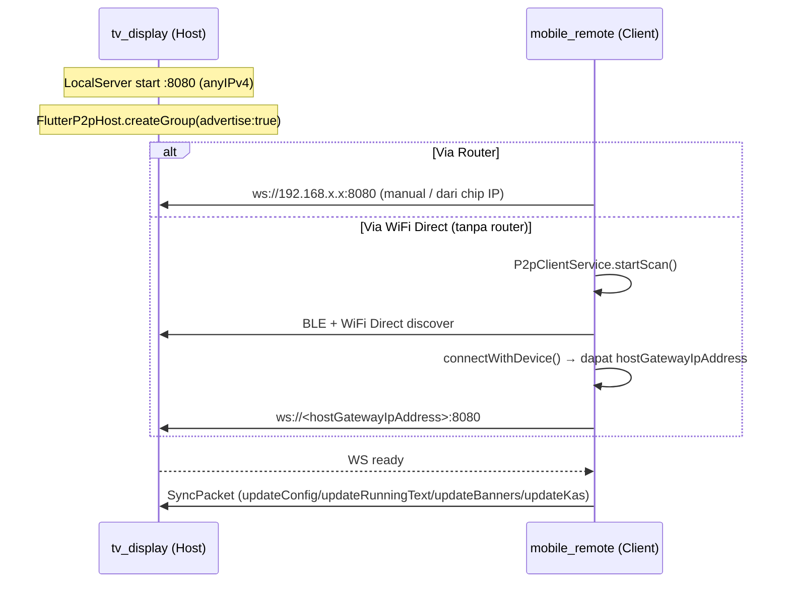

# Masjid You — Architectural Decision Records (DECISIONS.md)

> Kumpulan keputusan arsitektur: **kenapa, mengapa, dan bagaimana** setiap keputusan besar diambil.
> Format ringan ADR — setiap catatan: Konteks → Keputusan → Alasan → Konsekuensi.

---

## Daftar ADR

1. [ADR-001 — Menulis Ulang dari Nol menggantikan `Alyeandemo`](#adr-001)
2. [ADR-002 — Memilih Flutter untuk kedua platform](#adr-002)
3. [ADR-003 — Arsitektur Local HTTP Server + P2P/WiFi Direct](#adr-003)
4. [ADR-004 — Fallback UI Handler (banner default & running text kosong)](#adr-004)
5. [ADR-005 — `didUpdateWidget` + Auto-scroll untuk teks panjang](#adr-005)
6. [ADR-006 — Shared package `shared_models` untuk protokol & model](#adr-006)
7. [ADR-007 — Perhitungan jadwal sholat offline (`adhan`) + offset per sholat](#adr-007)
8. [ADR-008 — Indikator "Unsaved Changes" + sinkronisasi manual](#adr-008)
9. [ADR-009 — State Machine Waktu Shalat + Animasi CustomPainter](#adr-009)
10. [ADR-010 — Material 3 Expressive dengan `material_new_shapes`](#adr-010)
11. [ADR-011 — Shape Manual (`RoundedRectangleBorder(28)` + `ArchBorder`) & model swap jam](#adr-011)
12. [ADR-012 — Revert tema M3 Expressive di mobile_remote (kembali ke square)](#adr-012)
13. [ADR-013 — Perbaikan Bug Major P0 & Penanganan Error Konektivitas](#adr-013)
14. [ADR-014 — Perbaikan WiFi Direct Discovery & Prasyarat Check](#adr-014)
15. [ADR-015 — Validasi Prasyarat WiFi Direct di Mobile Remote](#adr-015)

---

## ADR-001 — Menulis Ulang dari Nol menggantikan `Alyeandemo`

### Konteks
Proyek sebelumnya bernama **`Alyeandemo`** adalah aplikasi tampilan masjid berbasis web. Pembuatan ulang dilakukan di lingkungan **Termux** (terminal Android) yang sangat terbatas, sehingga muncul banyak masalah struktural.

### Keputusan
Buang kode `Alyeandemo` sepenuhnya dan tulis aplikasi baru dari nol sebagai monorepo Flutter bernama **`masjid-you`**.

### Alasan
- **Masalah Termux**: membangun aplikasi Android penuh di Termux rentan terhadap toolchain yang tidak stabil, cache rusak, dan keterbatasan memori — tidak cocok untuk proyek produksi berkelanjutan.
- **Non-atomic**: basis kode lama bertumbuh tanpa pemisahan modul/arsitektur yang jelas sehingga sulit diuji dan dirawat.
- **Web-only**: versi web tidak bisa menjadi aplikasi *kiosk* fullscreen yang stabil di Google TV / Android TV; butuh akses hardware (WiFi Direct, BLE, wakelock, kunci layar) yang hanya tersedia di aplikasi native.
- **Kebutuhan baru**: sinkronisasi jarak jauh, tata letak TV 2K, koneksi tanpa internet — semuanya butuh fondasi arsitektur baru.

### Konsekuensi
- Migrasi penuh ke Flutter berarti timeline pengembangan awal lebih panjang, tetapi membayar lunas dengan testability, hot reload, dan satu codebase untuk kedua perangkat.

---

## ADR-002 — Memilih Flutter untuk kedua platform

### Konteks
Dibutuhkan **satu aplikasi kiosk** untuk Google TV/Android TV (display) dan **satu aplikasi kontroler** untuk HP Android, dengan penampilan yang konsisten dan render yang mulus.

### Keputusan
Gunakan **Flutter (Dart)** untuk `tv_display` dan `mobile_remote`, plus satu paket `shared_models` di dalam satu monorepo.

### Alasan
- **Cross-platform**: satu bahasa untuk TV & HP; Android TV punya `LEANBACK_LAUNCHER` dan `uses-feature` yang mudah dikonfigurasi di manifest.
- **60 fps untuk TV**: rendering berbasis skia/impeller memberi animasi halus (carousel, marquee, ring countdown) bahkan pada resolusi TV.
- **Material You 3**: `ColorScheme.fromSeed(0xFF006A60)` menghasilkan tema modern yang konsisten di kedua app, ringan tanpa aset gambar tema.
- **Kiosk mode**:
  - `SystemChrome.setEnabledSystemUIMode(SystemUiMode.immersiveSticky)` menyembunyikan status bar.
  - `wakelock_plus.enable()` mencegah TV tidur.
  - Manifest menandai aktivitas sebagai `LEANBACK_LAUNCHER` agar muncul di daftar aplikasi TV.
- **Ekosistem paket**: `adhan` (jadwal sholat offline), `geolocator` (GPS), `flutter_p2p_connection` (WiFi Direct/BLE), `shelf` (server WebSocket) tersedia dan matang.

### Konsekuensi
- Dua aplikasi + satu paket harus di-*build* bersamaan (menggunakan *Dart workspaces* / `workspace:` di `pubspec.yaml` root).
- Performa & pengujian layar memerlukan perhatian khusus (lihat ADR-005 dan dokumentasi TV).

---

## ADR-003 — Arsitektur Local HTTP Server + P2P/WiFi Direct

### Konteks
Masjid sering berada di lokasi tanpa koneksi internet atau tanpa router WiFi yang dapat dikonfigurasi. Remote HP harus bisa mengontrol TV hanya dengan jaringan lokal.

### Keputusan
- **TV** menjadi **server WebSocket** `anyIPv4:8080` (paket `shelf` + `shelf_web_socket`).
- **Remote HP** menjadi **client WebSocket** yang menyambung ke `ws://<ip-TV>:8080`.
- Tambahan jalur koneksi **WiFi Direct + BLE** (`flutter_p2p_connection`) sehingga HP dapat menemukan TV **tanpa router**:
  - TV: `FlutterP2pHost.createGroup(advertise: true)` → membuat hotspot p2p.
  - HP: `FlutterP2pClient.startScan(...)` menemukan perangkat, `connectWithDevice(...)` menyambung.
  - IP handoff: `HotspotClientState.hostGatewayIpAddress` diisi otomatis ke kolom IP Remote.

### Alasan
- **Tanpa internet/router**: komunikasi lokal murni; tidak ada dependensi cloud, API eksternal, atau akun.
- **Offline-first**: semua data (jadwal, banner, kas, running text) disimpan/dikirim lokal; perhitungan jadwal juga offline (ADR-007).
- **Simple > pub-sub**: satu arah push (Remote → TV) cukup untuk use-case pengaturan kiosk; pesan dikemas sebagai `SyncPacket` JSON ber-`SyncAction` sehingga mudah diextend (contoh: `triggerBeep`, `getInitialState` sudah ada di enum).
- **Broadcast** tersedia di `LocalServer.broadcast()` untuk kebutuhan multi-client di masa depan (misal beberapa remote).

### Konsekuensi
- IP TV harus diketahui Remote — ditutupi oleh WiFi Direct (otomatis) dan chip "Remote Sync IP" di header TV untuk kasus WiFi router.
- WebSocket mempertahankan koneksi hidup; TV menangani `onDone`/`onError` untuk membersihkan client yang putus.
- Emulator tidak punya radio P2P/BLE asli → pengujian WiFi Direct harus di perangkat fisik.

### Diagram alur koneksi

---

## ADR-004 — Fallback UI Handler (banner default & running text kosong)

### Konteks
Tidak semua masjid langsung mengisi konten. Saat daftar banner kosong atau running text kosong, layar TV tidak boleh kosong / patah, dan harus tetap informatif.

### Keputusan
- **`BannerCarousel`** (di `apps/tv_display/lib/widgets/banner_carousel.dart`): jika `_activeBanners.isEmpty` → tampilkan kartu fallback: ikon masjid `Icons.mosque_rounded` + teks **"Jagalah Shaf dan Shalatlah Tepat Waktu"**.
- **`RunningTextBar`** (di `apps/tv_display/lib/widgets/running_text_bar.dart`): jika tidak ada pesan aktif → hentikan marquee, badge **INFORMASI** memenuhi full width, tampilkan teks statis **"Tidak ada informasi"**.
- Setiap fallback tetap memakai warna & bentuk dari `ColorScheme` (Material), bukan hardcode.

### Alasan
- **Ketahanan kiosk**: layar TV berjalan 24/7; fallback mencegah blank screen dan kebocoran layout.
- **Pengalaman pengguna**: pesan default mengingatkan jamaah (menjaga shaf) alih-alih tampilan mati.
- **Menghindari bug render**: kasus daftar kosong yang tidak ditangani dapat memicu pembagian dengan nol di `PageView.builder`/`animateToPage`.

### Konsekuensi
- Filter "aktif" dilakukan di dua tempat: `MediaBanner.isActive` dan `RunningTextMessage.isActive` — konsisten karena keduanya di-seed `true` oleh default.
- Running text default *lama* yang menampilkan teks dengan `Color(...)` yang bocor telah dihapus total (perbaikan leak string).

---

## ADR-005 — `didUpdateWidget` + Auto-scroll untuk teks panjang

### Konteks
Info Masjid (banner) bisa sangat panjang, dan Running Text bisa berubah kapan saja lewat sinkronisasi. Di layar TV (960×540 logis di emulator), teks yang panjang berisiko overflow atau terpotong.

### Keputusan
- **Tidak memakai `FittedBox`** untuk mengecilkan teks (menjadi terlalu kecil untuk dibaca di TV).
- **`_BannerPage`** (`banner_carousel.dart`) menggunakan `SingleChildScrollView` + `ScrollController` dengan **auto-scroll pelan**:
  - Timer `50 ms`, durasi total ~`9000 ms`, langkah = `maxScrollExtent / (9000/50)`.
  - Berhenti saat mencapai ujung; reset ke atas saat halaman berubah konten atau kembali aktif.
- **`didUpdateWidget`** dipakai untuk reaksi perubahan data *tanpa* membongkar state:
  - Jika konten banner berubah → batalkan timer, `jumpTo(0)`, mulai ulang.
  - Jika halaman menjadi aktif lagi → reset & mulai ulang.
- **`RunningTextBar`** juga memakai `didUpdateWidget` untuk menyalakan/mematikan timer marquee saat daftar pesan berubah dari kosong ↔ terisi.

### Alasan
- Teks harus tetap **terbaca** (font tidak mengecil) — prioritas utama pada tampilan jarak jauh di TV.
- `didUpdateWidget` lebih efisien daripada membongkar-pasang stateful widget, dan menghindari timer yang membuang resource / menumpuk.
- `maxScrollExtent <= 0` diabaikan → tidak ada scroll percuma untuk teks pendek.

### Konsekuensi
- Ada dua timer independen di area banner: timer *page* 10 detik (pindah halaman) dan timer *scroll* 50 ms (scroll vertikal). Keduanya di-`cancel` di `dispose`.
- Regresi overflow dipantau oleh test `TV layout has no overflow at small TV viewport` (960×540).

---

## ADR-006 — Shared package `shared_models` untuk protokol & model

### Konteks
Dua aplikasi berbagi bentuk data yang sama (config, banner, running text, kas, jadwal). Menyalin model di kedua app akan menyebabkan drift.

### Keputusan
Buat paket Dart lokal **`packages/shared_models`** (di-*workspace* root), berisi:
- `SyncPacket` + `SyncAction` (protokol WS),
- `MosqueConfig`, `IqamahDuration` (konfigurasi),
- `PrayerType` + `PrayerSchedule` + `PrayerScheduleItem` (jadwal sholat offline),
- `MediaBanner`, `RunningTextMessage`, `KasTransaction`, `KasSummary`,
- `kAllPrayerTypes` (daftar 6 sholat).

### Alasan
- **Single source of truth**: serialisasi (`toMap`/`fromMap`/`toJson`/`fromJson`) ditulis sekali.
- **Backward compatibility** ditangani di satu tempat (contoh: `MediaBanner.fromMap` memetakan `subtitle` lama → `content`; `MosqueConfig.fromMap` membaca `prayerCorrectionMinutes` lama → seed semua offset).
- **Test terpusat**: `test/shared_models_test.dart` (12 test) mengunci perilaku protokol.

### Konsekuensi
- Setiap perubahan model wajib sinkron di `toMap`/`fromMap` dan di test.
- Perubahan di `shared_models` mengharuskan rebuild kedua app.

---

## ADR-007 — Perhitungan jadwal sholat offline (`adhan`) + offset per sholat

### Konteks
Jadwal sholat harus akurat dan tersedia **tanpa internet**. Koordinat bisa dari manual atau GPS. Setiap masjid butuh koreksi halus per waktu (misal beda 1–2 menit dengan jadwal lokal).

### Keputusan
- **Hitung lokal** memakai paket `adhan` (`CalculationMethod.singapore`, madhab shafi — sesuai standar Kemenag RI / MABIMS).
- Koordinat bersumber dari:
  - **Manual**: kolom Latitude/Longitude di tab Pengaturan Remote.
  - **GPS**: tombol "Ambil Koordinat dari GPS" via `geolocator` (izin lokasi runtime).
- **Offset per sholat**: `MosqueConfig.prayerOffsets` berupa `Map<PrayerType, int>` (menit, boleh negatif), diisi 6 kolom di Remote. `PrayerSchedule.calculate` menerapkan offset per waktu (termasuk perhitungan Fajr besok untuk countdown).
- **Simulasi**: tombol "Simulasi Jadwal" menghitung jadwal untuk tanggal + jam pilihan secara offline dan menandai sholat berikutnya + countdown.

### Alasan
- **Offline-first**: tidak ada panggilan API astronomi; semua kalkulasi lokal (ADR-003).
- **Akurasi lokal**: offset per sholat memungkinkan penyesuaian terhadap hisab masjid setempat tanpa mengubah rumus.
- **Verifikasi cepat**: simulasi memberi kepercayaan sebelum data dikirim ke TV.

### Konsekuensi
- `PrayerSchedule.calculate(config, [targetDate])` menerima tanggal opsional — dipakai TV tiap detik (untuk countdown) dan dialog simulasi (untuk pratinjau).
- Nilai koordinat di-clamp (lat −90..90, lng −180..180) dan fallback ke nilai lama bila input tidak valid.
- Backward compat: config lama ber-`prayerCorrectionMinutes` diterjemahkan ke semua offset.

---

## ADR-008 — Indikator "Unsaved Changes" + sinkronisasi manual

### Konteks
Remote bisa mengedit banyak hal (banner, running text, kas, config) saat TV belum terhubung. Tanpa penanda, pengguna tidak tahu data sudah sampai ke TV atau belum.

### Keputusan
- Di `_RemoteHomeScreenState` (mobile_remote) ada flag **`_hasUnsyncedChanges`**.
- Setiap mutasi (tambah/edit/hapus/toggle) men-set `_hasUnsyncedChanges = true` dan menyimpan daftar lokal.
- Jika terhubung, perubahan langsung dikirim dan flag di-reset `false`.
- Jika belum terhubung, muncul **banner amber** di bawah AppBar: ikon `sync_problem` + "Ada perubahan belum dikirim ke TV" + tombol **"Kirim Ke TV"** yang memanggil `_pushAllToTv()`.
- `_pushAllToTv` memastikan koneksi ada; `_syncAllToTv` mengirim 4 jenis data sekaligus.

### Alasan
- **Kesadaran status**: pengguna tahu kapan perubahan masih lokal (belum tampil di TV).
- **Anti kehilangan data**: perubahan disimpan di memori lokal sehingga masih bisa dikirim setelah terhubung.
- **UX sederhana**: satu tombol "Kirim Ke TV" = batch sinkronisasi penuh.

### Konsekuensi
- Semua handler mutasi mengikuti pola seragam: `setState { data...; _hasUnsyncedChanges = true; }` → jika `_isConnected` kirim → reset flag.
- Auto-connect WiFi Direct memanggil `_connectToTv()` yang pada sukses melakukan `_syncAllToTv()` dan membersihkan flag.

---

## ADR-009 — State Machine Waktu Shalat + Animasi CustomPainter

### Konteks
Layar TV harus secara otomatis mengikuti siklus ibadah jamaah: menjelang azan → azan berkumandang → jeda ikamah → shalat berlangsung → kembali normal. Remote butuh kendali cepat (skip) dan durasi tiap fase yang bisa diatur realtime.

### Keputusan
- **Model di `shared_models`**: `MosqueConfig` mendapat 4 durasi (`preAdhanMinutes`=15, `adhanMinutes`=2, `preIqomahMinutes`=1, `shalatMinutes`=10) — dikirim via `updateConfig`, backward-compatible (default saat field absen).
- **Protokol**: enum `PrayerPhase` (normal/preAdhan/adhan/preIqomah/shalat) + `SyncAction.skipAdhan/startShalat/finishShalat` (Remote→TV) dan `stateUpdate` (TV→Remote, berisi fase + sisa detik).
- **TV — `PrayerStateMachine`** (`lib/state/prayer_state_machine.dart`): manager murni `ChangeNotifier` yang di-*drive* oleh clock timer 1 detik yang sudah ada (tidak ada timer internal sendiri — bebas drift & bebas resource).
  - Auto-start dari `NORMAL` saat `timeUntilNextPrayer <= preAdhanMinutes` (Syuruq/sunrise dikecualikan — bukan waktu azan).
  - Transisi otomatis antar fase berdasarkan durasi; skip manual hanya valid pada fase terkait (no-op di fase lain).
  - `updateConfig` men-clamp sisa waktu bila durasi baru lebih pendek.
- **TV — `PrayerStateOverlay`** (`lib/widgets/prayer_state_overlay.dart`): overlay layar penuh di atas Stack utama.
  - `PRE_ADHAN`/`PRE_IQOMAH`: **circular progress ring** (`_CircularRingPainter`, `TweenAnimationBuilder` 900 ms agar mulus antar tick 1 detik) + ikon + nama shalat + countdown.
  - `ADHAN`: **wavy progress bar** (`_WavyProgressPainter` — single sine wave stroke line + cursor bar `|` ala media player Material You) dengan palet **moody low-contrast** (muted teal/dark olive/amber/sage), ikon speaker, "Azan [Nama] Berkumandang".
  - `SHALAT`: layar **hitam penuh** dengan teks statis sangat redup di tengah.
  - Animasi gelombang memakai `AnimationController.repeat()` + `CustomPainter(repaint:)` → hanya repaint, bukan rebuild → 60 FPS ringan. **Progress wavy bar dihitung sub-detik** dari `PrayerStateMachine.deadline` terhadap `DateTime.now()` di tiap frame `paint` → cursor bergerak mulus 60 FPS, bukan melompat per tick 1 detik.
- **Remote**: tab Pengaturan mendapat 4 field durasi + kartu "Aksi Cepat Waktu Shalat" (tombol aktif sesuai fase TV yang diterima dari `stateUpdate`). Durasi di-persist ke **SharedPreferences** dan dikirim ke TV.

### Alasan
- **Offline-first & realtime**: protokol lokal WS yang sudah ada (ADR-003) dipakai apa adanya; tidak ada state management library baru.
- **Performa TV (60 FPS)**: `CustomPainter` + `repaint` menghindari rebuild widget per frame; `AnimatedBuilder` hanya rebuild overlay 1×/detik saat countdown berubah.
- **Deterministik & teruji**: state machine murni Dart diuji unit (15 kasus: auto-start, auto-cycle, skip, clamp, sunrise-exclude, forcePhase); overlay diuji bebas overflow pada viewport TV 960×540.
- **UX kiosk**: layar redup total saat shalat mencegah silau; skip dari Remote menjaga jadwal tetap terkontrol.

### Konsekuensi
- Perubahan durasi hanya berdampak pada fase yang sedang berjalan (clamp); siklus tetap berjalan normal.
- `stateUpdate` di-broadcast tiap detik saat fase berlangsung (trafik kecil di LAN).
- Test layout memakai `MasjidDisplayScreen(autoPrayerCycle: false)` agar deterministik terhadap waktu nyata; perilaku otomatis diuji terpisah di unit test.

## ADR-010 — Material 3 Expressive dengan `material_new_shapes`

### Konteks
UI masih memakai bentuk standar Material 3 (`RoundedRectangleBorder`/`StadiumBorder`). Produk ingin tampilan yang lebih ekspresif: blob latar belakang berbentuk organik (ala pemutar media Android 16 "Now Playing"), kartu dengan sudut "puffy", dan badge berbentuk pil — tanpa menunggu rilis stable M3 Expressive di Flutter.

### Keputusan
- **Package**: `material_new_shapes: ^1.0.0` (MIT, tanpa deps tambahan selain `flutter`/`meta`/`vector_math`) ditambahkan ke `tv_display` dan `mobile_remote`.
- **Pendekatan hybrid**: jadikan shape default terasa *expressive* dengan memakai material eksperimental (`MaterialShapes.*`), tapi tanpa mengubah struktur widget yang sudah ada. `tv_display` memakai **theme-level** (cardTheme, typography emphasized) + blob background; `mobile_remote` memakai **per-widget** (semua kartu, tombol, chip, dropdown, dialog, NavigationBar) dengan `M3Pressable` untuk feedback spring.
- **`M3ShapeBorder`** (duplikat di `apps/tv_display/lib/theme/m3_shape_border.dart` dan `apps/mobile_remote/lib/m3_shape_border.dart`): wrapper `ShapeBorder`/`OutlinedBorder` untuk `RoundedPolygon` dari `MaterialShapes.*`. Polygon ternormalisasi (0..1) diskalakan ke `Rect` via `Matrix4.setEntry` (bukan `Matrix4.translate`/`scale` yang deprecated di Flutter 3.44). Turunan `OutlinedBorder` agar sah dipakai di `ButtonStyle.shape` (bertipe `OutlinedBorder?`).
- **`MaterialBlobBackground`** (tv_display) ditulis ulang: tanpa `BackdropFilter` (boros di TV); 4 shape M3 besar (`cookie4Sided` teal 20%, `clover4Leaf` emerald 18%, `flower` darkTeal 16%, `sunny` teal 14%) dengan `MaskFilter.blur(3)`, masing-masing berputar (kecepatan ±0.14–0.22 rad/s) + melayang pola Lissajous, digambar di `CustomPainter(repaint:)` pada `AnimationController.repeat()` → hanya repaint 60 FPS.
- **Bentuk**: Card = `MaterialShapes.puffy`; badge/pil = `MaterialShapes.pill`; `tv_display` pakai emphasized typography (display/headline weight 700–900, letterSpacing −0.5..−2).

### Alasan
- **Anti-overfit ke rilis Flutter**: `MaterialShapes` ditarik dari `material_new_shapes` yang stabil di versi package, bukan dari SDK; bila API Flutter berubah, cukup upgrade package.
- **Kompatibilitas API**: `M3ShapeBorder` dibangun menyesuaikan `ShapeBorder`/`OutlinedBorder` Flutter 3.44 (`OutlinedBorder.lerp` fallback "pick nearest", `Matrix4.setEntry` menggantikan `translate`/`scale` deprecated).
- **Performa TV**: animasi blob lewat `repaint` + `Canvas.save/restore`; tidak ada layer blur/backdrop → hemat GPU untuk kiosk TV.
- **UX**: shape organik + feedback spring membuat remote terasa lebih modern tanpa ganti framework.

### Konsekuensi
- `material_new_shapes` ditambahkan di kedua pubspec (version `^1.0.0`); `flutter pub get` di root.
- `flutter analyze`: 0 error di kedua app (sisa hanya info pre-existing `avoid_print` + deprecation `DropdownButtonFormField.value`).
- Test: tv_display 25/25, mobile_remote 2/2, shared_models 18/18.
- Verifikasi emulator (Android TV 960×540): blob terdeteksi bergerak (51% posisi berubah antar 2 frame), bentuk non-lingkaran (variasi radius radial 0.83 = cookie/flower), kartu ber-sudut puffy (corner-inset 22 px).
- `M3ShapeBorder` non-const (getter `MaterialShapes.*` bukan konstanta) → tidak bisa dipakai dalam `const` tree; `StadiumBorder` pada badge diganti ke `M3ShapeBorder(MaterialShapes.pill)`.
- `SwitchThemeData(thumbShape:)`/`SliderThemeData(shape:)` dihapus dari theme remote — parameter dihapus pada Flutter versi ini (bentuk default tetap bagus).

---

## ADR-011 — Shape Manual (`RoundedRectangleBorder(28)` + `ArchBorder`) & model swap jam

### Konteks
Setelah ADR-010, beberapa shape dari `material_new_shapes` ternyata tidak pas untuk kiosk TV saat diverifikasi visual (user menyerahkan verifikasi visual ke pengamat/agent UI/UX): (1) `MaterialShapes.square` dibulatkan **terlalu besar** (`_cornerRound30`) sehingga kartu tidak tampak bersih; (2) `MaterialShapes.arch` ternormalisasi (0..1) sehingga saat di-stretch ke kapsul jam yang lebar, kubah membesar dan **memakan ruang vertikal** header — bahkan versi awal yang menggambar dome di luar `rect.top` ter-clip menjadi puncak datar; (3) kartu shalat aktif menampilkan jam statis besar **di atas** ring sehingga berebut perhatian.

### Keputusan
- **Kartu besar** (Header, Info Masjid, Kas Summary, Running Text Bar) memakai **`RoundedRectangleBorder(borderRadius: 28)`** manual, menggantikan `MaterialShapes.square` dari package.
- **Kapsul jam** memakai **`ArchBorder`** — kelas `OutlinedBorder` baru di `apps/tv_display/lib/theme/m3_shape_border.dart` — arch manual: dome **selalu di dalam bounds** (puncak di `rect.top`, sisi lurus mulai di `rect.top + rise`), `rise = min(width × domeFactor, height × 0.4)` dengan `domeFactor = 0.2`. `getInnerPath = getOuterPath` karena `Path.deflate` tidak tersedia di Flutter 3.44.9. Padding kapsul: `only(top: 20, bottom: 12, left: 28, right: 28)`.
- **Badge "SELANJUTNYA" dihapus**; kartu shalat aktif memakai `RoundedRectangleBorder(28)` + side `primary` 2px + `primaryContainer`, dan **hanya menampilkan nama + ring**.
- **Model swap** di `_NextPrayerTimer`: `Timer.periodic(4s)` membalik `_showCountdown`; `AnimatedSwitcher` (fade + slide 400ms, kunci `ValueKey(_showCountdown)`) menampilkan countdown ("tersisa") ↔ jam ("waktu") bergantian di dalam ring.
- Kartu non-aktif tetap `M3ShapeBorder(MaterialShapes.slanted)`; badge tetap pill/stadium.

### Alasan
- **Keseragaman & kebersihan**: radius 28 konsisten di semua kartu dan menghindari pembulatan package yang berlebihan; `RoundedRectangleBorder` juga `const`-friendly.
- **Anti-clip**: dengan dome di dalam bounds, kapsul jam tidak pernah terpotong datar berapa pun lebar/tinggi container (bug ditemukan lewat verifikasi emulator).
- **Hierarki visual**: kartu aktif cukup ditandai border + warna; informasi waktu disajikan bergantian di dalam ring sehingga tidak bertabrakan dengan ring (mengembalikan perilaku "jam bergantian" yang sudah disetujui user).

### Konsekuensi
- `M3ShapeBorder` masih dipakai untuk kartu non-aktif shalat, badge pill, dan (saat itu) seluruh tema remote (`puffy`/`pill`) — lihat [ADR-012](#adr-012) untuk status terbaru remote; `ArchBorder` & `RoundedRectangleBorder(28)` khusus layar TV.
- Test yang ada (25/25 tv_display) tetap lulus; verifikasi visual emulator: dome terlihat naik dari sisi ke puncak tanpa overflow, teks jam tetap di bawah dome.
- Dokumen terkait: [`tv_display/m3_shapes.md`](tv_display/m3_shapes.md) (detail apa/kenapa/bagaimana) & `widget_mapping.md` §2.6.

---

## ADR-012 — Revert tema M3 Expressive di mobile_remote (kembali ke square)

### Konteks
Setelah ADR-010, `mobile_remote` memakai `M3ShapeBorder(MaterialShapes.puffy)` untuk semua kartu, dialog, dan bottom sheet. Secara visual, `puffy` berbentuk 4 lobus dan tampak seperti **clover** (daun semanggi). User melaporkan seluruh UI admin tiba-tiba berubah bentuk menjadi clover dan meminta kembali ke **square biasa**.

### Keputusan
- **Revert shape mobile_remote ke Material 3 standar** di `_buildTheme` (`apps/mobile_remote/lib/main.dart`):
  - `cardTheme` → `RoundedRectangleBorder(borderRadius: 16)` (konsisten dengan `OutlineInputBorder(16)` input field).
  - `dialogTheme`/`bottomSheetTheme` → `RoundedRectangleBorder(borderRadius: 28)`.
  - `navigationBarTheme.indicatorShape`, `chipTheme.shape`, `filledButtonTheme`/`outlinedButtonTheme`/`textButtonTheme` → `StadiumBorder()`.
- **Hapus artefak M3 Expressive** dari mobile_remote: file `lib/m3_shape_border.dart` dihapus; import `material_new_shapes` & `m3_shape_border.dart` dihapus dari `main.dart`; dependency `material_new_shapes` dihapus dari `apps/mobile_remote/pubspec.yaml`.
- **Pertahankan `M3Pressable`** — kelas lokal (spring scale saat tekan) tidak mengubah bentuk dan tetap dipakai.

### Alasan
- **Feedback langsung user**: bentuk clover tidak cocok untuk UI admin yang padat informasi (form, daftar kas, banner); shape netral square/rounded tidak merebut perhatian dari konten.
- **Konsistensi internal**: radius 16 kartu menyamai radius input field; pill standar M3 untuk tombol/chip adalah bentuk default yang sudah familier.
- **Hapus kode mati**: setelah semua referensi `MaterialShapes.*` hilang, `M3ShapeBorder` dan dependency tidak lagi terpakai — dihapus agar build bersih dan tidak ada dead code.
- `material_new_shapes` tetap dibutuhkan `tv_display` (kartu shalat non-aktif `slanted`, badge pill, blob background) sehingga tidak dihapus dari repo secara global.

### Konsekuensi
- `flutter analyze` mobile_remote: 0 error (4 info pre-existing: `deprecated_member_use` ×2, `avoid_print` ×2); `flutter test` 2/2 lulus; APK debug dibangun & ter-install ke `emulator-5554`.
- `M3Pressable` tidak bergantung pada `material_new_shapes` (Flutter bawaan) → tetap kompatibel.
- Status shape saat ini: **tv_display** memakai campuran `M3ShapeBorder` (slanted/pill) + manual (`RoundedRectangleBorder(28)`/`ArchBorder`); **mobile_remote** murni Material 3 standar.
- Dokumen terkait: [`mobile_remote/theme_shapes.md`](mobile_remote/theme_shapes.md) (apa/kenapa/bagaimana) & `tab_mapping.md` §1.

---

## ADR-013 — Perbaikan Bug Major P0 & Penanganan Error Konektivitas

### Konteks
Saat pengujian dan analisis statis codebase, ditemukan beberapa masalah kritis (P0):
1. Perubahan teks running text dan banner yang dikirim dari remote tidak memicu restart animasi/timer jika jumlah item tetap sama.
2. Inisialisasi P2P host dan server WebSocket lokal di `apps/tv_display/lib/main.dart` belum memiliki penanganan error (try-catch & stream onError), berisiko memicu crash unhandled exception saat port terpakai atau service bermasalah.
3. Pemanggilan `forcePhase` pada `PrayerStateMachine` saat `schedule` bernilai null berpotensi menyebabkan ketidakstabilan state.

### Keputusan
1. **`RunningTextBar.didUpdateWidget`**: Diperbarui untuk membandingkan `id`, `content`, dan `category` dari pesan aktif, sehingga perubahan teks/kategori memicu `_startAutoScroll()`.
2. **`BannerCarousel.didUpdateWidget`**: Diperbarui untuk mendeteksi perubahan daftar banner aktif dan memicu reset/start timer rotasi halaman `_startTimer()`.
3. **Penanganan Error Server & P2P**:
   - `_p2pHost.start()` dibungkus dalam blok `try-catch` dan listener `stateStream` diberi handler `onError`.
   - `_localServer.start()` dibungkus dalam blok `try-catch`.
   - Pencarian IP lokal `_fetchLocalIp()` menggunakan `debugPrint` untuk logging error.
4. **`PrayerStateMachine.forcePhase`**: Menambahkan fallback aman ke `PrayerType.fajr` saat tidak ada jadwal shalat berikutnya yang tersedia.

### Alasan
- **Akurasi Tampilan**: Marquee running text dan rotasi banner harus langsung merespons mutasi data tanpa memerlukan restart aplikasi TV.
- **Kestabilan Kiosk TV**: TV display berjalan 24/7 tanpa pengawasan manusia; server WebSocket dan P2P Host harus tahan terhadap error jaringan atau bentrok port.

### Konsekuensi
- Tampilan TV secara instan memperbarui running text dan banner begitu dikirim dari Remote HP.
- Aplikasi TV lebih tangguh terhadap kegagalan jaringan lokal / P2P.

---

## ADR-014 — Perbaikan WiFi Direct Discovery & Prasyarat Check

### Konteks
Mode WiFi Direct tidak bisa menemukan device saat dijalankan di device asli (mobile remote / TV display).
1. **TV Display (`p2p_host_service.dart`)**: Tidak ada validasi prasyarat sebelum `createGroup()`. Jika Location/Bluetooth/WiFi mati, pembuatan grup gagal tanpa umpan balik ke user.
2. **Mobile Remote (`p2p_client_service.dart`)**: Pemindaian BLE (`startScan()`) tidak mengecek status GPS/Location. Pada Android 6-11, BLE scan tanpa Location aktif menghasilkan 0 perangkat tanpa error, membuat remote stuck pada "Mencari TV...".
3. **Mobile Remote (`main.dart`)**: Pemindaian otomatis berhenti dalam 15 detik, namun callback `onDone` tidak diproses sehingga UI tidak mengupdate status pemindaian.

### Keputusan
1. **Model Prasyarat (`P2pPrerequisites`)**: Menambahkan model prasyarat yang mencakup status WiFi, Bluetooth, Location, serta perizinan P2P & Bluetooth.
2. **Metode Validasi di Host (`P2pHostService`)**:
   - Menambahkan `checkPrerequisites()` untuk mengevaluasi kesiapan hardware dan perizinan.
   - Menambahkan helper `enableWifiIfNeeded()`, `enableBluetoothIfNeeded()`, dan `enableLocationIfNeeded()` untuk membantu menyalakan layanan yang mati secara otomatis/manual.
3. **Alur UX Validasi di TV Display (`main.dart`)**:
   - Menambahkan `P2pMode` enum (`pending`, `directFull`, `directIpOnly`).
   - Melakukan pemeriksaan prasyarat di `initState()`. Jika lengkap, mulai host mode Direct penuh. Jika tidak, tampilkan dialog interaktif "WiFi Direct Belum Siap" yang memberikan pilihan untuk mengaktifkan semua layanan satu per satu, atau memilih fallback "Mode IP Saja".
4. **Perbaikan Scan di Mobile Remote (`p2p_client_service.dart` & `main.dart`)**:
   - Menambahkan validasi dan aktivasi otomatis `checkLocationEnabled()` dan `enableLocationServices()` sebelum scan.
   - Mengirim callback `onDone` dari `P2pClientService.startScan()` ke `_startScan()` remote untuk memperbarui UI (`_isScanning = false` dan pesan status selesai/tidak ditemukan).

### Alasan
- **Keandalan Koneksi**: WiFi Direct & BLE sangat sensitif terhadap prasyarat hardware dan perizinan OS Android yang ketat. Validasi eksplisit meminimalkan kegagalan diam-diam (silent failure).
- **Pengalaman Pengguna (UX) yang Jelas**: Memberikan umpan balik visual terperinci mengenai modul mana yang belum aktif (WiFi, Bluetooth, atau Lokasi) serta tombol tindakan cepat untuk mengatasinya.
- **Fleksibilitas (YAGNI & Fallback)**: Jika hardware tidak mendukung penuh atau perizinan ditolak, user dapat beralih dengan mudah ke "Mode IP Saja" di mana WebSocket server lokal tetap berjalan lancar melalui jaringan WiFi normal.

### Konsekuensi
- Aplikasi TV Display & Remote HP mendeteksi dan memandu user menyalakan WiFi, Bluetooth, dan Lokasi secara transparan.
- Status scan remote HP terupdate otomatis saat timeout pemindaian (15 detik) tercapai.
- Pengujian static analysis (`flutter analyze`) lolos dengan bersih.

---

## ADR-015 — Validasi Prasyarat WiFi Direct di Mobile Remote

### Konteks
ADR-014 menambahkan validasi prasyarat WiFi Direct (`P2pPrerequisites` + dialog "WiFi Direct Belum Siap") di sisi **TV Display**. Di sisi **Mobile Remote**, validasi hardware/perizinan masih *implicit* di dalam `P2pClientService.startScan()` (auto-enable diam-diam tanpa umpan balik). Jika WiFi/Bluetooth/Lokasi/perizinan belum siap, scan BLE menghasilkan 0 perangkat dan user hanya melihat "Mencari TV..." tanpa tahu harus menyalakan apa.

### Keputusan
1. **Model & helper di `P2pClientService`** (`apps/mobile_remote/lib/services/p2p_client_service.dart`): tambahkan `P2pPrerequisites` (mirror dari `P2pHostService` TV), `checkPrerequisites()`, `askPermissionsIfNeeded()`, `enableWifiIfNeeded()`, `enableBluetoothIfNeeded()`, `enableLocationIfNeeded()`.
   - Saat `_client == null` (bukan Android / test), `checkPrerequisites()` mengembalikan status "siap" agar tidak memblokir.
   - `startScan()` di-refactor memakai helper yang sama (tetap auto-enable sebagai safety net).
2. **Alur UX validasi di `_RemoteHomeScreenState`** (`apps/mobile_remote/lib/main.dart`):
   - Tombol "Cari TV" (`_startScan`) kini berjalan `async`: cek `checkPrerequisites()` dulu → jika `isReady(locationRequired: sdk < 31)` langsung `_runScan()`; jika tidak, tampilkan dialog **"WiFi Direct Belum Siap"** (barrier non-dismissible) berisi status Wi-Fi, Bluetooth, Lokasi, dan Izin Perangkat.
   - Dialog dua aksi (sama seperti TV): **"Mode IP Saja"** → tutup dialog, user memakai koneksi IP manual; **"Aktifkan & Mulai"** → `_enableAllP2pServices()` (SnackBar panduan → buka pengaturan → **minta izin sistem dulu** (`askPermissionsIfNeeded`) → enable layanan yang mati → cek ulang → scan langsung atau tampilkan dialog lagi).
   - Helper `_androidSdkVersion()` dibawa ke Remote untuk menentukan `locationRequired` (Lokasi wajib pada Android < 12).
3. **Perbaikan simetris di TV** (`apps/tv_display/lib/main.dart` `_enableAllP2pServices`): `P2pHostService.askPermissionsIfNeeded()` kini dipanggil sebelum enable layanan — sebelumnya TV juga tidak memicu dialog izin sistem sehingga baris "Izin Perangkat" bisa tetap merah selamanya. Kedua app kini konsisten meminta izin P2P/Bluetooth (dialog sistem) sebelum menyalakan layanan.

### Alasan
- **Konsistensi antar perangkat**: UX validasi kini simetris antara TV (host) dan Remote (client) — mencerminkan ADR-014.
- **Anti silent failure**: user melihat persis modul mana yang belum aktif sebelum scan, bukan berakhir pada "0 perangkat ditemukan".
- **Keandalan scan**: BLE scan di Android 6–11 memang butuh Lokasi aktif; validasi eksplisit mencegah kegagalan diam-diam.

### Konsekuensi
- `P2pPrerequisites` terduplikasi di dua app (TV: `server/p2p_host_service.dart`; Remote: `services/p2p_client_service.dart`) — pola duplikasi sama seperti `M3ShapeBorder` sebelum dihapus; tidak dipindah ke `shared_models` agar paket shared tetap murni Dart tanpa dependensi plugin Flutter.
- `flutter analyze` mobile_remote: 0 error (sisa info pre-existing `avoid_print` ×2 & `withOpacity`); `flutter test` 2/2 lulus. TV: `flutter analyze` 0 error & `flutter test` 30/30 lulus.
- Tombol "Cari TV" meminta izin setiap kali prasyarat belum lengkap (dialog), dan status UI scan tetap sama saat siap langsung.

---

### P2P hardening & refactor `shared_models` (sesi agent-parallel gagal, dilanjutkan inline)
- **Refactor `shared_models`**: `fromMap` semua model di-hardening (fallback tipe-aman, tanpa `TypeError` dari `as` cast: angka/datetime/kunci non-String, payload non-Map pada `SyncPacket`); `==`/`hashCode`/`toString` untuk semua model; `prayerOffsets` unmodifiable via `MosqueConfig._internal` (dipakai `fromMap` & `copyWith` — salinan deep copy); `MediaBanner.copyWith(clearBase64Image:)` untuk menghapus gambar; `library` name & `shared_models_base.dart` (dead code) dihapus.
- **Bug ditemukan & diperbaiki saat menulis test**: `LocalServer.stop()` melempar `ConcurrentModificationError` bila ada klien aktif saat shutdown (iterasi `_clients` sambil `onDone` menghapus elemen) → iterasi salinan `List.of`.
- `RemoteWsClient.isValidIp` ditertakan: menolak leading-zero (`01.1.1.1`) & whitespace — octet `[0-9]` tunggal tanpa awalan 0.
- Baseline hijau penuh: `dart test` shared_models 41/41, `flutter test` mobile_remote 15/15 & tv_display 37/37; `dart analyze`/`flutter analyze` bersih (sisa info pre-existing `avoid_print`/`withOpacity`).
- Laporan analisis konektivitas lengkap (arsitektur LocalOnlyHotspot+BLE, izin per SDK level, temuan bug) ada di [p2p_analysis.md](p2p_analysis.md).
- Status: 3 agent paralel gagal karena kredit Cline habis; seluruh workstream diselesaikan inline.

---

> Kembali ke [MAP.md](MAP.md) | Lanjut ke [tv_display/widget_mapping.md](tv_display/widget_mapping.md) | [mobile_remote/tab_mapping.md](mobile_remote/tab_mapping.md) | [mobile_remote/theme_shapes.md](mobile_remote/theme_shapes.md)