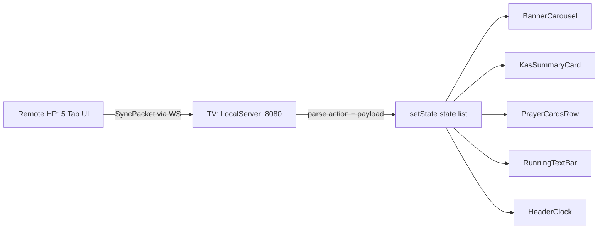

# Masjid You — Master Codebase Map (MAP.md)

> **Dokumentasi & Arsitektur Lengkap** untuk monorepo **`masjid-you`**.
> Sistem tampilan TV Masjid (Google TV / Android TV) + Remote HP pendamping, berjalan **offline** (WiFi lokal / WiFi Direct / BLE), sinkronisasi via WebSocket.

---

## 1. Daftar Isi & Navigasi

| Dokumen | Isi | Kapan Dibaca |
|---|---|---|
| **[MAP.md](MAP.md)** (file ini) | Peta arsitektur umum, peta fungsi per-file, navigasi lintas dokumen | Mulai dari sini |
| **[DECISIONS.md](DECISIONS.md)** | *Architectural Decision Records* (ADR): kenapa ditulis ulang, kenapa Flutter, kenapa WebSocket/P2P, kenapa fallback UI, kenapa `didUpdateWidget` | Memahami alasan desain |
| **[tv_display/widget_mapping.md](tv_display/widget_mapping.md)** | Bedah seluruh file `apps/tv_display/lib/`, fungsi tiap widget, state management, timer, penanganan layar TV | Bekerja di sisi TV |
| **[mobile_remote/tab_mapping.md](mobile_remote/tab_mapping.md)** | Bedah seluruh file `apps/mobile_remote/lib/`, fungsi 5 tab, GPS/geolocator, offset jadwal, indikator unsaved changes | Bekerja di sisi Remote |

**Cara cepat menemukan sesuatu:**

- Widget layar TV → [`tv_display/widget_mapping.md`](tv_display/widget_mapping.md)
- Form & tab Remote → [`mobile_remote/tab_mapping.md`](mobile_remote/tab_mapping.md)
- Protokol sinkronisasi & model data → lihat peta file `packages/shared_models` di bawah
- Alasan arsitektur → [`DECISIONS.md`](DECISIONS.md)

---

## 2. Peta Arsitektur Umum

```
┌─────────────────────────────────────────────────────────────────────┐
│                        MONOREPO masjid_you_workspace                │
│              (pubspec.yaml — Dart workspaces, Flutter ≥ 3.44.9)     │
└─────────────────────────────────────────────────────────────────────┘
                          │
        ┌─────────────────┼──────────────────────────────┐
        ▼                 ▼                              ▼
┌────────────────┐ ┌──────────────┐ ┌───────────────────────────────┐
│ apps/          │ │ apps/        │ │ packages/                     │
│ tv_display     │ │ mobile_remote│ │ shared_models                 │
│ (SISI TV)      │ │ (SISI HP)    │ │ (Paket model + logika shared) │
└───────┬────────┘ └──────┬───────┘ └───────────────┬───────────────┘
        │                 │                        │
        │  ★ SERVER WS    │  ★ CLIENT WS          │  diimpor oleh
        │  port 8080      │  connect(ip:8080)      │  kedua app
        │  anyIPv4        │                        │
        │                 ▼                        ▼
        │        ┌────────────────────┐    ┌──────────────────────────┐
        │        │ SYNC PACKET (JSON) │    │ MosqueConfig, MediaBanner,│
        │        │ SyncAction enum    │◄──►│ RunningTextMessage,       │
        │        │ + payload map      │    │ KasTransaction,           │
        │        └────────────────────┘    │ PrayerSchedule(adhan),   │
        └──────────────┬───────────────────┘ PrayerType               │
                       │                                              │
                       ▼  juga lewat WiFi Direct / BLE (tanpa router) │
        ┌─────────────────────────────────────────────────────────────┐
        │ flutter_p2p_connection 3.0.3                                 │
        │   TV: FlutterP2pHost  → createGroup(advertise:true)          │
        │   HP: FlutterP2pClient → startScan/connectWithDevice          │
        │   Handoff IP: HotspotClientState.hostGatewayIpAddress        │
        └─────────────────────────────────────────────────────────────┘
```

### 2.1 Alur data satu arah (konfigurasi → tampilan)



### 2.2 Teknologi utama per aplikasi

| Aspek | `tv_display` | `mobile_remote` | `shared_models` |
|---|---|---|---|
| Peran | Server WS + render TV | Client WS + editor | Model + perhitungan |
| Server | `shelf`, `shelf_web_socket` | — | — |
| Client WS | — | `web_socket_channel` | — |
| P2P | `flutter_p2p_connection` (host) | `flutter_p2p_connection` (client) | — |
| Lokasi | — | `geolocator` (GPS) | — |
| Jadwal sholat | — (hanya render) | simulasi via `PrayerSchedule` | `adhan` (offline) |
| Sleep | `wakelock_plus` | — | — |
| Izin Android | WiFi Direct, BLE, lokasi | WiFi Direct, BLE, lokasi | — |

---

## 3. Peta Fungsi Per-File

### 3.1 `apps/tv_display` — Aplikasi TV

| File | Fungsi Utama | Class / Method penting |
|---|---|---|
| `lib/main.dart` | Entrypoint TV, state global, orkestrasi server & p2p, layout layar | `MasjidYouTVApp`, `MasjidDisplayScreen` / `_MasjidDisplayScreenState` (`_initLocalServer`, `_initP2pHost`, `_recalculateSchedule`, `_fetchLocalIp`, `_clockTimer` 1 detik) |
| `lib/theme/app_theme.dart` | Tema gelap Material You | `AppTheme.darkTheme` (seed `0xFF006A60`, `CardThemeData` radius 28) |
| `lib/widgets/header_clock.dart` | Header: nama/alamat masjid, chip IP & P2P, jam besar + tanggal | `HeaderClock` (stateless, format `id_ID`) |
| `lib/widgets/banner_carousel.dart` | Carousel Info Masjid + fallback kosong + auto-scroll vertikal | `BannerCarousel` / `_BannerCarouselState`, `_BannerPage` / `_BannerPageState` (`_startTimer`, `_startAutoScroll`, `didUpdateWidget`) |
| `lib/widgets/kas_summary_card.dart` | Ringkasan kas (saldo, pemasukan, pengeluaran) | `KasSummaryCard`, `_KasAmountRow` |
| `lib/widgets/prayer_cards.dart` | Baris 6 kartu sholat + kartu "SELANJUTNYA" ring countdown | `PrayerCardsRow`, `_NextPrayerTimer` (`_remainingFraction`, `_formatDuration`) |
| `lib/widgets/running_text_bar.dart` | Running text marquee + badge INFORMASI + fallback kosong | `RunningTextBar` / `_RunningTextBarState` (`_startAutoScroll`, `didUpdateWidget`, `_buildEmptyState`, `_buildRunningState`) |
| `lib/server/local_ws_server.dart` | Server WebSocket `anyIPv4:8080`, daftar client, broadcast | `LocalServer` (`start`, `broadcast`, `stop`) |
| `lib/server/p2p_host_service.dart` | Host WiFi Direct (group + advertise) | `P2pHostService` (`start`, `stop`, `stateStream`) |
| `test/widget_test.dart` | Smoke test + regresi overflow 960×540 | — |
| `test/running_text_bar_test.dart` | Test kosong/terisi RunningTextBar | — |

### 3.2 `apps/mobile_remote` — Aplikasi Remote HP

| File | Fungsi Utama | Class / Method penting |
|---|---|---|
| `lib/main.dart` | Entrypoint Remote, 5 tab UI, koneksi WS & P2P, semua handler edit | `MasjidYouRemoteApp`, `RemoteHomeScreen` / `_RemoteHomeScreenState`, `_KasStatCard` |
| `lib/services/ws_client.dart` | Client WebSocket + helper kirim per tipe data | `RemoteWsClient` (`connect`, `sendConfigUpdate`, `sendRunningTextsUpdate`, `sendBannersUpdate`, `sendKasUpdate`, `disconnect`) |
| `lib/services/p2p_client_service.dart` | Scan & konek WiFi Direct/BLE | `P2pClientService` (`startScan`, `stopScan`, `connectTo`, `disconnect`, `stateStream`) |
| `test/widget_test.dart` | Smoke test | — |

### 3.3 `packages/shared_models` — Model & Logika Shared

| File | Fungsi Utama | Class / enum |
|---|---|---|
| `lib/src/sync_packet.dart` | Protokol sinkronisasi | `SyncAction` (enum), `SyncPacket` |
| `lib/src/mosque_config.dart` | Konfigurasi masjid + offset per sholat | `MosqueConfig`, `IqamahDuration` |
| `lib/src/prayer_type.dart` | Enum sholat + label Indonesia | `PrayerType`, `PrayerTypeX`, `kAllPrayerTypes` |
| `lib/src/prayer_schedule.dart` | Hitung jadwal sholat (adhan, offline) | `PrayerSchedule`, `PrayerScheduleItem`, `PrayerSchedule.calculate` |
| `lib/src/media_banner.dart` | Banner Info Masjid 4 bidang | `MediaBanner` (header/title/content/footer) |
| `lib/src/running_text.dart` | Teks berjalan | `RunningTextMessage` |
| `lib/src/kas_transaction.dart` | Transaksi kas + agregasi | `KasTransaction`, `KasType`, `KasSummary` |
| `lib/src/shared_models_base.dart` | Placeholder awal (belum dipakai) | `Awesome` |
| `lib/shared_models.dart` | Barrel export | — |
| `test/shared_models_test.dart` | 12 unit test | — |

---

## 4. Diagram Lapisan Tampilan TV

```
┌──────────────────────────────────────────────────────────────┐
│ Stack (fullscreen)                                           │
│  ├─ Image.network (background masjid)  → fallback warna       │
│  ├─ Overlay hitam alpha 0.85                                  │
│  └─ SafeArea + Padding(10) ─ Column ────────────────────────  │
│      ├─ HeaderClock (jam, tanggal, IP, P2P)                   │
│      ├─ Expanded(Row: BannerCarousel flex3 | KasSummary flex2)│
│      ├─ PrayerCardsRow (6 kartu)                              │
│      └─ RunningTextBar (badge + marquee / full-width kosong)  │
└──────────────────────────────────────────────────────────────┘
```

---

## 5. Protokol Sinkronisasi Singkat

```
Koneksi:  ws://<ip-TV>:8080        (TV listen anyIPv4:8080)
Frame:    {"action": "updateConfig|updateRunningText|updateBanners|updateKas", "payload": {...}}
Alur:     Remote memanggil helper → SyncPacket → JSON → WS → TV switch(action) → setState
```

Detail payload per aksi:

| `SyncAction` | `payload` |
|---|---|
| `updateConfig` | `MosqueConfig.toMap()` (termasuk `prayerOffsets`) |
| `updateRunningText` | `{'messages': [RunningTextMessage.toMap()...]}` |
| `updateBanners` | `{'banners': [MediaBanner.toMap()...]}` |
| `updateKas` | `{'transactions': [KasTransaction.toMap()...]}` |

---

## 6. Catatan Lingkungan & Konvensi

- **Flutter:** `3.44.9` (Flutter SDK), Dart SDK `>=3.5.0 <4.0.0`, `minSdkVersion` default Flutter = 24 (**Android 7.0+**).
- **NDK dipin** di kedua app: `ndkVersion = "30.0.15729638"`.
- **applicationId:** `com.masjidyou.tv_display` dan `com.masjidyou.mobile_remote`.
- **Emulator dev:** `emulator-5554` (Android TV, IP `10.0.2.15`), `emulator-5556` (Pixel phone, IP `10.0.2.16`). Viewport logis TV = 960×540 (1920×1080 @ density 2).
- **Port 8080** di host dev sering terisi proses lain → test widget mencetak *"Address already in use"* tetapi tetap lulus (server memakai port bebas / gagal-bangun-benar).
- **Izin Android** (dua-duanya): `NEARBY_WIFI_DEVICES`, `ACCESS/CHANGE_WIFI_STATE`, `ACCESS_NETWORK_STATE`, `CHANGE_NETWORK_STATE`, `ACCESS_FINE/COARSE_LOCATION`, `BLUETOOTH_SCAN/ADVERTISE/CONNECT` (+ legacy `BLUETOOTH`/`BLUETOOTH_ADMIN` maxSdk 30).
- **Repo bukan git** (belum ada version control aktif).

---

## 7. Perintah Umum

```bash
# Analisis statis
flutter analyze                     # (jalankan di apps/tv_display, apps/mobile_remote, packages/shared_models)

# Uji
flutter test                        # di masing-masing package/app

# Build APK debug (x64 untuk emulator)
flutter build apk --debug --target-platform android-x64

# Pasang ke emulator
adb -s emulator-5554 install -r build/app/outputs/flutter-apk/app-debug.apk   # TV
adb -s emulator-5556 install -r build/app/outputs/flutter-apk/app-debug.apk   # Remote
```

> Lanjut baca: [DECISIONS.md](DECISIONS.md) → [tv_display/widget_mapping.md](tv_display/widget_mapping.md) → [mobile_remote/tab_mapping.md](mobile_remote/tab_mapping.md)
