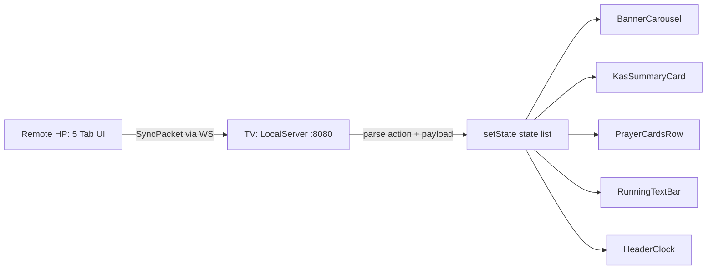

# Masjid You — Master Codebase Map (MAP.md)

> **Dokumentasi & Arsitektur Lengkap** untuk monorepo **`masjid-you`**.
> Sistem tampilan TV Masjid (Google TV / Android TV) + Remote HP pendamping, berjalan **offline** (WiFi lokal / WiFi Direct / BLE), sinkronisasi via WebSocket.

---

## 1. Daftar Isi & Navigasi

| Dokumen | Isi | Kapan Dibaca |
|---|---|---|
| **[MAP.md](MAP.md)** (file ini) | Peta arsitektur umum, peta fungsi per-file, navigasi lintas dokumen | Mulai dari sini |
| **[DECISIONS.md](DECISIONS.md)** | *Architectural Decision Records* (ADR): kenapa ditulis ulang, kenapa Flutter, kenapa WebSocket/P2P, kenapa fallback UI, kenapa `didUpdateWidget`, penanganan error P0, validasi prasyarat WiFi Direct TV & Remote | Memahami alasan desain |
| **[tv_display/widget_mapping.md](tv_display/widget_mapping.md)** | Bedah seluruh file `apps/tv_display/lib/`, fungsi tiap widget, state management, timer, penanganan layar TV | Bekerja di sisi TV |
| **[tv_display/m3_shapes.md](tv_display/m3_shapes.md)** | Arsitektur perubahan shape terbaru: manual `RoundedRectangleBorder(28)`, `ArchBorder`, model swap jam, penghapusan badge — apa/kenapa/bagaimana | Memahami tampilan/shape layar TV |
| **[tv_display/prayer_state_machine.md](tv_display/prayer_state_machine.md)** | Arsitektur siklus waktu shalat otomatis (state machine + overlay animasi): apa yang diubah, kenapa, bagaimana cara kerja, protokol & alur data | Memahami/mengubah fitur waktu shalat |
| **[mobile_remote/tab_mapping.md](mobile_remote/tab_mapping.md)** | Bedah seluruh file `apps/mobile_remote/lib/`, navigasi 6 halaman swipe (4 menu bawah + 3 sub-tab Konten), GPS/geolocator, offset jadwal, durasi siklus shalat, aksi cepat, indikator unsaved changes | Bekerja di sisi Remote |
| **[mobile_remote/theme_shapes.md](mobile_remote/theme_shapes.md)** | Arsitektur tema/shape Remote: revert dari M3 Expressive (`puffy`/clover) ke Material 3 standar (square) — apa/kenapa/bagaimana | Memahami tampilan/theme Remote |

**Cara cepat menemukan sesuatu:**

- Widget layar TV → [`tv_display/widget_mapping.md`](tv_display/widget_mapping.md)
- Tampilan/shape layar TV (perubahan terbaru) → [`tv_display/m3_shapes.md`](tv_display/m3_shapes.md)
- Siklus waktu shalat (state machine + overlay + aksi cepat Remote) → [`tv_display/prayer_state_machine.md`](tv_display/prayer_state_machine.md)
- Form, tab, & navigasi swipe Remote → [`mobile_remote/tab_mapping.md`](mobile_remote/tab_mapping.md)
- Tema/shape Remote (revert ke square) → [`mobile_remote/theme_shapes.md`](mobile_remote/theme_shapes.md)
- Protokol sinkronisasi & model data → lihat peta file `packages/shared_models` di bawah
- Alasan arsitektur → [`DECISIONS.md`](DECISIONS.md)

---

## 2. Peta Arsitektur Umum

```
┌─────────────────────────────────────────────────────────────────────┐
│                        MONOREPO masjid_you_workspace                │
│              (pubspec.yaml — Dart workspaces, Flutter ≥ 3.44.9)     │
└─────────────────────────────────────────────────────────────────────┘
                          │
        ┌─────────────────┼──────────────────────────────┐
        ▼                 ▼                              ▼
┌────────────────┐ ┌──────────────┐ ┌───────────────────────────────┐
│ apps/          │ │ apps/        │ │ packages/                     │
│ tv_display     │ │ mobile_remote│ │ shared_models                 │
│ (SISI TV)      │ │ (SISI HP)    │ │ (Paket model + logika shared) │
└───────┬────────┘ └──────┬───────┘ └───────────────┬───────────────┘
        │                 │                        │
        │  ★ SERVER WS    │  ★ CLIENT WS          │  diimpor oleh
        │  port 8080      │  connect(ip:8080)      │  kedua app
        │  anyIPv4        │                        │
        │                 ▼                        ▼
        │        ┌────────────────────┐    ┌──────────────────────────┐
        │        │ SYNC PACKET (JSON) │    │ MosqueConfig, MediaBanner,│
        │        │ SyncAction enum    │◄──►│ RunningTextMessage,       │
        │        │ + payload map      │    │ KasTransaction,           │
        │        └────────────────────┘    │ PrayerSchedule(adhan),   │
        └──────────────┬───────────────────┘ PrayerType               │
                       │                                              │
                       ▼  juga lewat WiFi Direct / BLE (tanpa router) │
        ┌─────────────────────────────────────────────────────────────┐
        │ flutter_p2p_connection 3.0.3                                 │
        │   TV: FlutterP2pHost  → createGroup(advertise:true)          │
        │   HP: FlutterP2pClient → startScan/connectWithDevice          │
        │   Handoff IP: HotspotClientState.hostGatewayIpAddress        │
        └─────────────────────────────────────────────────────────────┘
```

### 2.1 Alur data satu arah (konfigurasi → tampilan)



### 2.2 Teknologi utama per aplikasi

| Aspek | `tv_display` | `mobile_remote` | `shared_models` |
|---|---|---|---|
| Peran | Server WS + render TV | Client WS + editor | Model + perhitungan |
| Server | `shelf`, `shelf_web_socket` | — | — |
| Client WS | — | `web_socket_channel` | — |
| P2P | `flutter_p2p_connection` (host) | `flutter_p2p_connection` (client) | — |
| Lokasi | — | `geolocator` (GPS) | — |
| Jadwal sholat | — (hanya render) | simulasi via `PrayerSchedule` | `adhan` (offline) |
| Sleep | `wakelock_plus` | — | — |
| Izin Android | WiFi Direct, BLE, lokasi | WiFi Direct, BLE, lokasi | — |

---

## 3. Peta Fungsi Per-File

### 3.1 `apps/tv_display` — Aplikasi TV

| File | Fungsi Utama | Class / Method penting |
|---|---|---|
| `lib/main.dart` | Entrypoint TV, state global, orkestrasi server & p2p, layout layar, driver state machine | `MasjidYouTVApp`, `MasjidDisplayScreen` / `_MasjidDisplayScreenState` (`_initLocalServer`, `_initP2pHost`, `_recalculateSchedule`, `_fetchLocalIp`, `_clockTimer` 1 detik, `_broadcastState`) |
| `lib/theme/app_theme.dart` | Tema gelap Material You | `AppTheme.darkTheme` (seed `0xFF006A60`, `CardThemeData` puffy) |
| `lib/theme/m3_shape_border.dart` | Wrapper polygon M3 + arch manual | `M3ShapeBorder` (`MaterialShapes.*` → `ShapeBorder`), `ArchBorder` (dome di dalam bounds) |
| `lib/state/prayer_state_machine.dart` | Manager siklus waktu shalat otomatis `NORMAL→PRE_ADHAN→ADHAN→(KHUTBAH Jumat)→PRE_IQOMAH→SHALAT` | `PrayerStateMachine` (`tick`, `skipAdhan(now)`, `startIqomah`, `startShalat`, `finishShalat`, `updateConfig`, `progress`) |
| `lib/widgets/prayer_state_overlay.dart` | Overlay layar penuh + CustomPainter animasi (circular ring, wavy progress, khutbah Jumat, layar redup shalat) | `PrayerStateOverlay`, `_KhutbahOverlay`, `_StaffChip`, `_WavyProgressPainter`, `_CircularRingPainter` |
| `lib/widgets/header_clock.dart` | Header: nama/alamat masjid, chip IP & P2P, jam besar + tanggal (kapsul `ArchBorder`) | `HeaderClock` (stateless, format `id_ID`) |
| `lib/widgets/banner_carousel.dart` | Carousel Info Masjid + fallback kosong + auto-scroll vertikal | `BannerCarousel` / `_BannerCarouselState`, `_BannerPage` / `_BannerPageState` (`_startTimer`, `_startAutoScroll`, `didUpdateWidget`) |
| `lib/widgets/kas_summary_card.dart` | Ringkasan kas (saldo, pemasukan, pengeluaran) | `KasSummaryCard`, `_KasAmountRow` |
| `lib/widgets/friday_staff_card.dart` | Kartu Petugas Hari Jumat (Khatib & Muadzin), tampil bergantian dgn Kartu Kas tiap 10 dtk di hari Jumat | `FridayStaffCard`, `_StaffRow` |
| `lib/widgets/prayer_cards.dart` | Baris 6 kartu sholat + ring *swap* countdown/waktu pada kartu aktif (Dzuhur→"Jumat" di hari Jumat) | `PrayerCardsRow`, `_NextPrayerTimer` (`_remainingFraction`, `_formatDuration`, swap 4 dtk) |
| `lib/widgets/running_text_bar.dart` | Running text marquee + badge INFORMASI + fallback kosong | `RunningTextBar` / `_RunningTextBarState` (`_startAutoScroll`, `didUpdateWidget`, `_buildEmptyState`, `_buildRunningState`) |
| `lib/server/local_ws_server.dart` | Server WebSocket `anyIPv4:8080`, daftar client, broadcast | `LocalServer` (`start`, `broadcast`, `stop`) |
| `lib/server/p2p_host_service.dart` | Host WiFi Direct (group + advertise) | `P2pHostService` (`start`, `stop`, `stateStream`) |
| `test/widget_test.dart` | Smoke test + regresi overflow 960×540 | — |
| `test/running_text_bar_test.dart` | Test kosong/terisi RunningTextBar | — |
| `test/prayer_state_machine_test.dart` | 19 unit test: group **Hari Biasa** (16) + group **Hari Jumat** (3: khutbah di auto-cycle, `skipAdhan`/`startIqomah`, no-op) | — |
| `test/prayer_state_overlay_test.dart` | 5 widget test overlay (4 fase, bebas overflow 960×540) | — |

> **Detail arsitektur siklus waktu shalat** (state machine, overlay, protokol, alur data): → [`tv_display/prayer_state_machine.md`](tv_display/prayer_state_machine.md)
>
> **Detail perubahan shape terbaru** (manual shapes, `ArchBorder`, model swap, penghapusan badge): → [`tv_display/m3_shapes.md`](tv_display/m3_shapes.md)

### 3.2 `apps/mobile_remote` — Aplikasi Remote HP

| File | Fungsi Utama | Class / Method penting |
|---|---|---|
| `lib/main.dart` | Entrypoint Remote, mengorkestrasikan navigasi dan menyelaraskan callback state serta form controllers; validasi prasyarat WiFi Direct (`checkPrerequisites`) sebelum scan + dialog "WiFi Direct Belum Siap" | `MasjidYouRemoteApp`, `RemoteHomeScreen` / `_RemoteHomeScreenState` |
| `lib/theme/remote_theme.dart` | Konfigurasi tersentralisasi tema Material 3 standar Remote | `buildRemoteTheme` |
| `lib/widgets/m3_pressable.dart` | Widget interaktif dengan umpan balik gerakan spring M3 Expressive | `M3Pressable` |
| `lib/widgets/playful_nav_icon.dart` | Ikon navigasi dinamis dengan mikro-animasi lompatan elastis dan putaran | `PlayfulNavIcon` |
| `lib/widgets/kas_stat_card.dart` | Kartu visual untuk ringkasan nominal kas masuk, keluar, dan saldo | `KasStatCard` |
| `lib/screens/settings/settings_tab.dart` | Layar pengaturan identitas masjid, GPS, durasi siklus shalat, aksi cepat, dan tombol simulasi | `SettingsTab` |
| `lib/screens/content/running_text_subtab.dart` | Editor pesan running text berjalan berdasarkan kategori | `RunningTextSubtab` |
| `lib/screens/content/banners_subtab.dart` | Editor banner informasi masjid multi-bidang dengan kendali sakelar aktif | `BannersSubtab` |
| `lib/screens/content/kas_subtab.dart` | Manajemen data kas masuk/keluar, input nominal, dan riwayat transaksi | `KasSubtab` |
| `lib/screens/connectivity/connectivity_tab.dart` | Pengaturan koneksi jaringan nirkabel WebSocket manual dan pencarian WiFi Direct TV | `ConnectivityTab` |
| `lib/screens/simulation/simulation_tab.dart` | Menu tes simulasi untuk memicu paksa fase siklus shalat TV | `SimulationTab` |
| `lib/services/ws_client.dart` | Client WebSocket + helper kirim per tipe data + listen paket masuk | `RemoteWsClient` (`connect`, `sendConfigUpdate`, `sendRunningTextsUpdate`, `sendBannersUpdate`, `sendKasUpdate`, `sendSkipAdhan`, `sendStartIqomah`, `sendStartShalat`, `sendFinishShalat`, `sendForcePhase`, `onPacket`, `disconnect`) |
| `lib/services/p2p_client_service.dart` | Scan & konek WiFi Direct/BLE; validasi prasyarat (model `P2pPrerequisites` + `checkPrerequisites`) mirror TV (ADR-015) | `P2pClientService` (`startScan`, `stopScan`, `connectTo`, `disconnect`, `stateStream`, `checkPrerequisites`, `enableWifiIfNeeded`, `enableBluetoothIfNeeded`, `enableLocationIfNeeded`, `askPermissionsIfNeeded`) |
| `test/widget_test.dart` | Smoke test | — |

> **Detail tema/shape Remote** (revert M3 Expressive → square): → [`mobile_remote/theme_shapes.md`](mobile_remote/theme_shapes.md)

> **Durasi siklus shalat & aksi cepat di tab Pengaturan** → detail di [`tv_display/prayer_state_machine.md`](tv_display/prayer_state_machine.md) & [`mobile_remote/tab_mapping.md`](mobile_remote/tab_mapping.md)

### 3.3 `packages/shared_models` — Model & Logika Shared

| File | Fungsi Utama | Class / enum |
|---|---|---|
| `lib/src/sync_packet.dart` | Protokol sinkronisasi | `SyncAction` (enum: `...`, `skipAdhan`, `startIqomah`, `startShalat`, `finishShalat`, `forcePhase`), `SyncPacket` |
| `lib/src/prayer_phase.dart` | Fase siklus waktu shalat (protokol `stateUpdate`) | `PrayerPhase` (enum: normal/preAdhan/adhan/**khutbah**/preIqomah/shalat), `PrayerPhaseX` (`label`, `durationFor`) |
| `lib/src/mosque_config.dart` | Konfigurasi masjid + offset per sholat + durasi siklus + **petugas Jumat** (`khutbahMinutes`, `fridayKhatib`, `fridayMuadzin`) | `MosqueConfig`, `IqamahDuration` |
| `lib/src/prayer_type.dart` | Enum sholat + label Indonesia + `displayNameForDate` (Dzuhur→"Jumat" di hari Jumat) | `PrayerType`, `PrayerTypeX`, `kAllPrayerTypes` |
| `lib/src/prayer_schedule.dart` | Hitung jadwal sholat (adhan, offline) | `PrayerSchedule`, `PrayerScheduleItem`, `PrayerSchedule.calculate` |
| `lib/src/media_banner.dart` | Banner Info Masjid 4 bidang | `MediaBanner` (header/title/content/footer, `copyWith(clearBase64Image:)`) |
| `lib/src/running_text.dart` | Teks berjalan | `RunningTextMessage` |
| `lib/src/kas_transaction.dart` | Transaksi kas + agregasi | `KasTransaction`, `KasType`, `KasSummary` |
| `lib/shared_models.dart` | Barrel export | — |
| `test/shared_models_test.dart` | 41 unit test (round-trip, fallback payload, equality, unmodifiable offsets) | — |

---

## 4. Diagram Lapisan Tampilan TV

```
┌──────────────────────────────────────────────────────────────┐
│ Stack (fullscreen)                                           │
│  ├─ Image.network (background masjid)  → fallback warna       │
│  ├─ Overlay hitam alpha 0.85                                  │
│  └─ SafeArea + Padding(10) ─ Column ────────────────────────  │
│      ├─ HeaderClock (jam, tanggal, IP, P2P)                   │
│      ├─ Expanded(Row: BannerCarousel flex3 | KasSummary flex2)│
│      ├─ PrayerCardsRow (6 kartu)                              │
│      └─ RunningTextBar (badge + marquee / full-width kosong)  │
└──────────────────────────────────────────────────────────────┘
```

---

## 5. Protokol Sinkronisasi Singkat

```
Koneksi:  ws://<ip-TV>:8080        (TV listen anyIPv4:8080)
Frame:    {"action": "updateConfig|updateRunningText|updateBanners|updateKas", "payload": {...}}
Alur:     Remote memanggil helper → SyncPacket → JSON → WS → TV switch(action) → setState
```

Detail payload per aksi:

| `SyncAction` | `payload` |
|---|---|
| `updateConfig` | `MosqueConfig.toMap()` (termasuk `prayerOffsets`, `preAdhanMinutes`, `adhanMinutes`, `preIqomahMinutes`, `shalatMinutes`) |
| `updateRunningText` | `{'messages': [RunningTextMessage.toMap()...]}` |
| `updateBanners` | `{'banners': [MediaBanner.toMap()...]}` |
| `updateKas` | `{'transactions': [KasTransaction.toMap()...]}` |
| `skipAdhan` | `{}` — Remote meminta TV loncat `ADHAN → PRE_IQOMAH` |
| `startShalat` | `{}` — Remote meminta TV loncat `PRE_IQOMAH → SHALAT` |
| `finishShalat` | `{}` — Remote meminta TV loncat `SHALAT → NORMAL` |
| `forcePhase` | `{'phase': 'normal\|preAdhan\|adhan\|preIqomah\|shalat'}` — Menu Tes memaksa TV masuk fase tersebut (durasi penuh dari config) |
| `stateUpdate` (TV → Remote) | `{'phase': 'normal\|preAdhan\|adhan\|preIqomah\|shalat', 'prayer': 'maghrib', 'remainingSeconds': int, 'totalSeconds': int}` |
| `getInitialState` | `{}` — Remote meminta TV mengirim ulang status (`stateUpdate`) |

---

## 6. Catatan Lingkungan & Konvensi

- **Flutter:** `3.44.9` (Flutter SDK), Dart SDK `>=3.5.0 <4.0.0`, `minSdkVersion` default Flutter = 24 (**Android 7.0+**).
- **NDK dipin** di kedua app: `ndkVersion = "30.0.15729638"`.
- **`shared_preferences`** hanya di `mobile_remote` (persist durasi siklus waktu shalat).
- **applicationId:** `com.masjidyou.tv_display` dan `com.masjidyou.mobile_remote`.
- **Emulator dev:** `emulator-5556` (Android TV, IP `10.0.2.15`), `emulator-5554` (Pixel phone, IP `10.0.2.16`). Viewport logis TV = 960×540 (1920×1080 @ density 2).
- **Port 8080** di host dev sering terisi proses lain → test widget mencetak *"Address already in use"* tetapi tetap lulus (server memakai port bebas / gagal-bangun-benar).
- **Izin Android** (dua-duanya): `NEARBY_WIFI_DEVICES`, `ACCESS/CHANGE_WIFI_STATE`, `ACCESS_NETWORK_STATE`, `CHANGE_NETWORK_STATE`, `ACCESS_FINE/COARSE_LOCATION`, `BLUETOOTH_SCAN/ADVERTISE/CONNECT` (+ legacy `BLUETOOTH`/`BLUETOOTH_ADMIN` maxSdk 30).
- **Repo bukan git** (belum ada version control aktif).

---

## 7. Perintah Umum

```bash
# Analisis statis
flutter analyze                     # (jalankan di apps/tv_display, apps/mobile_remote, packages/shared_models)

# Uji
flutter test                        # di masing-masing package/app

# Build APK debug (x64 untuk emulator)
flutter build apk --debug --target-platform android-x64

# Pasang ke emulator
adb -s emulator-5556 install -r build/app/outputs/flutter-apk/app-debug.apk   # TV (Android TV)
adb -s emulator-5554 install -r build/app/outputs/flutter-apk/app-debug.apk   # Remote (HP)
```

> Lanjut baca: [DECISIONS.md](DECISIONS.md) → [tv_display/widget_mapping.md](tv_display/widget_mapping.md) → [tv_display/m3_shapes.md](tv_display/m3_shapes.md) → [tv_display/prayer_state_machine.md](tv_display/prayer_state_machine.md) → [mobile_remote/tab_mapping.md](mobile_remote/tab_mapping.md) → [mobile_remote/theme_shapes.md](mobile_remote/theme_shapes.md)
