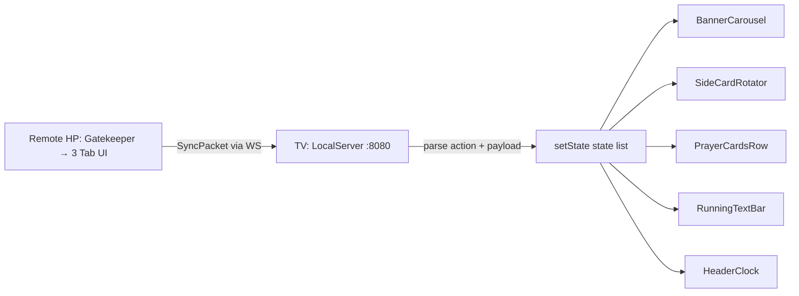

# Masjid You — Master Codebase Map (MAP.md)

> **Dokumentasi & Arsitektur Lengkap** untuk monorepo **`masjid-you`**.
> Sistem tampilan TV Masjid (Google TV / Android TV) + Remote HP pendamping, berjalan **offline** (WiFi lokal / Bluetooth Classic RFCOMM), sinkronisasi via WebSocket atau Bluetooth. Remote HP memakai layar sambungan (gatekeeper) sebelum masuk menu utama.

---

## 1. Daftar Isi & Navigasi

| Dokumen | Isi | Kapan Dibaca |
|---|---|---|
| **[MAP.md](MAP.md)** (file ini) | Peta arsitektur umum, peta fungsi per-file, navigasi lintas dokumen | Mulai dari sini |
| **[DECISIONS.md](DECISIONS.md)** | *Architectural Decision Records* (ADR): kenapa ditulis ulang, kenapa Flutter, kenapa WebSocket, kenapa fallback UI, kenapa `didUpdateWidget`, penanganan error P0, validasi prasyarat WiFi Direct TV & Remote, transport Bluetooth RFCOMM (ADR-016), cek lokasi discovery Bluetooth Android ≤11 (ADR-017), rotasi kartu slot samping TV + toggle kas/Jumatan (ADR-021) | Memahami alasan desain |
| **[codebase_index.md](codebase_index.md)** | Indeks simbol otomatis (class/fungsi/enum/field) per `file:baris` — hasil `dart run tools/codebase_index.dart`; wajib regenerasi setelah ubah `lib/` | Mencari fungsi/simbol tanpa membaca semua file |
| **[bt_rfcomm_rough_plan.md](bt_rfcomm_rough_plan.md)** | Rencana kasar perbaikan Bluetooth RFCOMM: daftar bug per prioritas + status tiap item (`[DIPATCH]` / `[SUDAH BENAR]` / `[TERBUKA]`) | Bekerja di jalur Bluetooth |
| **[tv_display/widget_mapping.md](tv_display/widget_mapping.md)** | Bedah seluruh file `apps/tv_display/lib/`, fungsi tiap widget, state management, timer, penanganan layar TV | Bekerja di sisi TV |
| **[tv_display/m3_shapes.md](tv_display/m3_shapes.md)** | Arsitektur perubahan shape terbaru: manual `RoundedRectangleBorder(28)`, `ArchBorder`, model swap jam, penghapusan badge — apa/kenapa/bagaimana | Memahami tampilan/shape layar TV |
| **[tv_display/prayer_state_machine.md](tv_display/prayer_state_machine.md)** | Arsitektur siklus waktu shalat otomatis (state machine + overlay animasi): apa yang diubah, kenapa, bagaimana cara kerja, protokol & alur data | Memahami/mengubah fitur waktu shalat |
| **[mobile_remote/tab_mapping.md](mobile_remote/tab_mapping.md)** | Bedah seluruh file `apps/mobile_remote/lib/`, navigasi 6 halaman swipe (4 menu bawah + 3 sub-tab Konten), GPS/geolocator, offset jadwal, durasi siklus shalat, aksi cepat, indikator unsaved changes | Bekerja di sisi Remote |
| **[mobile_remote/theme_shapes.md](mobile_remote/theme_shapes.md)** | Arsitektur tema/shape Remote: revert dari M3 Expressive (`puffy`/clover) ke Material 3 standar (square) — apa/kenapa/bagaimana | Memahami tampilan/theme Remote |

**Cara cepat menemukan sesuatu:**

- Widget layar TV → [`tv_display/widget_mapping.md`](tv_display/widget_mapping.md)
- Tampilan/shape layar TV (perubahan terbaru) → [`tv_display/m3_shapes.md`](tv_display/m3_shapes.md)
- Siklus waktu shalat (state machine + overlay + aksi cepat Remote) → [`tv_display/prayer_state_machine.md`](tv_display/prayer_state_machine.md)
- Form, tab, & navigasi swipe Remote → [`mobile_remote/tab_mapping.md`](mobile_remote/tab_mapping.md)
- Tema/shape Remote (revert ke square) → [`mobile_remote/theme_shapes.md`](mobile_remote/theme_shapes.md)
- Protokol sinkronisasi & model data → lihat peta file `packages/shared_models` di bawah
- Alasan arsitektur → [`DECISIONS.md`](DECISIONS.md)
- Cari simbol (fungsi/class/enum) → [`codebase_index.md`](codebase_index.md), skill `codebase-lookup`, atau MCP `codebase-index` (lihat [`AGENTS.md`](../AGENTS.md))

---

## 2. Peta Arsitektur Umum

```
┌─────────────────────────────────────────────────────────────────────┐
│                        MONOREPO masjid_you_workspace                │
│              (pubspec.yaml — Dart workspaces, Flutter ≥ 3.44.9)     │
└─────────────────────────────────────────────────────────────────────┘
                          │
        ┌─────────────────┼──────────────────────────────┐
        ▼                 ▼                              ▼
┌────────────────┐ ┌──────────────┐ ┌───────────────────────────────┐
│ apps/          │ │ apps/        │ │ packages/                     │
│ tv_display     │ │ mobile_remote│ │ shared_models                 │
│ (SISI TV)      │ │ (SISI HP)    │ │ (Paket model + logika shared) │
└───────┬────────┘ └──────┬───────┘ └───────────────┬───────────────┘
        │                 │                        │
        │  ★ SERVER WS    │  ★ CLIENT WS          │  diimpor oleh
        │  port 8080      │  connect(ip:8080)      │  kedua app
        │  anyIPv4        │                        │
        │                 ▼                        ▼
        │        ┌────────────────────┐    ┌──────────────────────────┐
        │        │ SYNC PACKET (JSON) │    │ MosqueConfig, MediaBanner,│
        │        │ SyncAction enum    │◄──►│ RunningTextMessage,       │
        │        │ + payload map      │    │ KasTransaction,           │
        │        └────────────────────┘    │ PrayerSchedule(adhan),   │
        └──────────────┬───────────────────┘ PrayerType               │
                       │                                              │
                       ▼  juga lewat Bluetooth RFCOMM (tanpa router)      │
        ┌─────────────────────────────────────────────────────────────┐
        │ bluetooth_sync (RFCOMM, framing 4-byte big-endian)           │
        │   TV: BluetoothHostService → listenUsingInsecureRfcomm        │
        │   HP: BluetoothClientService → discovery + connect            │
        └─────────────────────────────────────────────────────────────┘
```

### 2.1 Alur data satu arah (konfigurasi → tampilan)



### 2.2 Teknologi utama per aplikasi

| Aspek | `tv_display` | `mobile_remote` | `shared_models` |
|---|---|---|---|
| Peran | Server WS + render TV | Client WS + editor | Model + perhitungan |
| Server | `shelf`, `shelf_web_socket` | — | — |
| Client WS | — | `web_socket_channel` | — |
| Bluetooth | `bluetooth_sync` (RFCOMM host) | `bluetooth_sync` (RFCOMM client) | — |
| Lokasi | — | `geolocator` (GPS) | — |
| Jadwal sholat | — (hanya render) | simulasi via `PrayerSchedule` | `adhan` (offline) |
| Sleep | `wakelock_plus` | — | — |
| Izin Android | Bluetooth CONNECT + ADVERTISE, lokasi | Bluetooth CONNECT + SCAN, jaringan, lokasi | — |

---

## 3. Peta Fungsi Per-File

### 3.1 `apps/tv_display` — Aplikasi TV

| File | Fungsi Utama | Class / Method penting |
|---|---|---|
| `lib/main.dart` | Entrypoint TV, state global, orkestrasi server & p2p, layout layar, driver state machine, tangkap tombol Back untuk buka Menu Admin | `MasjidYouTVApp`, `MasjidDisplayScreen` / `_MasjidDisplayScreenState` (`_initLocalServer`, `_initBluetoothHost`, `_toggleBluetooth`, `_recalculateSchedule`, `_clockTimer` 1 detik, `_broadcastState`, `_broadcastSnapshot`, `_showAdminMenu`, root `PopScope(canPop: false)`); state `_sideImages` untuk rotasi kartu samping |
| `lib/widgets/admin_menu_overlay.dart` | Side panel admin slide-in dari sisi KANAN (400px full-height, scrim hitam 0.85): **kartu PIN 4 digit di PALING ATAS** (terbaca dari jarak jauh tanpa navigasi D-Pad), lalu daftar aksi D-Pad (toggle BT → Mode Pairing → kembali) dengan `Focus` autofocus di item pertama, highlight fokus border teal 2px + glow, OK/Enter memicu aksi, `PopScope` + tombol `goBack` menutup panel; status koneksi display-only + countdown Mode Pairing + teks IP TV (ADR-029); semua container `RoundedRectangleBorder` 12/16 (menimpa `cardTheme` puffy). Aksi "Salin PIN" dihapus — kartu PIN sudah di atas sehingga clipboard tidak lagi berguna di TV (ADR-020) | `AdminMenuOverlay` (`btEnabled`, `pin`, `statusText`, `isError`, `ipText`, `pairingActive`, `pairingRemainingSeconds`, `onStartPairingMode`, `onToggleBluetooth`, `onClose`), `_FocusableAction`, `formatPairingCountdown` |
| `lib/server/bluetooth_host_service.dart` | Host RFCOMM dengan **autentikasi PIN Challenge-Response**: generate PIN 4-digit + nonce hex 128-bit tiap koneksi, kirim `authChallenge`, verifikasi `authResponse`, tolak paket data sebelum autentikasi, kunci setelah 3x salah (`authFailure` → disconnect). **Mode Pairing (ADR-029)**: discoverable hanya lewat `startPairingMode()` (satu kali, 300 detik, deadline + timer satu-kali) — tidak ada lagi re-arm discoverable berkala | `BluetoothHostService` (`start`, `stop`, `broadcast`, `startPairingMode`, `pin`, `pairingActive`, `pairingRemaining`, `stateStream`), `BluetoothHostStatus` (idle/listening/connected/error), `BluetoothHostState` (`authenticated`, `isAuthenticated`, `pairingActive`, `pairingRemainingSeconds`) |
| `lib/theme/app_theme.dart` | Tema gelap Material You | `AppTheme.darkTheme` (seed `0xFF006A60`, `CardThemeData` puffy) |
| `lib/theme/m3_shape_border.dart` | Wrapper polygon M3 + arch manual | `M3ShapeBorder` (`MaterialShapes.*` → `ShapeBorder`), `ArchBorder` (dome di dalam bounds) |
| `lib/state/prayer_state_machine.dart` | Manager siklus waktu shalat otomatis `NORMAL→PRE_ADHAN→ADHAN→(KHUTBAH Jumat)→PRE_IQOMAH→SHALAT`; fase khutbah hanya bila `hasFridayPrayer` aktif (musholla: Dzuhur seperti hari biasa); `skipToNextPhase` = tombol OK remote TV (ADR-030) | `PrayerStateMachine` (`tick`, `skipAdhan(now)`, `startIqomah`, `startShalat`, `finishShalat`, `skipToNextPhase`, `forcePhase`, `updateConfig`, `progress`) |
| `lib/state/side_card_playlist.dart` | Susunan murni rotasi slot samping TV: `[Kas (bila showKas)] -> [Petugas Jumat (bila Jumat & hasFridayPrayer)] -> [gambar khusus aktif]` (ADR-021) | `SideCardKind`, `SideCardItem`, `buildSideCardPlaylist` |
| `lib/state/tv_store.dart` | Persist lokal data resmi TV (trust source) per blok JSON `tv_*`, termasuk `tv_sideImages` & `tv_backgroundImages`; status kontrol tampilan `tv_muted`/`tv_standby` terpisah (bukan data resmi, ADR-023); flag intro Mode Pairing `tv_btPairingIntroDone` (ADR-029) | `TvStore` (`load`, `saveConfig`, `saveRunningTexts`, `saveBanners`, `saveKas`, `saveSideImages`, `saveBackgroundImages`, `loadDisplayState`, `saveMuted`, `saveStandby`, `loadPairingIntroDone`, `savePairingIntroDone`) |
| `lib/state/local_ip.dart` | Pemilih alamat IPv4 lokal TV untuk menu admin (ADR-029): utamakan Wi-Fi lalu ethernet, abaikan loopback/link-local; `null` = tidak ada jaringan | `pickLocalIpv4`, `loadLocalIpv4`, `formatTvIpText`, `NetworkInterfaceInfo` |
| `lib/widgets/prayer_state_overlay.dart` | Overlay layar penuh + CustomPainter animasi (circular ring, wavy progress, khutbah Jumat, layar redup shalat) | `PrayerStateOverlay`, `_KhutbahOverlay`, `_StaffChip`, `_WavyProgressPainter`, `_CircularRingPainter` |
| `lib/widgets/header_clock.dart` | Header: logo masjid opsional 1:1 76px di kiri (ADR-032; tanpa logo tata letak identik seperti semula), nama masjid 30px + alamat (chip "Remote Sync IP" & "Mode Bluetooth" dihapus, ADR-018), chip WiFi Direct, jam besar + tanggal | `HeaderClock` (stateless, format `id_ID`) |
| `lib/widgets/banner_carousel.dart` | Carousel Info Masjid + fallback kosong + auto-scroll vertikal | `BannerCarousel` / `_BannerCarouselState`, `_BannerPage` / `_BannerPageState` (`_startTimer`, `_startAutoScroll`, `didUpdateWidget`) |
| `lib/widgets/kas_summary_card.dart` | Ringkasan kas (saldo, pemasukan, pengeluaran) | `KasSummaryCard`, `_KasAmountRow` |
| `lib/widgets/friday_staff_card.dart` | Kartu Petugas Hari Jumat (Khatib & Muadzin); satu entri rotasi `SideCardRotator` khusus hari Jumat | `FridayStaffCard`, `_StaffRow` |
| `lib/widgets/side_card_rotator.dart` | Rotator slot samping (kanan) TV: playlist `buildSideCardPlaylist` bergiliran tiap 10 dtk (AnimatedSwitcher), 1 kartu = statis, kosong = placeholder (ADR-021) | `SideCardRotator`, `_SidePlaceholderCard` |
| `lib/widgets/background_slideshow.dart` | Slideshow gambar latar TV dari Remote: rotasi per interval config dengan crossfade, gambar non-aktif dilewati, daftar kosong -> fallback wallpaper bawaan (ADR-031) | `BackgroundSlideshow`, `nextSlideshowIndex` |
| `lib/widgets/special_image_card.dart` | Kartu gambar khusus penuh satu kartu + caption bawah; fallback ikon bila base64 rusak | `SpecialImageCard` |
| `lib/widgets/prayer_cards.dart` | Baris 6 kartu sholat + ring *swap* countdown/waktu pada kartu aktif (Dzuhur→"Jumat" di hari Jumat, nonaktif bila `hasFridayPrayer` mati) | `PrayerCardsRow` (`hasFridayPrayer`), `_NextPrayerTimer` (`_remainingFraction`, `_formatDuration`, swap 4 dtk) |
| `lib/widgets/running_text_bar.dart` | Running text full-width 44px flush dasar layar (tanpa margin/radius), badge INFORMASI menyatu, fallback kosong | `RunningTextBar` / `_RunningTextBarState` (`_startAutoScroll`, `didUpdateWidget`, `_buildEmptyState`, `_buildRunningState`) |
| `lib/server/local_ws_server.dart` | Server WebSocket `anyIPv4:8080`, daftar client, broadcast | `LocalServer` (`start`, `broadcast`, `stop`) |
| `lib/server/p2p_host_service.dart` | Host WiFi Direct (group + advertise) | `P2pHostService` (`start`, `stop`, `stateStream`) |
| `test/widget_test.dart` | Smoke test + regresi overflow 960×540 | — |
| `test/running_text_bar_test.dart` | Test kosong/terisi RunningTextBar | — |
| `test/prayer_state_machine_test.dart` | 22 unit test: group **Hari Biasa** (16) + group **Hari Jumat** (3: khutbah di auto-cycle, `skipAdhan`/`startIqomah`, no-op) + group **Musholla** (3: tanpa khutbah saat `hasFridayPrayer=false`) | — |
| `test/side_card_playlist_test.dart` | 9 unit test susunan rotasi slot samping (kombinasi toggle × hari × gambar) | — |
| `test/side_card_rotator_test.dart` | 6 widget test rotator (urutan Jumat, musholla, kas mati, placeholder, gambar rusak) | — |
| `test/prayer_state_overlay_test.dart` | 5 widget test overlay (4 fase, bebas overflow 960×540) | — |
| `test/admin_menu_overlay_test.dart` | Test side panel admin (slide-in, toggle BT, tampil PIN, tombol Back menutup) | — |
| `test/bluetooth_host_service_test.dart` | Test autentikasi challenge-response PIN host Bluetooth | — |

> **Detail arsitektur siklus waktu shalat** (state machine, overlay, protokol, alur data): → [`tv_display/prayer_state_machine.md`](tv_display/prayer_state_machine.md)
>
> **Detail perubahan shape terbaru** (manual shapes, `ArchBorder`, model swap, penghapusan badge): → [`tv_display/m3_shapes.md`](tv_display/m3_shapes.md)

### 3.2 `apps/mobile_remote` — Aplikasi Remote HP

| File | Fungsi Utama | Class / Method penting |
|---|---|---|
| `lib/main.dart` | Entrypoint Remote: gatekeeper koneksi (hanya menu utama setelah terhubung & terverifikasi), orkestrasi state/data utama, badge status koneksi di AppBar (klik → Putuskan Koneksi), banner disconnect + aksi Sambungkan Ulang, dialog resolusi konflik sinkronisasi saat reconnect (Gunakan Data TV / Gunakan Data HP), dialog PIN BT (`_PinDialog` stateful, controller dimilikinya sendiri), lifecycle koneksi. Dialog & snackbar selalu memakai `appNavigatorKey`/`appMessengerKey` global; state BT ditahan (`_pendingBtState`) selama dialog pairing terbuka lalu diterapkan setelah route dialog lepas — mencegah assertion `_dependents.isEmpty` saat transisi gatekeeper ↔ menu utama | `MasjidYouRemoteApp`, `RemoteHomeScreen` / `_RemoteHomeScreenState` (`_handleConnectionEstablished`, `_handleTransportDisconnected`, `_reconnectLast`, `_showSyncConflictDialog`, `_disconnectFromTv`, `_buildConnectionBadge`, `_buildDisconnectedBanner`, `_showPinDialog`, `_closePinDialog`, `_drainPendingBtState`, `_connectBt`, `_connectToTv`), `_PinDialog` |
| `lib/theme/remote_theme.dart` | Konfigurasi tersentralisasi tema Material 3 standar Remote: skema dari dynamic color (wallpaper) atau seed "Hijau Masjid", tema komponen lengkap (AppBar, ListTile, SegmentedButton, FAB, SnackBar) (ADR-022) | `buildRemoteTheme`, `resolveRemoteColorScheme`, `masjidSeedScheme`, `kMasjidSeedColor` |
| `lib/theme/theme_preferences.dart` | Preferensi tampilan aplikasi (mode tema + sumber warna) tersimpan via SharedPreferences (ADR-022) | `ThemePreferences`, `AppColorSource` |
| `lib/screens/home/home_tab.dart` | Beranda Remote (ADR-023): kartu status TV, jam aktif + hitung mundur sholat berikutnya, Aksi Cepat 56dp (Senyap/Standby/Sinkron), ringkasan kas | `HomeTab`, `nextPrayerInfo`, `tvPhaseLabel`, `formatTanggalId` |
| `lib/widgets/kas_stat_card.dart` | Kartu visual untuk ringkasan nominal kas masuk, keluar, dan saldo | `KasStatCard` |
| `lib/screens/settings/settings_tab.dart` | Layar pengaturan identitas masjid, GPS, durasi siklus shalat, aksi cepat, tombol simulasi, **toggle kartu samping** (`showKas`, `hasFridayPrayer` — field Jumat non-aktif saat Jumatan mati), dan seksi **Tampilan Aplikasi** (SegmentedButton tema & warna, ADR-022) | `SettingsTab` |
| `lib/screens/content/running_text_subtab.dart` | Editor pesan running text berjalan berdasarkan kategori | `RunningTextSubtab` |
| `lib/screens/content/banners_subtab.dart` | Editor banner informasi masjid multi-bidang dengan kendali sakelar aktif | `BannersSubtab` |
| `lib/screens/content/kas_subtab.dart` | Manajemen data kas masuk/keluar, input nominal, dan riwayat transaksi | `KasSubtab` |
| `lib/screens/content/special_images_subtab.dart` | Editor kartu gambar khusus slot samping TV: pilih gambar + caption, sakelar aktif, urutan naik/turun, hapus (ADR-021) | `SpecialImagesSubtab` |
| `lib/screens/content/background_images_subtab.dart` | Editor gambar latar TV (ADR-031): pilih gambar asli tanpa penurunan kualitas, sakelar aktif, drag & drop, hapus; kartu opsi berisi stepper interval slideshow (StepperRow), sakelar kirim tanpa kompresi, dan indikator progress pengiriman Bluetooth | `BackgroundImagesSubtab` |
| `lib/services/background_send_service.dart` | Aturan kirim gambar latar (ADR-031): keputusan kompresi per transport (fungsi murni), kompresi JPEG maks 1920px kualitas 80 via paket `image` (fail-soft), dan preferensi opsi tanpa kompresi di HP | `shouldCompressBackgroundForSend`, `compressBackgroundImageBytes`, `compressedBackgroundPacket`, `BackgroundSendPreferences`, `BackgroundSendTransport` |
| `lib/screens/connection/connection_gateway_screen.dart` | Layar sambungan awal (gatekeeper): judul selamat datang + panduan, kartu Bluetooth (bagian "Perangkat Dikenal" untuk koneksi langsung tanpa discovery, ADR-029; scan/pairing/input PIN), kartu IP Address (input 192.168.x.x:8080 + tombol Hubungkan). Menu utama terkunci sampai koneksi terverifikasi | `ConnectionGatewayScreen` |
| `lib/screens/simulation/simulation_tab.dart` | Menu tes simulasi untuk memicu paksa fase siklus shalat TV | `SimulationTab` |
| `lib/screens/simulation/schedule_simulation_dialog.dart` | Dialog Simulasi Perhitungan Jadwal dari tab Pengaturan: jadwal hasil hitung untuk tanggal/jam pilihan DKM + sorotan shalat berikutnya; label tanggal memakai format manual `formatTanggalId`, bukan DateFormat id_ID (ADR-033) | `ScheduleSimulationDialog` |
| `lib/services/ws_client.dart` | Client WebSocket + helper kirim per tipe data + listen paket masuk + callback koneksi (`onConnected`/`onDisconnected`) untuk gatekeeper & banner disconnect | `RemoteWsClient` (`connect`, `sendConfigUpdate`, `sendRunningTextsUpdate`, `sendBannersUpdate`, `sendKasUpdate`, `sendSideImagesUpdate`, `sendBackgroundImagesUpdate`, `sendSkipAdhan`, `sendStartIqomah`, `sendStartShalat`, `sendFinishShalat`, `sendForcePhase`, `onPacket`, `onConnected`, `onDisconnected`, `disconnect`) |
| `lib/services/bluetooth_client_service.dart` | Client Bluetooth Classic (RFCOMM): discovery, `connecting` state, dedupe device per alamat, auto-reconnect, tukar `SyncPacket` dengan TV (ADR-016), validasi Location Services Android ≤11 (ADR-017), handler autentikasi challenge-response, daftar perangkat dikenal/bonded (ADR-029). Event `connected` **tidak** membuang `_pendingNonce` — challenge bisa diproses sebelum event `connected` tiba, sehingga PIN tetap terkirim (ADR-020). `cancelAuth()` membuang challenge **dan** memutus socket (sesi unverified tidak boleh menggantung) | `BluetoothClientService` (`startDiscovery`, `stopDiscovery`, `connectTo`, `disconnect`, `sendPacket`, `respondWithPin`, `cancelAuth`, `refreshKnownDevices`, `stateStream`, field `onAuthChallenge`/`onAuthSuccess`/`onAuthFailure`), `BluetoothClientState` (`needsLocation`, `knownDevices`), `BluetoothClientStatus` |
| `test/widget_test.dart` | Smoke test gatekeeper + stabilitas transisi pohon widget | — |
| `test/bluetooth_client_service_test.dart` | Unit test transisi state client Bluetooth (mock MethodChannel + EventChannel) | — |
| `test/pin_dialog_bluetooth_flow_test.dart` | Regresi crash Red Screen `_dependents.isEmpty`: alur penuh BT (discovery → connect → `authChallenge` → dialog PIN → `authFailure` → Batal) tanpa crash framework dan kembali ke layar sambungan; **plus** regresi urutan nonce (challenge diproses SEBELUM event `connected`, lalu `authResponse` tetap terkirim dengan `pin` + `nonce` challenge yang sama) | — |
| `test/pin_dialog_cxl_test.dart` | Regresi stabilitas navigator/messenger saat rebuild berulang | — |
| `test/special_images_subtab_test.dart` | 6 widget test editor gambar khusus (daftar, sakelar, hapus, urutan tepi/tengah, tombol simpan non-aktif) | — |
| `test/settings_toggles_test.dart` | 4 widget test toggle `showKas`/`hasFridayPrayer` di Pengaturan (nilai awal, callback, field Jumat non-aktif) | — |

> **Detail tema/shape Remote** (revert M3 Expressive → square): → [`mobile_remote/theme_shapes.md`](mobile_remote/theme_shapes.md)

> **Durasi siklus shalat & aksi cepat di tab Pengaturan** → detail di [`tv_display/prayer_state_machine.md`](tv_display/prayer_state_machine.md) & [`mobile_remote/tab_mapping.md`](mobile_remote/tab_mapping.md)

### 3.3 `packages/shared_models` — Model & Logika Shared

| File | Fungsi Utama | Class / enum |
|---|---|---|
| `lib/src/sync_packet.dart` | Protokol sinkronisasi + auth Bluetooth Challenge-Response | `SyncAction` (enum: `...`, `updateSideImages`, `updateBackgroundImages`, `chunkedData`, `skipAdhan`, `startIqomah`, `startShalat`, `finishShalat`, `forcePhase`, `setMuted`, `setStandby`, `authChallenge`, `authResponse`, `authSuccess`, `authFailure`), `SyncPacket` |
| `lib/src/prayer_phase.dart` | Fase siklus waktu shalat (protokol `stateUpdate`) | `PrayerPhase` (enum: normal/preAdhan/adhan/**khutbah**/preIqomah/shalat), `PrayerPhaseX` (`label`, `durationFor`) |
| `lib/src/mosque_config.dart` | Konfigurasi masjid + offset per sholat + durasi siklus + **petugas Jumat** (`khutbahMinutes`, `fridayKhatib`, `fridayMuadzin`) + **toggle tampilan** `showKas` & `hasFridayPrayer` (default `true`, payload lama tanpa kunci terbaca `true`) + **interval slideshow latar** `backgroundSlideSeconds` (default 30, clamp 5-300, ADR-031) | `MosqueConfig`, `IqamahDuration` |
| `lib/src/prayer_type.dart` | Enum sholat + label Indonesia + `displayNameForDate` (Dzuhur→"Jumat" di hari Jumat; parameter `hasFridayPrayer` menonaktifkannya untuk musholla) | `PrayerType`, `PrayerTypeX`, `kAllPrayerTypes` |
| `lib/src/special_image.dart` | Kartu gambar khusus slot samping TV (gambar base64 + caption + `isActive`); ikut `StateSnapshot`/`BackupBundle` sebagai `sideImages` | `SpecialImage` |
| `lib/src/background_image.dart` | Gambar latar slideshow TV (gambar base64 asli + `isActive`); ikut `StateSnapshot`/`BackupBundle` sebagai `backgroundImages` (ADR-031) | `BackgroundImage` |
| `lib/src/chunked_transfer.dart` | Transfer ter-chunk payload besar via Bluetooth di atas framing yang ada: ambang 64 KB, chunk 32 KB, metadata `transferId`/`action`/`seq`/`total`; penerima merangkai ulang sebelum menerapkan, transfer gagal dibuang aman (ADR-031) | `encodeChunkedTransfer`, `ChunkReassembler`, `newChunkTransferId`, `ChunkedEncoding` |
| `lib/src/prayer_schedule.dart` | Hitung jadwal sholat (adhan, offline) | `PrayerSchedule`, `PrayerScheduleItem`, `PrayerSchedule.calculate` |
| `lib/src/media_banner.dart` | Banner Info Masjid 4 bidang | `MediaBanner` (header/title/content/footer, `copyWith(clearBase64Image:)`) |
| `lib/src/running_text.dart` | Teks berjalan | `RunningTextMessage` |
| `lib/src/kas_transaction.dart` | Transaksi kas + agregasi | `KasTransaction`, `KasType`, `KasSummary` |
| `lib/shared_models.dart` | Barrel export | — |
| `test/shared_models_test.dart` | 41 unit test (round-trip, fallback payload, equality, unmodifiable offsets) | — |
| `test/side_rotation_test.dart` | 20 unit test fitur rotasi samping: toggle config (termasuk payload lama), label Jumat, `SpecialImage`, `sideImages` di snapshot/backup, `updateSideImages` | — |

---

## 4. Diagram Lapisan Tampilan TV

```
┌──────────────────────────────────────────────────────────────┐
│ Stack (fullscreen)                                           │
│  ├─ Image.network (background masjid)  → fallback warna       │
│  ├─ Overlay hitam alpha 0.85                                  │
│  └─ SafeArea + Padding(10) ─ Column ────────────────────────  │
│      ├─ HeaderClock (jam, tanggal, nama masjid, P2P chip)    │
│      ├─ Expanded(Row: BannerCarousel flex3 | SideCardRotator flex2)│
│      ├─ PrayerCardsRow (6 kartu)                              │
│      └─ RunningTextBar (full-width 44px flush dasar)          │
│  ├─ AdminMenuOverlay (slide-in kanan, saat _showAdminMenu)   │
│      ├─ PIN 4 digit (PALING ATAS, saat BT aktif)              │
│      ├─ Toggle "Nyalakan Koneksi" (Bluetooth RFCOMM)          │
│      └─ Status koneksi + tombol Kembali                       │
└──────────────────────────────────────────────────────────────┘
```

---

## 5. Protokol Sinkronisasi Singkat

```
Koneksi:  ws://<ip-TV>:8080        (TV listen anyIPv4:8080)
Frame:    {"action": "updateConfig|updateRunningText|updateBanners|updateKas", "payload": {...}}
Alur:     Remote memanggil helper → SyncPacket → JSON → WS → TV switch(action) → setState
```

Detail payload per aksi:

| `SyncAction` | `payload` |
|---|---|
| `updateConfig` | `MosqueConfig.toMap()` (termasuk `prayerOffsets`, `preAdhanMinutes`, `adhanMinutes`, `preIqomahMinutes`, `shalatMinutes`) |
| `updateRunningText` | `{'messages': [RunningTextMessage.toMap()...]}` |
| `updateBanners` | `{'banners': [MediaBanner.toMap()...]}` |
| `updateKas` | `{'transactions': [KasTransaction.toMap()...]}` |
| `updateSideImages` | `{'images': [SpecialImage.toMap()...]}` — daftar gambar khusus slot samping TV (ADR-021) |
| `skipAdhan` | `{}` — Remote meminta TV loncat `ADHAN → PRE_IQOMAH` |
| `startShalat` | `{}` — Remote meminta TV loncat `PRE_IQOMAH → SHALAT` |
| `finishShalat` | `{}` — Remote meminta TV loncat `SHALAT → NORMAL` |
| `forcePhase` | `{'phase': 'normal\|preAdhan\|adhan\|preIqomah\|shalat'}` — Menu Tes memaksa TV masuk fase tersebut (durasi penuh dari config) |
| `setMuted` | `{'muted': bool}` — Remote (Beranda) menyalakan/mematikan mode senyap TV; TV membalas status lewat `stateUpdate` (`muted`, `standby`) |
| `setStandby` | `{'standby': bool}` — Remote (Beranda) menyalakan/mematikan standby TV (layar hitam penuh) |
| `stateUpdate` (TV → Remote) | `{'phase': 'normal\|preAdhan\|adhan\|preIqomah\|shalat', 'prayer': 'maghrib', 'remainingSeconds': int, 'totalSeconds': int}` |
| `getInitialState` | `{}` — Remote meminta TV mengirim ulang status (`stateUpdate`) |
| `authChallenge` (TV → Remote) | `{'nonce': '<hex-128-bit>'}` — dikirim segera setelah koneksi RFCOMM terbentuk; Remote harus merespons dengan PIN |
| `authResponse` (Remote → TV) | `{'pin': '<4-digit>', 'nonce': '<hex>'}` — jawaban Remote atas challenge |
| `authSuccess` (TV → Remote) | `{}` — PIN benar; jalur siap untuk paket data |
| `authFailure` (TV → Remote) | `{'error': '<alasan>'}` — PIN salah / nonce tidak valid; setelah 3x gagal koneksi diputus |

---

## 6. Catatan Lingkungan & Konvensi

- **Flutter:** `3.44.9` (Flutter SDK), Dart SDK `>=3.5.0 <4.0.0`, `minSdkVersion` default Flutter = 24 (**Android 7.0+**).
- **NDK dipin** di kedua app: `ndkVersion = "30.0.15729638"`.
- **`shared_preferences`** hanya di `mobile_remote` (persist durasi siklus waktu shalat).
- **applicationId:** `com.masjidyou.tv_display` dan `com.masjidyou.mobile_remote`.
- **Emulator dev:** `emulator-5556` (Android TV, IP `10.0.2.15`), `emulator-5554` (Pixel phone, IP `10.0.2.16`). Viewport logis TV = 960×540 (1920×1080 @ density 2).
- **Port 8080** di host dev sering terisi proses lain → test widget mencetak *"Address already in use"* tetapi tetap lulus (server memakai port bebas / gagal-bangun-benar).
- **Izin Android** (dua-duanya): `NEARBY_WIFI_DEVICES`, `ACCESS/CHANGE_WIFI_STATE`, `ACCESS_NETWORK_STATE`, `CHANGE_NETWORK_STATE`, `ACCESS_FINE/COARSE_LOCATION`, `BLUETOOTH_SCAN/ADVERTISE/CONNECT` (+ legacy `BLUETOOTH`/`BLUETOOTH_ADMIN` maxSdk 30).
- **Repo menggunakan Git** (branch `main` + cabang fitur), panduan AI di [`AGENTS.md`](../AGENTS.md).

---

## 7. Perintah Umum

```bash
# Analisis statis
flutter analyze                     # (jalankan di apps/tv_display, apps/mobile_remote, packages/shared_models)

# Uji
flutter test                        # di masing-masing package/app

# Build APK debug (x64 untuk emulator)
flutter build apk --debug --target-platform android-x64

# Pasang ke emulator
adb -s emulator-5556 install -r build/app/outputs/flutter-apk/app-debug.apk   # TV (Android TV)
adb -s emulator-5554 install -r build/app/outputs/flutter-apk/app-debug.apk   # Remote (HP)
```

> Lanjut baca: [DECISIONS.md](DECISIONS.md) → [tv_display/widget_mapping.md](tv_display/widget_mapping.md) → [tv_display/m3_shapes.md](tv_display/m3_shapes.md) → [tv_display/prayer_state_machine.md](tv_display/prayer_state_machine.md) → [mobile_remote/tab_mapping.md](mobile_remote/tab_mapping.md) → [mobile_remote/theme_shapes.md](mobile_remote/theme_shapes.md)
