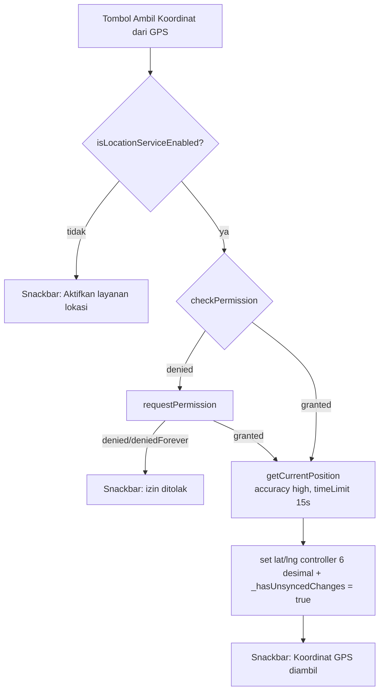

# mobile_remote — Tab & File Mapping

> Bedah lengkap **`apps/mobile_remote/lib/`** — aplikasi kontroler Remote Masjid DKM di HP Android.
> Fungsi 5 tab, mekanisme GPS/geolocator, offset jadwal sholat, dan indikator "Unsaved Changes".

**Navigasi:** [MAP.md](../MAP.md) · [DECISIONS.md](../DECISIONS.md) · [tv_display/widget_mapping.md](../tv_display/widget_mapping.md)

---

## 1. Struktur File

```
apps/mobile_remote/lib/
├── main.dart                  # Entry, 5 tab UI, state global, semua handler, koneksi
├── services/
│   ├── ws_client.dart         # Client WebSocket + helper kirim per tipe data
│   └── p2p_client_service.dart# Scan & konek WiFi Direct / BLE
└── test/
    └── widget_test.dart       # Smoke test
```

---

## 2. `main.dart` — Pusat UI Remote

### 2.1 Entry
```dart
void main() => runApp(const MasjidYouRemoteApp());
```
`MasjidYouRemoteApp` → `MaterialApp` (tema & darkTheme dari seed `0xFF006A60`, Material 3) → `home: RemoteHomeScreen`.

### 2.2 State global `_RemoteHomeScreenState`

| State | Tipe | Peran |
|---|---|---|
| `_tabIndex` | `int` | Tab aktif (0–4) |
| `_ipController` | `TextEditingController` | IP TV (default `192.168.1.`) |
| `_client` | `RemoteWsClient` | Koneksi WS |
| `_p2pClient` | `P2pClientService` | Koneksi WiFi Direct/BLE |
| `_isConnecting` / `_isConnected` | `bool` | Status koneksi |
| `_isScanning` / `_p2pDevices` / `_p2pStatus` | — | Status scan P2P + daftar perangkat + teks status |
| `_hasUnsyncedChanges` | `bool` | Penanda perubahan belum dikirim (ADR-008) |
| `_config` | `MosqueConfig` | Config lokal + koordinat + offset |
| `_runningTexts` / `_banners` / `_kasTransactions` | `List` | Data editor lokal |
| 8× `TextEditingController` + map `_prayerOffsetControllers` | — | Form: nama, alamat, lat, lng, offset per sholat, running text, banner (4), kas (2) |
| `_isFetchingLocation` | `bool` | Indikator proses ambil GPS |
| `_runningCategory` / `_kasType` | enum/string | Pilihan dropdown |

### 2.3 Inisialisasi
- `initState`: isi controller dari `_config` (termasuk lat/lng 6 desimal & offset per sholat).
- Subscribe `_p2pClient.stateStream` → jika hotspot aktif & punya `hostGatewayIpAddress` → isi `_ipController` + `_connectToTv()` (auto-connect).

### 2.4 Sinkronisasi & Unsaved Changes

**Alur umum setiap mutasi:**
```
setState { data berubah; _hasUnsyncedChanges = true }
   └─ jika _isConnected → kirim paket → setState { _hasUnsyncedChanges = false }
```

| Method | Fungsi |
|---|---|
| `_connectToTv()` | Sambung WS ke `_ipController`; sukses → `_syncAllToTv()` + reset flag |
| `_buildConfigFromForm()` | Bangun `MosqueConfig` dari semua controller (parse lat/lng dgn fallback + clamp) |
| `_syncAllToTv()` | Kirim 4 paket: config, running texts, banners, kas |
| `_pushAllToTv()` | Cek koneksi → `_syncAllToTv()` → reset flag + snackbar (dipanggil tombol "Kirim Ke TV") |
| `_sendConfigUpdate()` | Simpan config (set flag), kirim bila terhubung |

**Banner "Unsaved Changes"** (`_buildUnsyncedBanner`): Material `tertiaryContainer` di bawah AppBar saat `_hasUnsyncedChanges == true` — ikon `sync_problem` + "Ada perubahan belum dikirim ke TV" + `TextButton.icon` "Kirim Ke TV".

### 2.5 Layout utama

```
Scaffold
├── AppBar "Remote Masjid DKM"
├── body: Column
│   ├── [jika unsynced] _buildUnsyncedBanner
│   └── Expanded > IndexedStack(index: _tabIndex)
│       ├── _buildConfigTab       (0 Pengaturan)
│       ├── _buildRunningTextTab  (1 Running Text)
│       ├── _buildInfoMasjidTab   (2 Info Masjid)
│       ├── _buildKasTab          (3 Kas)
│       └── _buildConnectivityTab (4 Konektivitas)
└── bottomNavigationBar: NavigationBar (5 destinations)
```

`IndexedStack` menjaga state tiap tab tetap hidup saat berpindah.

---

## 3. Tab Demi Tab

### 3.1 Tab 0 — Pengaturan

**Fungsi**: identitas masjid + koordinat + offset jadwal sholat + simulasi.

| Bagian | Elemen | Keterangan |
|---|---|---|
| Identitas | `Nama Masjid`, `Alamat Masjid` | `_nameController`, `_addressController` |
| Koordinat & Jadwal Sholat | `Latitude`, `Longitude` | input desimal; `_latitudeController`, `_longitudeController` |
| GPS | tombol "Ambil Koordinat dari GPS" | `_getLocationFromGps()` — spinner saat `_isFetchingLocation` |
| Offset | 6 kolom "Subuh … Isya" (suffix `mnt`) | `_prayerOffsetControllers` per `PrayerType` |
| Aksi | "Simpan & Update Ke TV" | `_sendConfigUpdate()` |
| Simulasi | "Simulasi Jadwal" | `_showScheduleSimulation()` |

### 3.2 Tab 1 — Running Text

| Elemen | Fungsi |
|---|---|
| TextField "Tambah Teks Berjalan" + tombol `+` | `_addRunningText()` |
| Dropdown "Kategori" | `Pengumuman`, `Kajian`, `Kas`, `Himbauan`, `Infaq`, `Umum` (`_runningCategories`) |
| Daftar kartu | tiap item: `edit` (`_editRunningText` dialog: isi + kategori) & `delete` (`_removeRunningText`) |

Semua men-set `_hasUnsyncedChanges` dan mengirim `sendRunningTextsUpdate` bila terhubung.

### 3.3 Tab 2 — Info Masjid (MediaBanner)

Form 4 bidang: **Header/Kategori** (default `INFO MASJID`), **Judul**, **Isi** (3 baris), **Kaki/Catatan**.

- Tambah: `_addBanner()` — validasi minimal judul ATAU isi.
- Daftar: tiap banner punya **Switch** (`_toggleBanner` — on/off tampil di TV), **Edit** (`_editBanner` dialog 4 bidang), **Hapus** (`_removeBanner`).
- Banner `isActive=false` akan disembunyikan TV (lihat `BannerCarousel._activeBanners`).

### 3.4 Tab 3 — Kas

| Bagian | Elemen |
|---|---|
| Statistik | 3 kartu `_KasStatCard`: Saldo, Pemasukan, Pengeluaran (dari `KasSummary.fromTransactions`) |
| Tambah Transaksi | `SegmentedButton` Masuk/Keluar + `Nominal (Rp)` (input digitsOnly) + `Keterangan` → `_addKasTransaction()` |
| Riwayat | daftar transaksi: avatar arah panah, tanggal `d MMM yyyy, HH:mm`, `+/-Rp` berwarna; **long-press** untuk hapus (`_removeKasTransaction`) |

### 3.5 Tab 4 — Konektivitas

| Bagian | Elemen |
|---|---|
| Koneksi Jaringan (WiFi/Router) | kolom IP + tombol `Sambungkan/Terhubung` (`_connectToTv`); kartu berubah `primaryContainer` saat terhubung |
| WiFi Direct (Tanpa Router) | tombol `Cari TV`/`Stop` (`_startScan`/`_stopScan`), `LinearProgressIndicator` saat scanning, teks status `_p2pStatus`, daftar perangkat `BleDiscoveredDevice` → tap = `_connectP2p(device)` |

---

## 4. Mekanisme GPS (Geolocator) & Offset Jadwal

### 4.1 `_getLocationFromGps()` — alur



- Paket: `geolocator ^14.0.3`.
- Izin Android sudah ada di manifest: `ACCESS_FINE_LOCATION`, `ACCESS_COARSE_LOCATION` (+ runtime request).

### 4.2 Offset per jadwal
- `_buildConfigFromForm()` membaca 6 field offset → `prayerOffsets: Map<PrayerType,int>` (menit, boleh negatif).
- `_config` di-sync ke TV via `sendConfigUpdate`; TV menerapkan offset di `PrayerSchedule.calculate` (lihat [shared_models/MosqueConfig & PrayerSchedule](../MAP.md)).
- Backward compat: config lama ber-`prayerCorrectionMinutes` otomatis di-seed ke semua offset.

### 4.3 Simulasi Jadwal (`_showScheduleSimulation`)
- Membangun `MosqueConfig` dari form (koordinat + offset), lalu dialog:
  - Pilih **tanggal** (`showDatePicker`) & **jam** (`showTimePicker`).
  - `PrayerSchedule.calculate(config, simDateTime)` — **dihitung offline** (paket `adhan`).
  - Menampilkan 6 waktu sholat; sholat "SELANJUTNYA" disorot (`primaryContainer`) + countdown `mm:ss`.
- Tujuan: verifikasi jadwal & countdown sebelum dikirim ke TV.

---

## 5. `services/ws_client.dart` — Client WebSocket

| Method | Fungsi |
|---|---|
| `connect(ip, {port=8080})` | `WebSocketChannel.connect('ws://ip:port')` + await `ready`; set `_isConnected` |
| `sendPacket(SyncPacket)` | `sink.add(packet.toJson())` bila terhubung |
| `sendConfigUpdate(MosqueConfig)` | paket `SyncAction.updateConfig` |
| `sendRunningTextsUpdate(List<RunningTextMessage>)` | paket `updateRunningText` |
| `sendBannersUpdate(List<MediaBanner>)` | paket `updateBanners` |
| `sendKasUpdate(List<KasTransaction>)` | paket `updateKas` |
| `disconnect()` | tutup sink, reset flag |

---

## 6. `services/p2p_client_service.dart` — WiFi Direct / BLE

| Method | Fungsi |
|---|---|
| `_ensureClient()` | lazy-init `FlutterP2pClient` (hanya Android) + listen `streamHotspotState` → `_stateController` |
| `startScan(onDevices)` | cek/minta izin P2P & Bluetooth; cek/aktifkan WiFi & Bluetooth; `startScan(onDevices)` |
| `stopScan()` | hentikan scan |
| `connectTo(BleDiscoveredDevice)` | `connectWithDevice(device)` |
| `disconnect()` | `disconnect()` + `stopScan()` |

**Auto-connect:** `stateStream` (hotspot aktif dengan `hostGatewayIpAddress`) di-subscribe di `initState` → isi IP + `_connectToTv()`.

---

## 7. Kebersihan & Dispose

Semua controller di-`dispose()`: `_ipController`, nama/alamat/lat/lng, `_prayerOffsetControllers.values`, running text, 4 banner, 2 kas; lalu `_p2pClient.disconnect()` dan `_client.disconnect()`.

---

## 8. Lint & Test

- `flutter analyze`: hanya `info` (tidak `error`):
  - `avoid_print` di `p2p_client_service.dart`.
  - `deprecated_member_use` `DropdownButtonFormField.value` — **sengaja dipertahankan** karena dropdown dikendalikan state (`_runningCategory`).
- `test/widget_test.dart`: smoke test `MasjidYouRemoteApp` render judul "Remote Masjid DKM".

---

## 9. Menambah Tab / Fitur (checklist)

1. Tambah destination di `NavigationBar` + body ke-`IndexedStack` + builder method.
2. Tambah state & controller; daftarkan di `dispose()`.
3. Setiap mutasi: `setState { data; _hasUnsyncedChanges = true }` → kirim bila terhubung → reset flag.
4. Bila butuh data baru di TV: tambah case `SyncAction` + model di `shared_models` + rebuild dua app.
5. Verifikasi: `flutter analyze`, `flutter test`, build `android-x64`, pasang ke `emulator-5556`.

---

> Kembali ke [MAP.md](../MAP.md) · [DECISIONS.md](../DECISIONS.md) · [tv_display/widget_mapping.md](../tv_display/widget_mapping.md)
