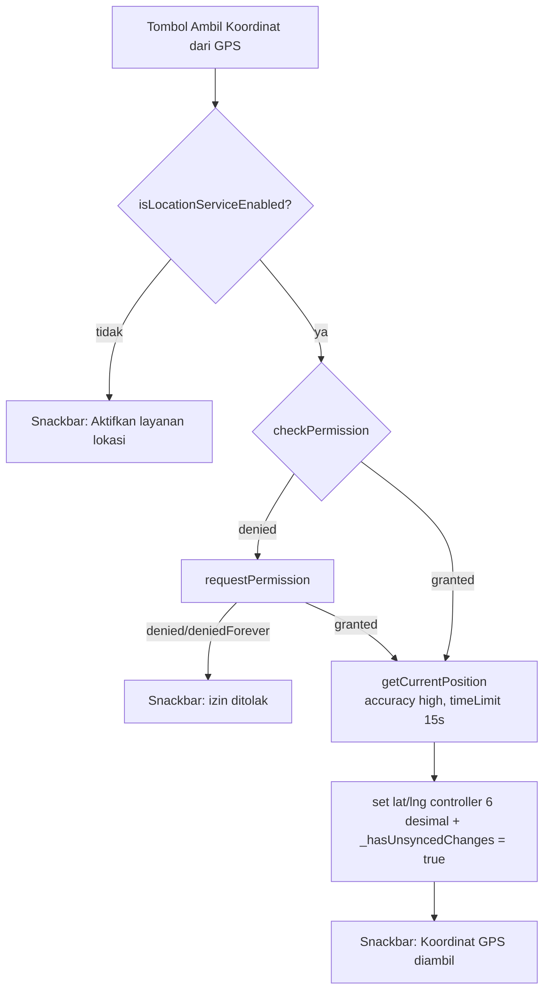

# mobile_remote — Tab & File Mapping

> Bedah lengkap **`apps/mobile_remote/lib/`** — aplikasi kontroler Remote Masjid DKM di HP Android.
> Navigasi 4 menu bawah (salah satunya **Konten** dengan 3 sub-tab atas) dalam **satu rangkaian 6 halaman yang bisa di-swipe**, mekanisme GPS/geolocator, offset jadwal sholat, indikator "Unsaved Changes", dan tema Material 3 standar.

**Navigasi:** [MAP.md](../MAP.md) · [DECISIONS.md](../DECISIONS.md) · [theme_shapes.md](theme_shapes.md) · [tv_display/widget_mapping.md](../tv_display/widget_mapping.md)

---

## 1. Struktur File

```
apps/mobile_remote/lib/
├── main.dart                  # Entry, navigasi 6 halaman swipe (4 menu bawah + 3 sub-tab Konten) + mikro-animasi PlayfulNavIcon, state global, semua handler, koneksi, durasi + aksi cepat shalat, theme M3
├── services/
│   ├── ws_client.dart         # Client WebSocket + helper kirim per tipe data + listen paket masuk
│   ├── p2p_client_service.dart# Scan & konek WiFi Direct / BLE
│   └── bluetooth_client_service.dart # Client Bluetooth Classic (RFCOMM): discovery, connect, auto-reconnect
└── test/
    ├── widget_test.dart       # Smoke test
    └── bluetooth_client_service_test.dart # Unit test transisi state client BT
```

**Tema Material 3 standar** (`MasjidYouRemoteApp._buildTheme`): `cardTheme` = `RoundedRectangleBorder(16)`; `dialogTheme`/`bottomSheetTheme` = `RoundedRectangleBorder(28)`; tombol (`FilledButton`/`OutlinedButton`/`TextButton`), `ChipThemeData.shape`, dan `navigationBarTheme.indicatorShape` = `StadiumBorder()`. `M3Pressable` (kelas lokal di main.dart) memberi feedback spring saat tekan — tetap dipakai, bukan shape. **Riwayat revert dari M3 Expressive (`puffy`/clover) → square:** lihat [theme_shapes.md](theme_shapes.md) & [ADR-012](../DECISIONS.md#adr-012).

---

## 2. `main.dart` — Pusat UI Remote

### 2.1 Entry
```dart
void main() => runApp(const MasjidYouRemoteApp());
```
`MasjidYouRemoteApp` → `MaterialApp` (tema & darkTheme dari seed `0xFF006A60`, Material 3) → `home: RemoteHomeScreen`.

### 2.2 State global `_RemoteHomeScreenState`

| State | Tipe | Peran |
|---|---|---|
| `_tabIndex` | `int` | Menu bawah aktif (0–3: Pengaturan, Konten, Konektivitas, Tes) — di-sinkronkan otomatis dari `_mainTabController` |
| `_mainTabController` | `TabController` (6) | Menggerakkan seluruh halaman (`TabBarView` 6 halaman) |
| `_subTabController` | `TabController` (3) | Menggerakkan indikator Top Tab Bar (Running Text/Info Masjid/Kas) |
| `_syncingControllers` | `bool` | Guard loop saat dua controller saling menyinkronkan |
| `_ipController` | `TextEditingController` | IP TV (default `192.168.1.`) |
| `_client` | `RemoteWsClient` | Koneksi WS |
| `_p2pClient` | `P2pClientService` | Koneksi WiFi Direct/BLE |
| `_btClient` | `BluetoothClientService` | Koneksi Bluetooth Classic (RFCOMM) |
| `_btIsScanning` / `_btConnected` / `_btDevices` / `_btStatus` | — | Status scan BT, koneksi, daftar perangkat, teks status |
| `_btWasConnected` | `bool` | Guard agar `_syncAllToTv()` + `getInitialState` hanya dikirim saat transisi tersambung (bukan tiap emit) |
| `_isConnecting` / `_isConnected` | `bool` | Status koneksi |
| `_isScanning` / `_p2pDevices` / `_p2pStatus` | — | Status scan P2P + daftar perangkat + teks status |
| `_hasUnsyncedChanges` | `bool` | Penanda perubahan belum dikirim (ADR-008) |
| `_config` | `MosqueConfig` | Config lokal + koordinat + offset + durasi siklus shalat |
| `_runningTexts` / `_banners` / `_kasTransactions` | `List` | Data editor lokal |
| 8× `TextEditingController` + map `_prayerOffsetControllers` | — | Form: nama, alamat, lat, lng, offset per sholat, running text, banner (4), kas (2) |
| 4× `TextEditingController` durasi | — | `_preAdhanController`, `_adhanController`, `_preIqomahController`, `_shalatController` |
| `_tvPhase` / `_tvRemaining` | `PrayerPhase` / `Duration` | Status fase TV dari `SyncAction.stateUpdate` (untuk enable tombol aksi cepat) |
| `_isFetchingLocation` | `bool` | Indikator proses ambil GPS |
| `_runningCategory` / `_kasType` | enum/string | Pilihan dropdown |

### 2.3 Inisialisasi
- `initState`: isi controller dari `_config` (termasuk lat/lng 6 desimal & offset per sholat).
- Subscribe `_p2pClient.stateStream` → jika hotspot aktif & punya `hostGatewayIpAddress` → isi `_ipController` + `_connectToTv()` (auto-connect).

### 2.4 Sinkronisasi & Unsaved Changes

**Alur umum setiap mutasi:**
```
setState { data berubah; _hasUnsyncedChanges = true }
   └─ jika _isConnected → kirim paket → setState { _hasUnsyncedChanges = false }
```

| Method | Fungsi |
|---|---|
| `_connectToTv()` | Sambung WS ke `_ipController`; sukses → `_syncAllToTv()` + reset flag |
| `_buildConfigFromForm()` | Bangun `MosqueConfig` dari semua controller (parse lat/lng dgn fallback + clamp) |
| `_syncAllToTv()` | Kirim 4 paket: config, running texts, banners, kas |
| `_pushAllToTv()` | Cek koneksi → `_syncAllToTv()` → reset flag + snackbar (dipanggil tombol "Kirim Ke TV") |
| `_sendConfigUpdate()` | Simpan config (set flag), kirim bila terhubung |

**Banner "Unsaved Changes"** (`_buildUnsyncedBanner`): Material `tertiaryContainer` di bawah AppBar saat `_hasUnsyncedChanges == true` — ikon `sync_problem` + "Ada perubahan belum dikirim ke TV" + `TextButton.icon` "Kirim Ke TV".

### 2.5 Layout utama

```
Scaffold
├── AppBar "Remote Masjid DKM"
├── body: Column
│   ├── [jika unsynced] _buildUnsyncedBanner
│   ├── AnimatedBuilder(_mainTabController.animation) > Top TabBar (_subTabController)
│   │       Running Text | Info Masjid | Kas
│   │       → tinggi + opacity disinkronkan dengan swipe (fade+slide, tanpa layout jump)
│   └── Expanded > TabBarView(controller: _mainTabController) — 6 halaman:
│       ├── 0 _buildConfigTab       (Pengaturan)
│       ├── 1 _buildRunningTextTab  (sub-tab Konten 1)
│       ├── 2 _buildInfoMasjidTab   (sub-tab Konten 2)
│       ├── 3 _buildKasTab          (sub-tab Konten 3)
│       ├── 4 _buildConnectivityTab (Konektivitas)
│       └── 5 _buildTestTab         (Tes — simulasi waktu shalat)
└── bottomNavigationBar: NavigationBar (4 destinations)
```

Seluruh navigasi adalah **satu rangkaian 6 halaman** yang digerakkan `_mainTabController` (`TabBarView`): pengguna bisa menggeser (swipe) kiri/kanan dari Pengaturan → Running Text → Info Masjid → Kas → Konektivitas → Tes secara mulus, dan sebaliknya. `_subTabController` (3) hanya menggerakkan indikator **Top Tab Bar**.

**Top Tab Bar tampil natural, bukan melompat.** Dulu dipakai `if (_tabIndex == 1)` yang membuat TabBar muncul/menghilang mendadak dan konten di bawahnya lompat (layout jump). Sekarang TabBar dibungkus `AnimatedBuilder` yang mendengarkan `_mainTabController.animation!` (0.0–5.0) dan memetakannya ke faktor tinggi+opacity: mendekati halaman 1 → TabBar **meluncur turun + fade-in** mengikuti gerak jari; di dalam Konten (1–3) tetap penuh; mendekati halaman 4 → **meluncur naik + fade-out**. Hasilnya mulus tanpa lompatan.

**Mikro-animasi ikon `PlayfulNavIcon`** (widget lokal di `main.dart`): setiap ikon menu bawah & sub-tab atas yang terpilih menjalankan lompatan vertikal (`SlideTransition`), membal elastis (`ScaleTransition` 1.0→1.2→1.0 dengan `Curves.bounceOut`), dan untuk ikon **Pengaturan** putaran gigi 45° (`RotationTransition`, `Curves.easeOutBack`) — 300ms, murni Flutter tanpa package. Terpicu saat di-tap maupun di-swipe (`didUpdateWidget` pada perubahan `isSelected`).

**Sinkronisasi ganda** (`_handleMainTabChange` / `_handleSubTabChange`, guard `_syncingControllers` untuk mencegah loop):
- Geser `TabBarView` ke halaman 1–3 → `_subTabController.index` disamakan (`halaman - 1`) + `setState` (selalu) agar ikon sub-tab ikut beranimasi real-time + `_tabIndex` jadi 1 (Konten).
- Geser ke halaman 0/4/5 → `_tabIndex` otomatis jadi 0/2/3; Top Tab Bar menyusut/fade-out.
- Tap Top Tab Bar → `_mainTabController.animateTo(sub + 1)` (melompat ke halaman sub-tab terkait).
- Tap menu bawah → `_mainTabController.animateTo(_mainPageForBottomNav(...))` — Konten membawa ke sub-tab terakhir dilihat.

`PageStorageKey` di setiap `ListView` menjaga posisi scroll; state & teks form hidup karena controller-nya milik `_RemoteHomeScreenState` (tidak pernah di-reset saat halaman di-rebuild).

---

## 3. Tab Demi Tab

### 3.1 Tab 0 — Pengaturan

**Fungsi**: identitas masjid + koordinat + durasi siklus shalat + offset jadwal + aksi cepat + simulasi.

| Bagian | Elemen | Keterangan |
|---|---|---|
| Identitas | `Nama Masjid`, `Alamat Masjid` | `_nameController`, `_addressController` |
| Koordinat & Jadwal Sholat | `Latitude`, `Longitude` | input desimal; `_latitudeController`, `_longitudeController` |
| GPS | tombol "Ambil Koordinat dari GPS" | `_getLocationFromGps()` — spinner saat `_isFetchingLocation` |
| Offset | 6 kolom "Subuh … Isya" (suffix `mnt`) | `_prayerOffsetControllers` per `PrayerType` |
| Durasi Siklus Shalat | 4 kolom `Jelang Azan` (15), `Azan` (2), `Jeda Ikamah` (1), `Shalat` (10) | `_preAdhanController` dkk; angka `digitsOnly`, min 0 |
| Aksi Cepat | kartu "Aksi Cepat Waktu Shalat": `Skip Azan`, `Skip Ikamah / Mulai Shalat`, `Selesaikan Shalat` + status "Mode TV saat ini" | `_buildQuickActionsCard`, `_sendQuickAction(action)`; tombol aktif hanya saat fase TV sesuai (`_tvPhase`) |
| Aksi | "Simpan & Update Ke TV" | `_sendConfigUpdate()` — juga persist durasi ke SharedPreferences |
| Simulasi | "Simulasi Jadwal" | `_showScheduleSimulation()` |

**Persist lokal:** `_loadSavedDurations()` (init) & `_persistDurations(config)` (saat kirim) memakai `shared_preferences` — kunci `preAdhanMinutes`, `adhanMinutes`, `preIqomahMinutes`, `shalatMinutes`.

### 3.2 Menu Konten & Sub-tab-nya (halaman 1–3)

Menu bawah **Konten** menyatukan **Running Text**, **Info Masjid**, dan **Kas** (sebelumnya 3 tab terpisah) agar bottom navigation lebih ringkas — dari 6 jadi 4 tombol. Ketiga halaman ini hanyalah **bagian tengah dari rangkaian 6 halaman** yang bisa di-swipe; halaman 1, 2, dan 3 masing-masing menampilkan sub-tab Konten. Saat berada di halaman 1–3, **Top Tab Bar** muncul di bawah AppBar (controller `_subTabController`) dan indikatornya mengikuti halaman aktif:

```dart
Top Tab Bar (muncul mulus saat masuk Konten, controller _subTabController)
├── Running Text   (campaign)          → halaman 1
├── Info Masjid    (newspaper)         → halaman 2
└── Kas            (account_balance_wallet) → halaman 3
```

Pindah antar sub-tab: **tap Top Tab Bar**, **tap menu bawah Konten**, atau cukup **swipe** kiri/kanan — menyatu dengan swipe ke Konektivitas/Tes/Pengaturan di ujung-ujungnya. Setiap `ListView` sub-tab diberi `PageStorageKey` agar posisi scroll tetap saat gonta-ganti halaman.

#### 3.2.1 Sub-tab Running Text

| Elemen | Fungsi |
|---|---|
| TextField "Tambah Teks Berjalan" + tombol `+` | `_addRunningText()` |
| Dropdown "Kategori" | `Pengumuman`, `Kajian`, `Kas`, `Himbauan`, `Infaq`, `Umum` (`_runningCategories`) |
| Daftar kartu | tiap item: `edit` (`_editRunningText` dialog: isi + kategori) & `delete` (`_removeRunningText`) |

Semua men-set `_hasUnsyncedChanges` dan mengirim `sendRunningTextsUpdate` bila terhubung.

#### 3.2.2 Sub-tab Info Masjid (MediaBanner)

Form 4 bidang: **Header/Kategori** (default `INFO MASJID`), **Judul**, **Isi** (3 baris), **Kaki/Catatan**.

- Tambah: `_addBanner()` — validasi minimal judul ATAU isi.
- Daftar: tiap banner punya **Switch** (`_toggleBanner` — on/off tampil di TV), **Edit** (`_editBanner` dialog 4 bidang), **Hapus** (`_removeBanner`).
- Banner `isActive=false` akan disembunyikan TV (lihat `BannerCarousel._activeBanners`).

#### 3.2.3 Sub-tab Kas

| Bagian | Elemen |
|---|---|
| Statistik | 3 kartu `_KasStatCard`: Saldo, Pemasukan, Pengeluaran (dari `KasSummary.fromTransactions`) |
| Tambah Transaksi | `SegmentedButton` Masuk/Keluar + `Nominal (Rp)` (input digitsOnly) + `Keterangan` → `_addKasTransaction()` |
| Riwayat | daftar transaksi: avatar arah panah, tanggal `d MMM yyyy, HH:mm`, `+/-Rp` berwarna; **long-press** untuk hapus (`_removeKasTransaction`) |

### 3.3 Tab 2 — Konektivitas

| Bagian | Elemen |
|---|---|
| Koneksi Jaringan (WiFi/Router) | kolom IP + tombol `Sambungkan/Terhubung` (`_connectToTv`); kartu berubah `primaryContainer` saat terhubung |
| WiFi Direct (Tanpa Router) | tombol `Cari TV`/`Stop` (`_startScan`/`_stopScan`), `LinearProgressIndicator` saat scanning, teks status `_p2pStatus`, daftar perangkat `BleDiscoveredDevice` → tap = `_connectP2p(device)` |

### 3.4 Tab 3 — Tes (Simulasi Waktu Shalat)

**Fungsi**: menguji state machine & overlay TV dengan **memaksa TV masuk fase tertentu** (`_buildTestTab`, `_sendForcePhase`).

| Bagian | Elemen |
|---|---|
| Status koneksi & fase | kartu: ikon TV hijau/off + "Mode TV saat ini: `_tvPhase.label`" (live dari `stateUpdate`) |
| Paksa Fase — Hari Biasa | 5 tombol full-width: `Normal (Standby)`, `PRE_ADHAN`, `ADHAN`, `PRE_IQOMAH`, `SHALAT` → `sendForcePhase(phase)`; disabled bila belum terhubung |
| Paksa Fase — Hari Jumat | kartu terpisah: 1 tombol `KHUTBAH · Khutbah Jumat` → `sendForcePhase(khutbah)` |

- Tombol tersedia meski TV sedang di fase lain — tes menu **menimpa** fase saat itu (masuk dengan durasi penuh dari konfigurasi).
- Tekan `Normal (Standby)` untuk kembali ke dashboard.
- Teks tombol memakai `PrayerPhaseX.label`; dipilih pakai `Icons.rocket_launch/access_time_filled/campaign/menu_book_rounded/groups/dark_mode`.

---

## 4. Mekanisme GPS (Geolocator) & Offset Jadwal

### 4.1 `_getLocationFromGps()` — alur



- Paket: `geolocator ^14.0.3`.
- Izin Android sudah ada di manifest: `ACCESS_FINE_LOCATION`, `ACCESS_COARSE_LOCATION` (+ runtime request).

### 4.2 Offset per jadwal
- `_buildConfigFromForm()` membaca 6 field offset → `prayerOffsets: Map<PrayerType,int>` (menit, boleh negatif).
- `_config` di-sync ke TV via `sendConfigUpdate`; TV menerapkan offset di `PrayerSchedule.calculate` (lihat [shared_models/MosqueConfig & PrayerSchedule](../MAP.md)).
- Backward compat: config lama ber-`prayerCorrectionMinutes` otomatis di-seed ke semua offset.

### 4.3 Simulasi Jadwal (`_showScheduleSimulation`)
- Membangun `MosqueConfig` dari form (koordinat + offset), lalu dialog:
  - Pilih **tanggal** (`showDatePicker`) & **jam** (`showTimePicker`).
  - `PrayerSchedule.calculate(config, simDateTime)` — **dihitung offline** (paket `adhan`).
  - Menampilkan 6 waktu sholat; sholat "SELANJUTNYA" disorot (`primaryContainer`) + countdown `mm:ss`.
- Tujuan: verifikasi jadwal & countdown sebelum dikirim ke TV.

---

## 5. `services/ws_client.dart` — Client WebSocket

| Method | Fungsi |
|---|---|
| `connect(ip, {port=8080})` | `WebSocketChannel.connect('ws://ip:port')` + await `ready`; set `_isConnected`; listen stream → `onPacket` |
| `sendPacket(SyncPacket)` | `sink.add(packet.toJson())` bila terhubung |
| `sendConfigUpdate(MosqueConfig)` | paket `SyncAction.updateConfig` |
| `sendRunningTextsUpdate(List<RunningTextMessage>)` | paket `updateRunningText` |
| `sendBannersUpdate(List<MediaBanner>)` | paket `updateBanners` |
| `sendKasUpdate(List<KasTransaction>)` | paket `updateKas` |
| `sendSkipAdhan()` | paket `skipAdhan` (ADHAN → PRE_IQOMAH) |
| `sendStartShalat()` | paket `startShalat` (PRE_IQOMAH → SHALAT) |
| `sendFinishShalat()` | paket `finishShalat` (SHALAT → NORMAL) |
| `sendForcePhase(PrayerPhase)` | paket `forcePhase` dengan payload `{'phase': <name>}` (dari Menu Tes) |
| `onPacket` | callback paket masuk (mis. `stateUpdate` fase TV) |
| `disconnect()` | tutup sink, reset flag |

---

## 6. `services/p2p_client_service.dart` — WiFi Direct / BLE

| Method | Fungsi |
|---|---|
| `_ensureClient()` | lazy-init `FlutterP2pClient` (hanya Android) + listen `streamHotspotState` → `_stateController` |
| `startScan(onDevices)` | cek/minta izin P2P & Bluetooth; cek/aktifkan WiFi & Bluetooth; `startScan(onDevices)` |
| `stopScan()` | hentikan scan |
| `connectTo(BleDiscoveredDevice)` | `connectWithDevice(device)` |
| `disconnect()` | `disconnect()` + `stopScan()` |

**Auto-connect:** `stateStream` (hotspot aktif dengan `hostGatewayIpAddress`) di-subscribe di `initState` → isi IP + `_connectToTv()`.

---

## 7. `services/bluetooth_client_service.dart` — Bluetooth Classic (RFCOMM)

| Method / anggota | Fungsi |
|---|---|
| `startDiscovery()` | cek/minta izin mode `client` (`CONNECT` + `SCAN`); aktifkan BT bila mati; `BluetoothSync.startDiscovery()` → event `discovered` mengisi daftar (dedupe per alamat, perangkat tanpa nama dilewati) |
| `stopDiscovery()` | hentikan scan; selalu emit state (tidak early-return diam) |
| `connectTo(BluetoothDeviceInfo)` | set status `connecting` → `BluetoothSync.connect(address)`; `connected` datang dari event plugin |
| `sendPacket(SyncPacket)` | kirim JSON sebagai frame 4-byte big-endian bila terhubung |
| `stateStream` / `currentState` | `BluetoothClientState` (status, isScanning, isConnected, devices, peerName, error) |
| `onPacket` | callback `SyncPacket` masuk dari TV |
| `disconnect()` / `dispose()` | putus koneksi, reset flag + daftar device |

**Auto-reconnect:** setelah event `disconnected`/`error`, service menjadwalkan reconnect dengan guard `_reconnecting` dan batas percobaan; pesan error yang tampil membedakan "menunggu percobaan ulang" vs "percobaan habis".

**Alur di `main.dart`:** listener `stateStream` → `if (state.isConnected && !_btWasConnected)` → `_syncAllToTv()` + kirim `getInitialState`; saat putus `_btWasConnected` direset. Paket keluar dari `RemoteWsClient.onSendPacket` di-mirror ke `_btClient.sendPacket` agar Remote yang hanya tersambung lewat BT tetap bisa kirim.

---

## 8. Kebersihan & Dispose

Semua controller di-`dispose()`: `_ipController`, nama/alamat/lat/lng, `_prayerOffsetControllers.values`, 4 controller durasi (`_preAdhanController` dkk), running text, 4 banner, 2 kas, `_mainTabController`, `_subTabController`; lalu `_p2pClient.disconnect()`, `_btClient.dispose()`, dan `_client.disconnect()`.

---

## 9. Lint & Test

- `flutter analyze`: hanya `info` (tidak `error`):
  - `avoid_print` di `p2p_client_service.dart`.
  - `deprecated_member_use` `DropdownButtonFormField.value` — **sengaja dipertahankan** karena dropdown dikendalikan state (`_runningCategory`).
- `test/widget_test.dart`: smoke test `MasjidYouRemoteApp` render judul "Remote Masjid DKM" + navigasi ke menu Tes (`pumpAndSettle` karena pindah tab memakai animasi `TabBarView`).

---

## 9. Menambah Tab / Fitur (checklist)

1. Tambah halaman di `TabBarView` utama (`_mainTabController`), tambah destination di `NavigationBar`, dan lengkapi `_bottomNavIndexForPage` / `_mainPageForBottomNav`.
2. Untuk grup sub-tab: tambahkan halamannya di tengah `TabBarView` + tab di Top Tab Bar (`_subTabController`); pastikan mapping `_bottomNavIndexForPage` mengelompokkannya ke satu menu bawah; beri `PageStorageKey` pada `ListView` tiap halaman.
3. Tambah state & controller; daftarkan di `dispose()`.
4. Setiap mutasi: `setState { data; _hasUnsyncedChanges = true }` → kirim bila terhubung → reset flag.
5. Bila butuh data baru di TV: tambah case `SyncAction` + model di `shared_models` + rebuild dua app.
6. Verifikasi: `flutter analyze`, `flutter test`, build `android-x64`, pasang ke `emulator-5554` (HP).

---

> Kembali ke [MAP.md](../MAP.md) · [DECISIONS.md](../DECISIONS.md) · [theme_shapes.md](theme_shapes.md) · [tv_display/widget_mapping.md](../tv_display/widget_mapping.md) · [tv_display/prayer_state_machine.md](../tv_display/prayer_state_machine.md)
