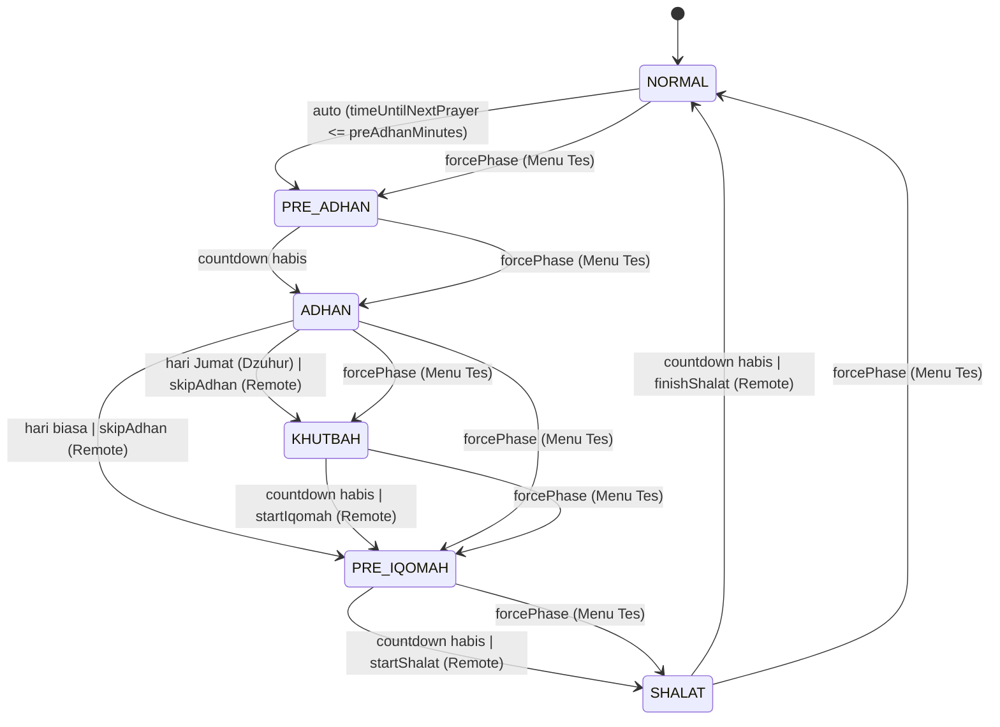
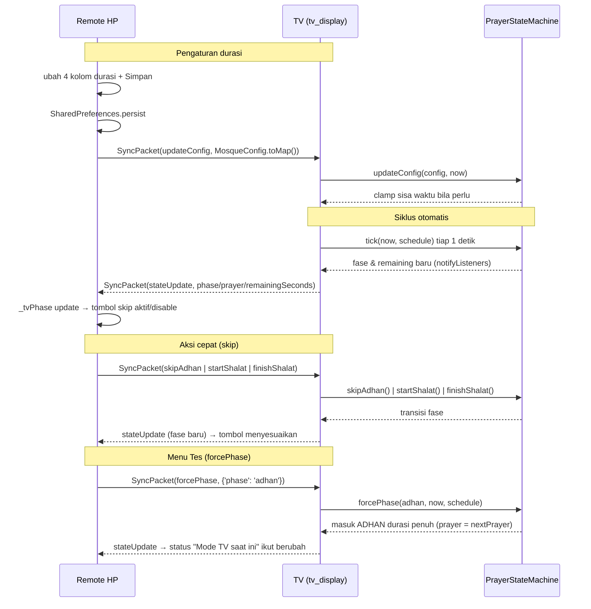

# Prayer State Machine — State Machine Waktu Shalat & Animasi UI

> Dokumen arsitektur **State Machine Waktu Shalat** di `apps/tv_display` + kontrol dari `apps/mobile_remote`.
> Menjawab: **Apa yang diubah**, **Kenapa keputusan diambil**, dan **Bagaimana cara kerjanya**.

**Navigasi:** [MAP.md](../MAP.md) · [DECISIONS.md](../DECISIONS.md) (lihat [ADR-009](../DECISIONS.md#adr-009)) · [tv_display/widget_mapping.md](widget_mapping.md) · [mobile_remote/tab_mapping.md](../mobile_remote/tab_mapping.md)

---

## 1. Ringkasan

Layar TV kini menjalankan **siklus waktu shalat otomatis**:

```
NORMAL → PRE_ADHAN → ADHAN → PRE_IQOMAH → SHALAT → NORMAL
```

Khusus **hari Jumat** (shalat Dzuhur), disisipkan fase **KHUTBAH** sesuai alur shalat Jumat di Indonesia:

```
NORMAL → PRE_ADHAN → ADHAN → KHUTBAH → PRE_IQOMAH → SHALAT → NORMAL
```

Siklus ini berjalan **tanpa campur tangan manusia** (dipicu oleh jadwal sholat), tapi durasi tiap fase dapat diatur dari Remote secara realtime, dan Remote punya tombol aksi cepat untuk *skip* ke fase berikutnya.

| Fase | Default | Tampilan TV |
|---|---|---|
| `normal` | — | Dashboard utama (Jam, Info, Kas, Running Text) |
| `preAdhan` | 15 mnt | Overlay circular progress ring + countdown "Menjelang Azan [Nama]" |
| `adhan` | 2 mnt | Wavy progress bar (palet moody low-contrast) + "Azan [Nama] Berkumandang" |
| `khutbah` *(Jumat)* | 20 mnt | Ring countdown "durasi khutbah" + "Khutbah Jumat Sedang Berlangsung" + nama Khatib & Muadzin |
| `preIqomah` | 1 mnt | Circular progress ring + "Shalat [Nama] Sebentar Lagi" + himbauan shaf |
| `shalat` | 10 mnt | Layar hitam penuh + teks redup "Sedang Melangsungkan Shalat [Nama]" |

---

## 2. Apa yang Diubah

### 2.1 `packages/shared_models` — model & protokol (single source of truth)

| Perubahan | File |
|---|---|
| `MosqueConfig` + 4 durasi: `preAdhanMinutes` (15), `adhanMinutes` (2), `preIqomahMinutes` (1), `shalatMinutes` (10) — masuk `toMap`/`fromMap` (default jika field absen → backward-compat) / `copyWith` | `lib/src/mosque_config.dart` |
| **Fitur Jumat**: `khutbahMinutes` (20), `fridayKhatib` ('Ustadz Khatib'), `fridayMuadzin` ('Ustadz Bilal') di `MosqueConfig` | `lib/src/mosque_config.dart` |
| Enum `PrayerPhase` (normal/preAdhan/adhan/**khutbah**/preIqomah/shalat) + `PrayerPhaseX.label` & `durationFor(config)` — dipakai TV & Remote | `lib/src/prayer_phase.dart` (baru) |
| `SyncAction` + `skipAdhan`, **`startIqomah`**, `startShalat`, `finishShalat` | `lib/src/sync_packet.dart` |
| `PrayerType.displayNameForDate(date)` — `dhuhr` tampil sebagai **"Jumat"** khusus hari Jumat | `lib/src/prayer_type.dart` |

### 2.2 `apps/tv_display` — sisi TV

| Perubahan | File |
|---|---|
| Manager siklus `PrayerStateMachine` (ChangeNotifier, tanpa timer sendiri) + `forcePhase` untuk Menu Tes + **logika Jumat** (`skipAdhan(now)` & `_advance` menyisipkan `khutbah`, `startIqomah()`) | `lib/state/prayer_state_machine.dart` (baru) |
| Overlay layar penuh + CustomPainter (ring & wavy) + **`_KhutbahOverlay`** (ring "durasi khutbah" + chip Khatib/Muadzin) | `lib/widgets/prayer_state_overlay.dart` (baru) |
| **Kartu Petugas Jumat** `FridayStaffCard` — hari Jumat area kanan dashboard bergantian 10 detik (AnimatedSwitcher) dengan `KasSummaryCard` | `lib/widgets/friday_staff_card.dart` (baru) |
| Integrasi: init + `tick()` 1 detik + handler WS (termasuk `forcePhase`, `startIqomah`) + broadcast `stateUpdate` | `lib/main.dart` |
| Param `initialConfig` & `autoPrayerCycle` pada `MasjidDisplayScreen` (test deterministik) | `lib/main.dart` |

### 2.3 `apps/mobile_remote` — sisi Remote

| Perubahan | File |
|---|---|
| Tab Pengaturan: 4 kolom durasi siklus + **kolom "Khutbah (Jumat)"** + **form Nama Khatib & Muadzin** + kartu "Aksi Cepat Waktu Shalat" (3 tombol skip, aktif sesuai fase TV; saat fase `khutbah` muncul tombol "Selesai Khutbah / Mulai Ikamah") | `lib/main.dart` |
| **Tab 3 — Tes** (bawah): 6 tombol paksa fase (NORMAL/PRE_ADHAN/ADHAN/**KHUTBAH**/PRE_IQOMAH/SHALAT) + status fase TV live | `lib/main.dart` |
| Persist durasi & petugas Jumat ke **SharedPreferences** (`_loadSavedDurations` / `_persistDurations`) | `lib/main.dart` |
| Status fase TV dari `stateUpdate` → `_tvPhase` (enable/disable tombol) | `lib/main.dart` |
| Client listen paket masuk (`onPacket`) + `sendSkipAdhan` / `sendStartShalat` / `sendFinishShalat` | `lib/services/ws_client.dart` |
| Dependensi baru: `shared_preferences` | `pubspec.yaml` |

---

## 3. Kenapa Keputusan Ini Diambil

1. **Otomatis & offline-first** — kiosk TV berjalan 24/7; siklus ibadah harus berjalan sendiri tanpa internet/router, memakai protokol WS lokal yang sudah ada ([ADR-003](../DECISIONS.md#adr-003)). Tidak menambah state-management library apa pun.
2. **Durasi di `MosqueConfig` (shared)** — satu sumber kebenaran; durasi dikirim bersama `updateConfig`, jadi tidak ada protokol khusus & otomatis backward-compatible ([ADR-006](../DECISIONS.md#adr-006)).
3. **State machine murni Dart tanpa timer sendiri** — di-drive oleh clock timer 1 detik yang sudah ada di `main.dart`. Bebas drift (pakai `deadline` wall-clock), bebas bocor resource, dan mudah diuji unit.
4. **Performa 60 FPS** — animasi gelombang pakai `AnimationController.repeat()` + `CustomPainter(repaint:)`: per frame hanya repaint, **bukan rebuild widget**. **Progress wavy bar mulus sub-detik**: dihitung dari `deadline` (waktu mutlak akhir fase) terhadap `DateTime.now()` saat `paint` di tiap frame → cursor bergerak mulus 60 FPS tanpa menunggu tick 1 detik. Ring countdown dihaluskan `TweenAnimationBuilder` 900 ms antar tick 1 detik. Overlay dirender oleh `AnimatedBuilder` hanya 1×/detik.
5. **Overlay terpisah di Stack** — tidak menyentuh layout dashboard yang sudah ada; fase `normal` render `SizedBox.shrink()`. Mengikuti pola ADR-004 (fallback, jangan pecahkan layar).
6. **`autoPrayerCycle` flag** — test layout 960×540 jadi deterministik terhadap waktu nyata; perilaku otomatis diuji terpisah di unit test.
7. **Persist di Remote** — durasi disimpan di SharedPreferences agar tidak hilang saat app ditutup, dan otomatis disinkronkan ke TV saat tersambung ([ADR-008](../DECISIONS.md#adr-008)).

---

## 4. Bagaimana Cara Kerjanya

### 4.1 Siklus & transisi



Aturan penting di `PrayerStateMachine.tick(now, schedule)`:
- Auto-start hanya dari `NORMAL` dan hanya untuk **shalat fardhu** — `PrayerType.sunrise` (Syuruq) dikecualikan, bukan waktu azan.
- Jika `timeUntilNextPrayer <= 0` saat masih `NORMAL` → langsung masuk `ADHAN` (bukan `PRE_ADHAN`).
- **Fase `khutbah` hanya muncul di hari Jumat** saat shalat Dzuhur (`now.weekday == Friday` && prayer `dhuhr`); hari biasa `adhan` langsung ke `preIqomah`.
- Skip manual (`skipAdhan`/`startIqomah`/`startShalat`/`finishShalat`) **no-op** bila fase sekarang tidak sesuai — Remote hanya mengetuk di fase yang benar.
- `updateConfig(config, now)`: bila durasi baru lebih pendek dari sisa waktu fase yang sedang berjalan → sisa di-*clamp*.
- `forcePhase(phase, {now, schedule})` (**Menu Tes**): langsung masuk fase yang diminta dengan durasi penuh dari config; shalat memakai `schedule.nextPrayer` (atau mempertahankan yang sedang berjalan); `normal` me-reset penuh.

### 4.2 Alur data end-to-end



### 4.3 Protokol

| Arah | `SyncAction` | Payload |
|---|---|---|
| HP → TV | `updateConfig` | `MosqueConfig.toMap()` termasuk 4 durasi + `khutbahMinutes` + `fridayKhatib` + `fridayMuadzin` |
| HP → TV | `skipAdhan` | `{}` — ADHAN → KHUTBAH (Jumat) / PRE_IQOMAH (biasa) |
| HP → TV | `startIqomah` | `{}` — KHUTBAH → PRE_IQOMAH (Jumat) |
| HP → TV | `startShalat` | `{}` |
| HP → TV | `finishShalat` | `{}` |
| HP → TV | `forcePhase` | `{'phase': <name>}` — Menu Tes |
| TV → HP | `stateUpdate` | `{phase, prayer, remainingSeconds, totalSeconds}` |

### 4.4 Lapisan render TV

```
Stack
├── Background masjid + overlay hitam
├── SafeArea → dashboard (HeaderClock, BannerCarousel|Kas|PetugasJumat, PrayerCards, RunningText)
└── AnimatedBuilder(_prayerStateMachine) → PrayerStateOverlay  ← lapisan teratas
    ├── preAdhan/preIqomah → _AnimatedProgressRing + countdown
    ├── adhan             → _WavyProgressBar (sine wave, 60 FPS repaint)
    ├── khutbah (Jumat)   → _AnimatedProgressRing "durasi khutbah" + _StaffChip (Khatib/Muadzin)
    ├── shalat            → Container(black) + teks redup
    └── normal            → SizedBox.shrink()
```

> **Hari Jumat** area kanan dashboard (flex 2) bergantian tiap 10 detik antara
> `KasSummaryCard` dan `FridayStaffCard` (AnimatedSwitcher fade+slide), sehingga
> nama khatib/muadzin yang di-input dari Remote selalu terlihat tanpa mengorbankan info Kas.

---

## 5. File & Kelas Penting

| File | Kelas / elemen kunci |
|---|---|
| `apps/tv_display/lib/state/prayer_state_machine.dart` | `PrayerStateMachine` (`initialize`, `tick`, `skipAdhan(now)`, `startIqomah`, `startShalat`, `finishShalat`, `forcePhase`, `updateConfig`, `progress`) |
| `apps/tv_display/lib/widgets/prayer_state_overlay.dart` | `PrayerStateOverlay`, `_KhutbahOverlay`, `_StaffChip`, `_AnimatedProgressRing`, `_WavyProgressBar`, `_CircularRingPainter`, `_WavyProgressPainter` |
| `apps/tv_display/lib/widgets/friday_staff_card.dart` | `FridayStaffCard` (Khatib & Muadzin) |
| `apps/tv_display/lib/main.dart` | `_broadcastState`, `_onStateMachineChanged`, handler WS `skipAdhan/startIqomah/startShalat/finishShalat/forcePhase/getInitialState`, `_showKasCard`/`_rightCardTick` (alternasi 10 detik) |
| `packages/shared_models/lib/src/prayer_phase.dart` | `PrayerPhase`, `PrayerPhase.fromName`, `PrayerPhaseX.label`, `PrayerPhaseX.durationFor` |
| `packages/shared_models/lib/src/prayer_type.dart` | `PrayerTypeX.displayNameForDate(date)` (Dzuhur → "Jumat" di hari Jumat) |
| `apps/mobile_remote/lib/main.dart` | `_buildQuickActionsCard`, `_buildTestTab`, `_sendQuickAction`, `_sendForcePhase`, `_loadSavedDurations`, `_persistDurations`, `_handleTvPacket` |
| `apps/mobile_remote/lib/services/ws_client.dart` | `onPacket`, `sendSkipAdhan`, `sendStartIqomah`, `sendStartShalat`, `sendFinishShalat`, `sendForcePhase` |

---

## 6. Test

| Test | Cakupan |
|---|---|
| `apps/tv_display/test/prayer_state_machine_test.dart` | **group "Hari Biasa"** (16): auto-start, auto-cycle penuh, skip (no-op fase salah), clamp durasi, exclude Syuruq, `autoCycle:false`, `forcePhase`, Dzuhur Kamis melewati KHUTBAH — **group "Hari Jumat"** (3): khutbah tersisip di auto-cycle Dzuhur Jumat, `skipAdhan`→`khutbah` + `startIqomah`→`preIqomah`, `startIqomah` no-op di luar khutbah |
| `apps/tv_display/test/prayer_state_overlay_test.dart` | Widget test overlay fase bebas overflow di viewport 960×540 |
| `apps/tv_display/test/widget_test.dart` | Regresi layout memakai `MasjidDisplayScreen(autoPrayerCycle: false)` agar deterministik |
| `packages/shared_models/test/shared_models_test.dart` | Durasi round-trip, default fallback, field Jumat (`khutbahMinutes`/`fridayKhatib`/`fridayMuadzin`), `PrayerPhase.durationFor` (termasuk khutbah), paket skip + `startIqomah`, `displayNameForDate` |
| `apps/mobile_remote/test/widget_test.dart` | Smoke + navigasi ke tab Tes (tombol paksa fase tampil) |

---

## 7. Catatan Operasional

- **Perubahan durasi saat fase berjalan** hanya men-clamp sisa waktu (tidak me-restart fase).
- **`stateUpdate` di-broadcast tiap detik** saat fase non-`normal` — trafik kecil di LAN lokal.
- **Emulator**: TV `emulator-5556` (IP `10.0.2.15`), Remote `emulator-5554` (IP `10.0.2.16`); radio P2P/BLE harus diuji di perangkat fisik (lihat [MAP.md §6](../MAP.md)).
- **Kapan harus membaca dokumen ini**: saat mengubah alur siklus ibadah, menambah fase/aksi cepat, atau mengubah payload `stateUpdate`.

---

> Kembali ke [MAP.md](../MAP.md) · [DECISIONS.md](../DECISIONS.md) · [widget_mapping.md](widget_mapping.md) · [tab_mapping.md](../mobile_remote/tab_mapping.md)
