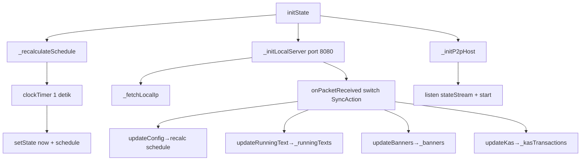

# tv_display — Widget & File Mapping

> Bedah lengkap **`apps/tv_display/lib/`** — aplikasi kiosk di Google TV / Android TV.
> Layout, state management, lifecycle timer, dan penanganan layar TV (2K / emulator 960×540).

**Navigasi:** [MAP.md](../MAP.md) · [DECISIONS.md](../DECISIONS.md) · [mobile_remote/tab_mapping.md](../mobile_remote/tab_mapping.md)

---

## 1. Struktur File

```
apps/tv_display/lib/
├── main.dart                  # Entry, state global, orkestrasi server + P2P, layout
├── theme/
│   └── app_theme.dart         # Tema gelap Material You
├── widgets/
│   ├── header_clock.dart      # Header: jam, tanggal, nama masjid, chip IP/P2P
│   ├── banner_carousel.dart   # Carousel Info Masjid + fallback + auto-scroll
│   ├── kas_summary_card.dart  # Ringkasan kas
│   ├── prayer_cards.dart      # 6 kartu sholat + ring countdown
│   └── running_text_bar.dart  # Marquee running text + fallback kosong
└── server/
    ├── local_ws_server.dart   # Server WebSocket :8080
    └── p2p_host_service.dart  # Host WiFi Direct
```

---

## 2. `main.dart` — Orkestrator Utama

### 2.1 Entry (`main()`)
```dart
WidgetsFlutterBinding.ensureInitialized();
SystemChrome.setEnabledSystemUIMode(SystemUiMode.immersiveSticky); // fullscreen kiosk
await WakelockPlus.enable();                                       // TV tidak tidur
runApp(const MasjidYouTVApp());
```

### 2.2 Widget tree level atas
- `MasjidYouTVApp` (stateless) → `MaterialApp(theme: AppTheme.darkTheme, home: MasjidDisplayScreen)`.
- `MasjidDisplayScreen` (stateful) → semua state global hidup di sini.

### 2.3 State global di `_MasjidDisplayScreenState`

| State | Tipe | Peran |
|---|---|---|
| `_now` | `DateTime` | Jam sekarang, di-update tiap detik |
| `_clockTimer` | `Timer?` | Timer 1 detik → `setState(_now; _prayerSchedule = calculate(_config,_now))` |
| `_localServer` | `LocalServer?` | Server WS |
| `_localIp` | `String?` | IP LAN TV (untuk chip "Remote Sync IP") |
| `_p2pHost` | `P2pHostService` | Host WiFi Direct |
| `_p2pState` | `HotspotHostState?` | Status grup P2P |
| `_config` | `MosqueConfig` | Konfigurasi masjid + koordinat + offset |
| `_runningTexts` | `List<RunningTextMessage>` | Pesan berjalan |
| `_banners` | `List<MediaBanner>` | Info masjid |
| `_kasTransactions` | `List<KasTransaction>` | Transaksi kas |
| `_prayerSchedule` | `PrayerSchedule` | Jadwal sholat terhitung |

### 2.4 Lifecycle & sinkronisasi



`dispose()`: `_clockTimer?.cancel()`, `_localServer?.stop()`, `_p2pHost.stop()`.

### 2.5 Layout layar (build)

```
Stack(fit: expand)
├── Image.network(masjid)  ── errorBuilder → surfaceContainerLowest
├── Overlay hitam alpha .85 (kontras)
└── SafeArea > Padding(10) > Column
    ├── HeaderClock
    ├── SizedBox(6)
    ├── Expanded > Row [ BannerCarousel (flex 3) | KasSummaryCard (flex 2) ]
    ├── SizedBox(6)
    ├── PrayerCardsRow
    ├── SizedBox(6)
    └── RunningTextBar
```

---

## 3. Widget-Widget

### 3.1 `HeaderClock` — header & jam (stateless)
- Props: `config`, `currentTime`, `serverIp`, `p2pActive`, `p2pSsid`, `p2pIp`.
- Kiri: nama masjid (`config.name`), alamat (`config.address`), chip IP (`serverIp:8080`), chip P2P ("Mode Direct: `<ssid>` (`<ip>`)").
- Kanan: kapsul jam besar `HH:mm:ss` (tabular figures) + tanggal `EEEE, d MMMM yyyy` (locale `id_ID`, fallback default).
- **Catatan TV**: teks nama/alamat di-`ellipsis` (max 1 baris) agar tidak overflow di layar sempit.

### 3.2 `BannerCarousel` — carousel info masjid (stateful)

**`_BannerCarouselState`:**
| Elemen | Detail |
|---|---|
| `_activeBanners` | getter filter `b.isActive` — hanya banner aktif ditampilkan |
| `_pageController` | `PageController` untuk `PageView.builder` |
| `_timer` | `Timer.periodic(10 dtk)` → `animateToPage(next, 600ms, easeInOutCubic)` |
| Fallback kosong | jika `_activeBanners.isEmpty` → kartu ikon masjid + **"Jagalah Shaf dan Shalatlah Tepat Waktu"** |
| Reset indeks | `if (_currentIndex >= banners.length) _currentIndex = 0` |

**`_BannerPage` (stateful, satu halaman):**
- Layout: header pill (`StadiumBorder`) + judul (`displayMedium` 26px) + isi (`titleMedium` 16px, `height 1.3`) + footer (`labelLarge`, warna primary).
- **Auto-scroll vertikal** untuk teks panjang:
  - `_scrollController` + `SingleChildScrollView`.
  - `_startAutoScroll()`: hitung `step = maxScrollExtent / (9000ms / 50ms)`; `Timer.periodic(50ms)` `jumpTo(offset + step)`; berhenti saat sampai ujung; abaikan jika `maxScroll <= 0`.
  - Reset ke atas jika konten berubah **atau** halaman kembali aktif.
- `didUpdateWidget`: bandingkan 4 field (header/title/content/footer); jika berubah → cancel timer, `jumpTo(0)`, mulai ulang. Jika `active` berubah `false→true` → reset & mulai ulang.

**Tidak memakai FittedBox** → font tidak mengecil (lihat [ADR-005](../DECISIONS.md#adr-005)).

### 3.3 `KasSummaryCard` — ringkasan kas (stateless)
- `KasSummary.fromTransactions(transactions)` → `saldo`, `totalMasuk`, `totalKeluar`.
- Format uang: `NumberFormat.currency(id_ID, 'Rp ', 0 desimal)`.
- Layout: ikon + judul "Kas Masjid", saldo besar (42px, `FittedBox` scaleDown), label "SALDO KAS", baris pemasukan (tertiary) & pengeluaran (error) via `_KasAmountRow`.

### 3.4 `PrayerCardsRow` — 6 kartu sholat (stateless)

```
Row
└─ Expanded × 6 (kartu per PrayerScheduleItem)
   ├─ [jika next] badge pill "SELANJUTNYA" (primary)
   ├─ nama sholat (displayName)
   └─ waktu:
        ├─ jika NEXT & timeUntilNextPrayer != null → _NextPrayerTimer (ring)
        └─ lainnya → FittedBox teks HH:mm (32px)
```

**Highlight "SELANJUTNYA":** kartu berwarna `primaryContainer` + border `primary` 2px.

**`_remainingFraction(schedule)`** (proporsi sisa):
- `idx` = posisi sholat berikutnya.
- total = interval `item[idx].time − item[idx-1].time`; untuk Fajr (`idx==0`): interval = `fajr_today − (isha_kemarin)` dihitung `item[0].time − (item.last.time − 1 hari)`.
- `fraction = remaining/total` di-clamp `0..1`, 0 jika total ≤ 0.

**`_NextPrayerTimer` (stateful):**
- Ring `CircularProgressIndicator` 84×84, stroke 6, `StrokeCap.round`, warna `primary` di atas `onPrimaryContainer` alpha 0.15.
- Di tengah, **AnimatedSwitcher** (slide + fade 400ms) bergantian tiap **4 detik**:
  - Mode countdown: `mm:ss` / `hh:mm:ss` + label **"tersisa"** (font 20px).
  - Mode waktu: `HH:mm` asli + label **"waktu"**.
- `_formatDuration` meng-clamp negatif ke `Duration.zero` (tidak pernah tampil minus).

### 3.5 `RunningTextBar` — running text (stateful)

**Dua kondisi di `build`:**

| Kondisi | Render |
|---|---|
| `activeMessages.isEmpty` | `_buildEmptyState`: `Container` full width (`double.infinity`, tinggi 40, radius 50, warna `primary`) berisi icon 📢 + **INFORMASI** + `•` + **"Tidak ada informasi"** (statis, tanpa scroll) |
| ada pesan aktif | `_buildRunningState`: `Card` radius 28 dengan badge pill kiri (icon + INFORMASI) + `Expanded(ListView horizontal)` marquee `[Kategori] isi • [Kategori] isi …` |

**Timer marquee (`_startAutoScroll`):**
- `Timer.periodic(50ms)`; `jumpTo(offset + 2.0)`; reset ke 0 saat mencapai `maxScrollExtent`; `SizedBox(width: 400)` di akhir list sebagai ruang loop.
- Jika `activeMessages.isEmpty` → **tidak menjalankan timer** (`return` sebelum `Timer.periodic`).

**`didUpdateWidget`:** saat `widget.messages` berubah —
- kosong → `_timer?.cancel()`;
- terisi & timer mati → `_startAutoScroll()`.

**Perbaikan leak:** teks fallback lama berisi `${Theme.of(context).primaryColor}` (menghasilkan `Color(0xff006a60)` di layar) **dihapus total** — lihat [ADR-004](../DECISIONS.md#adr-004).

---

## 4. Server & Konektivitas

### 4.1 `LocalServer` (`server/local_ws_server.dart`)
- `start({port=8080})`: `webSocketHandler` + `serve(handler, anyIPv4, 8080)`.
  - Tiap koneksi masuk ditambahkan ke `_clients`; pesan didecode `utf8` → `SyncPacket.fromJson` → `onPacketReceived(packet)`; `onDone`/`onError` menghapus client.
- `broadcast(SyncPacket)`: kirim JSON ke semua client.
- `stop()`: tutup semua sink + `_server?.close(force:true)`.

### 4.2 `P2pHostService` (`server/p2p_host_service.dart`)
- `start()` (hanya Android): `FlutterP2pHost.initialize()` → `streamHotspotState()` (di-forward ke `_stateController` broadcast) → minta izin P2P & Bluetooth bila perlu → `createGroup(advertise:true)`.
- `stop()`: `removeGroup()` + `dispose()`.
- **Catatan**: tidak memanggil `enableWifiServices`/`enableBluetoothServices` (menghindari layar pengaturan WiFi terbuka otomatis di emulator/TV).

---

## 5. State Management & Lifecycle Timer (rekap)

| Timer | Lokasi | Periode | Fungsi |
|---|---|---|---|
| `_clockTimer` | main.dart | 1 dtk | update jam + hitung ulang schedule |
| `_pageTimer` | banner_carousel | 10 dtk | pindah halaman carousel |
| `_scrollTimer` | banner_carousel (`_BannerPage`) | 50 ms | auto-scroll vertikal (9 dtk) |
| `_scrollTimer` | running_text_bar | 50 ms | marquee horizontal |
| `_toggleTimer` | prayer_cards (`_NextPrayerTimer`) | 4 dtk | toggle countdown ↔ waktu |

Semua timer di-`cancel` di `dispose()` masing-masing widget/state.

**Pattern state:** *local widget state* + *parent-driven props*. Tidak ada state management library (setState saja) — volume data kecil dan satu arah (Remote → TV). Perubahan data dari WS masuk lewat `onPacketReceived` → `setState` → widget turunan menerima props baru.

---

## 6. Penanganan Layar TV / 2K / Resizing

- **Viewport dev**: emulator Android TV = `wm size 1920x1080` + density 320 → Flutter melihat **960×540 logical**. Test regresi `TV layout has no overflow at small TV viewport` memakai `physicalSize 1920x1080` + `devicePixelRatio 2.0` dan memastikan `tester.takeException() == null`.
- **Anti-overflow** yang dipakai:
  - `FittedBox(scaleDown)` untuk jam kas, waktu sholat non-next, chip IP/P2P.
  - `maxLines + TextOverflow.ellipsis` untuk nama/alamat masjid.
  - `Expanded` + `flex` untuk membagi banner (3) dan kas (2).
  - fallback penuh untuk daftar kosong (banner & running text).
- **Kiosk**: `immersiveSticky` + `wakelock_plus` → tampilan penuh tanpa sleep.

---

## 7. Test yang Ada

| File | Cakupan |
|---|---|
| `test/widget_test.dart` | Smoke `MasjidYouTVApp`; regresi overflow 960×540 (kas, pemasukan, pengeluaran tampil) |
| `test/running_text_bar_test.dart` | Kosong → badge full-width + "Tidak ada informasi" (tidak di dalam ListView); semua non-aktif → sama; ada isi → marquee + badge |

---

## 8. Menambah Fitur Baru (checklist)

1. Model baru / ubah field → di `packages/shared_models` + test → rebuild **kedua app**.
2. Sisi TV: tambah case di `onPacketReceived` (main.dart) bila data datang dari Remote.
3. Widget: ikuti pola props + local timer; cancel timer di `dispose`; tangani daftar kosong.
4. Jalankan `flutter analyze` & `flutter test` (termasuk test 960×540).
5. Build `flutter build apk --debug --target-platform android-x64` dan pasang ke `emulator-5554`.

---

> Kembali ke [MAP.md](../MAP.md) · [DECISIONS.md](../DECISIONS.md) · [mobile_remote/tab_mapping.md](../mobile_remote/tab_mapping.md)
